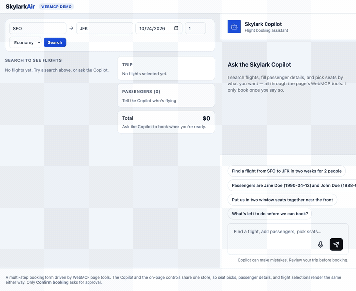
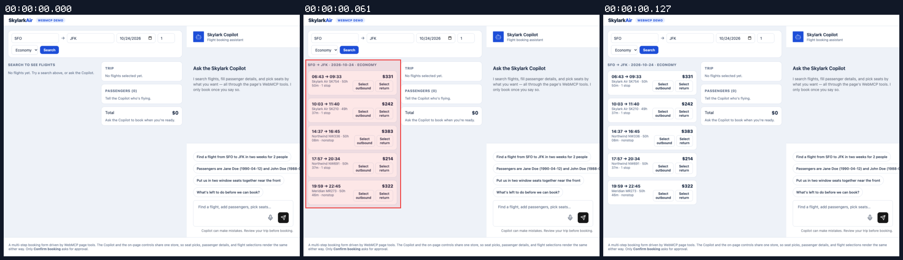
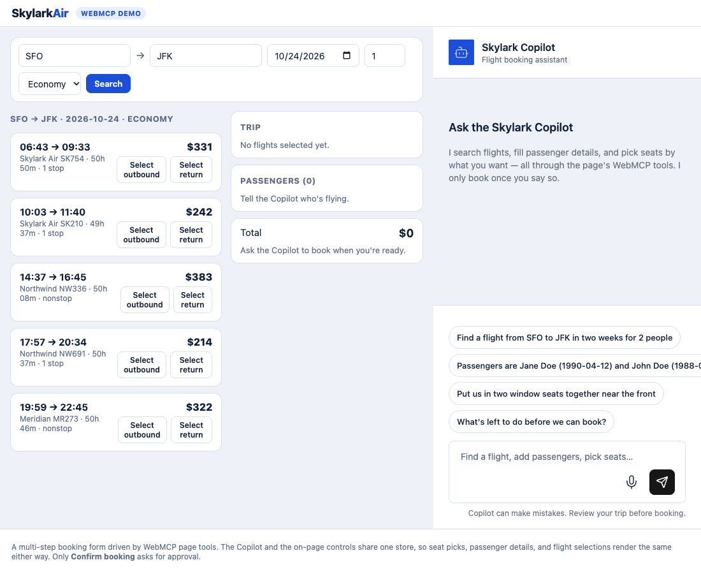

## Persona verification

branch `HEAD` · captured at `1043df9963` · run `20261010-225709-ceee6f` · apps/web vite dev (widget from source), keyless fixture

| Feature | Result | Note |
| --- | --- | --- |
| streaming | ✅ verified | Corrected v6 initializer boots the real flights demo, registers WebMCP tools, and local Search renders flight choices. No live model booking was attempted. |

### streaming

**Flights initializer and local search smoke**

[`01-streaming-flights-initializer-and-local-search-smoke.webm`](./01-streaming-flights-initializer-and-local-search-smoke.webm)

**Flights loaded and search results rendered**

[`02-streaming-flights-loaded-and-search-results-rendered.aria.txt`](./02-streaming-flights-loaded-and-search-results-rendered.aria.txt)

**Registered flight tools after initialization**: 0 request(s) crossed the network boundary, 1 controller event(s)

[`03-streaming-registered-flight-tools-after-initialization.page.json`](./03-streaming-registered-flight-tools-after-initialization.page.json)

