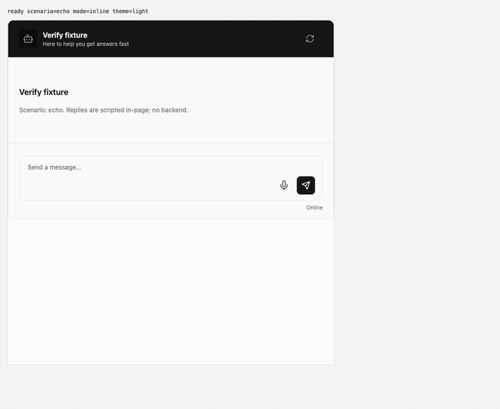
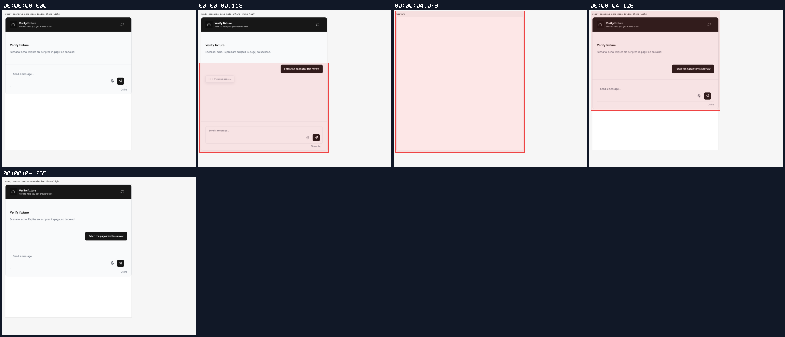
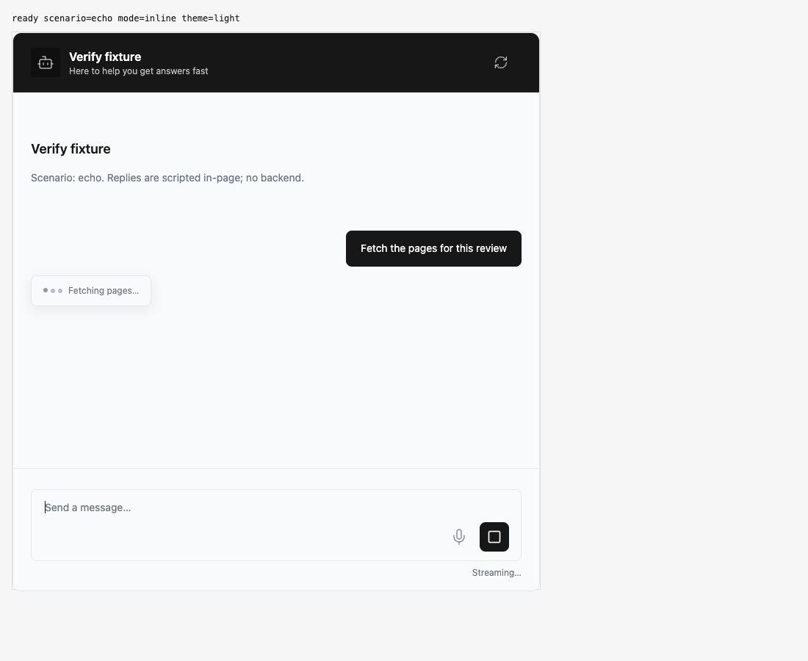
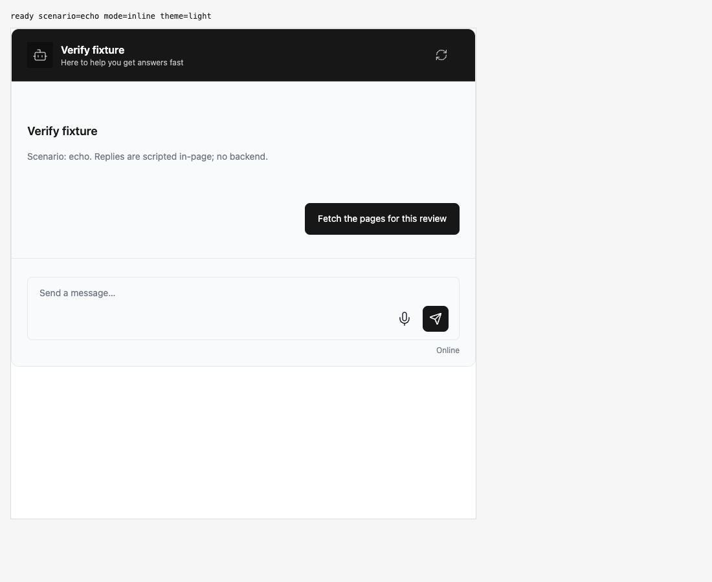

## Persona verification

branch `HEAD` · captured at `38155931f8` · run `20261010-225646-979346` · apps/web vite dev (widget from source), keyless fixture

| Feature | Result | Note |
| --- | --- | --- |
| streaming | ✅ verified | Real await stream showed Fetching pages; reload restored the saved chat with unresolved pause metadata but zero visible pause spinners. Only HTTP was scripted. |

### streaming

**Durable pause survives reload without a stale spinner**

[`01-streaming-durable-pause-survives-reload-without-a-stale-sp.webm`](./01-streaming-durable-pause-survives-reload-without-a-stale-sp.webm)

**Active live pause**

[`02-streaming-active-live-pause.aria.txt`](./02-streaming-active-live-pause.aria.txt)

**Live pause request and events**: 1 request(s) crossed the network boundary, 2 controller event(s)

[`03-streaming-live-pause-request-and-events.page.json`](./03-streaming-live-pause-request-and-events.page.json)

**Reload preserves chat without stale pause spinner**

[`04-streaming-reload-preserves-chat-without-stale-pause-spinne.aria.txt`](./04-streaming-reload-preserves-chat-without-stale-pause-spinne.aria.txt)

**Restored pause hidden**: 0 request(s) crossed the network boundary, 0 controller event(s)

[`05-streaming-restored-pause-hidden.page.json`](./05-streaming-restored-pause-hidden.page.json)

