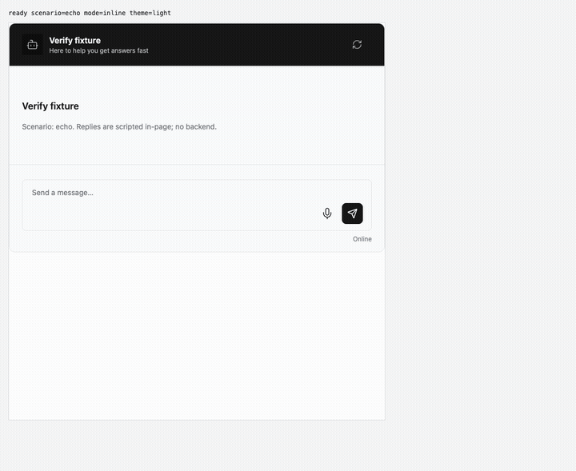
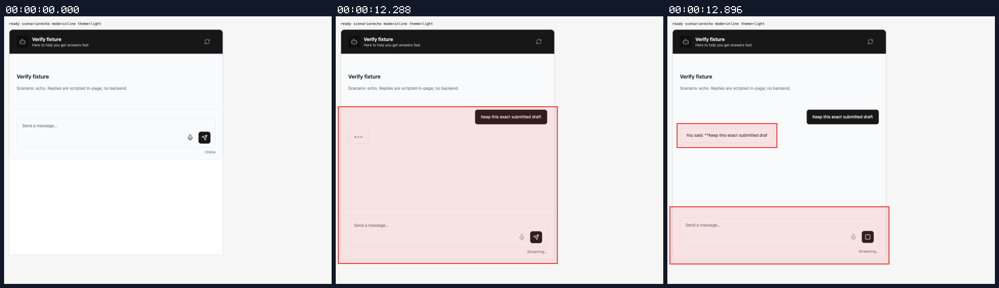
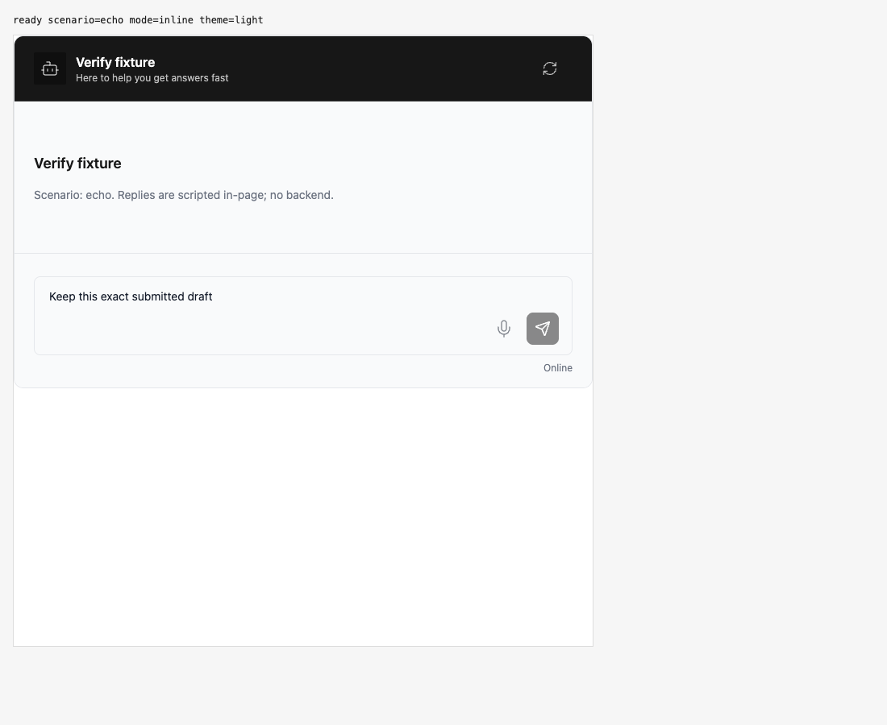
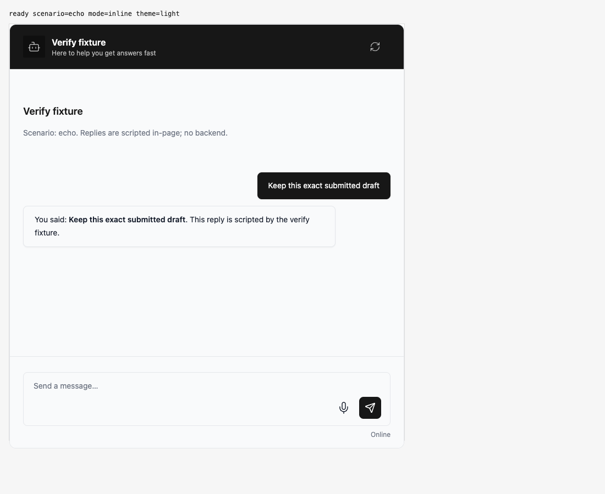

## Persona verification

branch `HEAD` · captured at `4a2119764a + uncommitted changes (24017ebd2754)` · run `20261010-225406-cf1409` · apps/web vite dev (widget from source), keyless fixture

| Feature | Result | Note |
| --- | --- | --- |
| streaming | ✅ verified | Actual controls locked during async send hook; zero requests before admission, original text delivered once, controls unlocked afterwards. History/receipt/cancellation paths covered by regression tests, not this browser proof. |

### streaming

**Captured draft stays locked during admission**

[`01-streaming-captured-draft-stays-locked-during-admission.webm`](./01-streaming-captured-draft-stays-locked-during-admission.webm)

**Draft locked before admission**

[`02-streaming-draft-locked-before-admission.aria.txt`](./02-streaming-draft-locked-before-admission.aria.txt)

**Admitted draft delivered exactly once**

[`03-streaming-admitted-draft-delivered-exactly-once.aria.txt`](./03-streaming-admitted-draft-delivered-exactly-once.aria.txt)

**Admission lock preserves submitted draft**: 1 request(s) crossed the network boundary, 3 controller event(s)

[`04-streaming-admission-lock-preserves-submitted-draft.page.json`](./04-streaming-admission-lock-preserves-submitted-draft.page.json)

