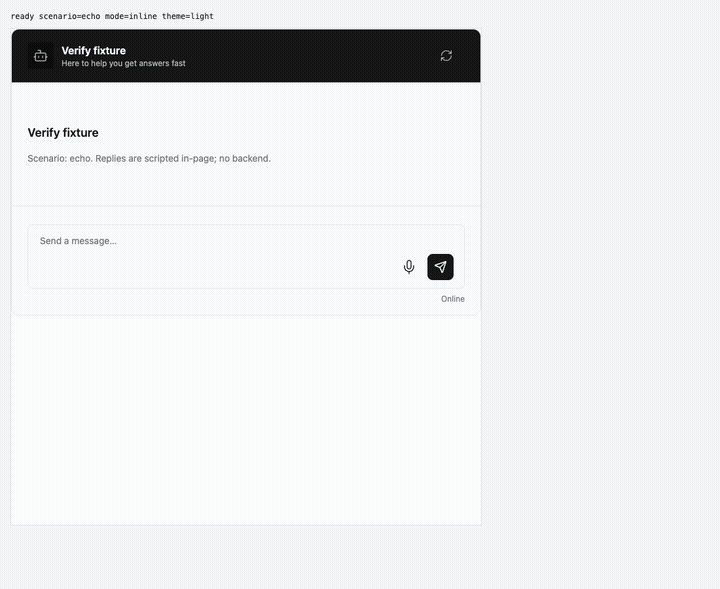
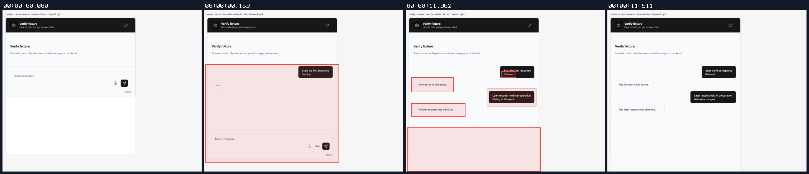
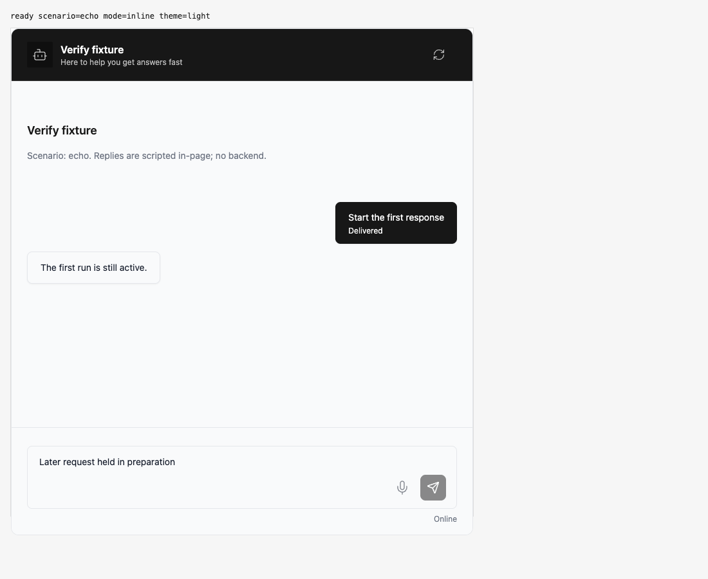
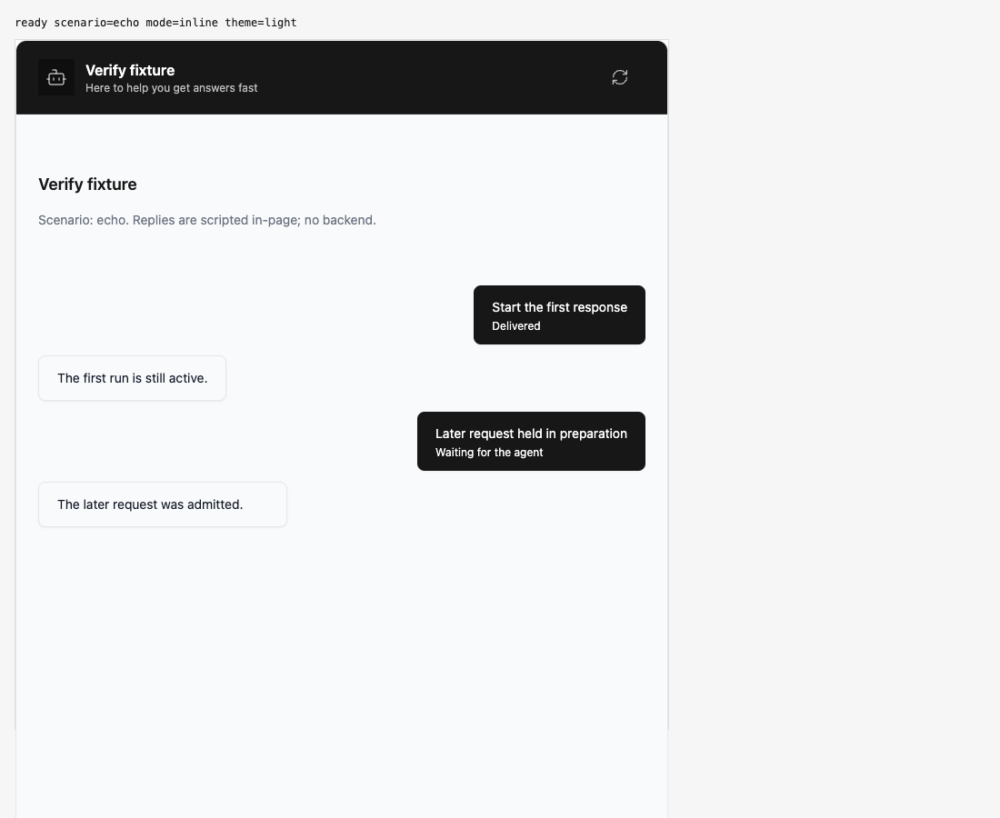

## Persona verification

branch `HEAD` · captured at `b6b2292852 + uncommitted changes (e548ca450ea3)` · run `20261010-230201-f1a092` · apps/web vite dev (widget from source), keyless fixture

| Feature | Result | Note |
| --- | --- | --- |
| streaming | ✅ verified | Actual Stop click during a held second send posted cancel for active-run and aborted its stream. The draft stayed unchanged and locked until preparation resolved, then was sent exactly once. Only HTTP was scripted. |

### streaming

**Stop works while the submitted draft is frozen**

[`01-streaming-stop-works-while-the-submitted-draft-is-frozen.webm`](./01-streaming-stop-works-while-the-submitted-draft-is-frozen.webm)

**Stop stays available beside frozen draft controls**

[`02-streaming-stop-stays-available-beside-frozen-draft-control.aria.txt`](./02-streaming-stop-stays-available-beside-frozen-draft-control.aria.txt)

**Active run cancelled; later draft remains intact**

[`03-streaming-active-run-cancelled-later-draft-remains-intact.aria.txt`](./03-streaming-active-run-cancelled-later-draft-remains-intact.aria.txt)

**Draft admitted after preparation resolves**

[`04-streaming-draft-admitted-after-preparation-resolves.aria.txt`](./04-streaming-draft-admitted-after-preparation-resolves.aria.txt)

**Cancellation and exact submitted payloads**: 6 request(s) crossed the network boundary, 8 controller event(s)

[`05-streaming-cancellation-and-exact-submitted-payloads.page.json`](./05-streaming-cancellation-and-exact-submitted-payloads.page.json)

