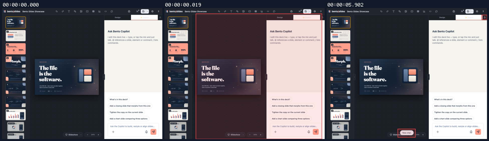
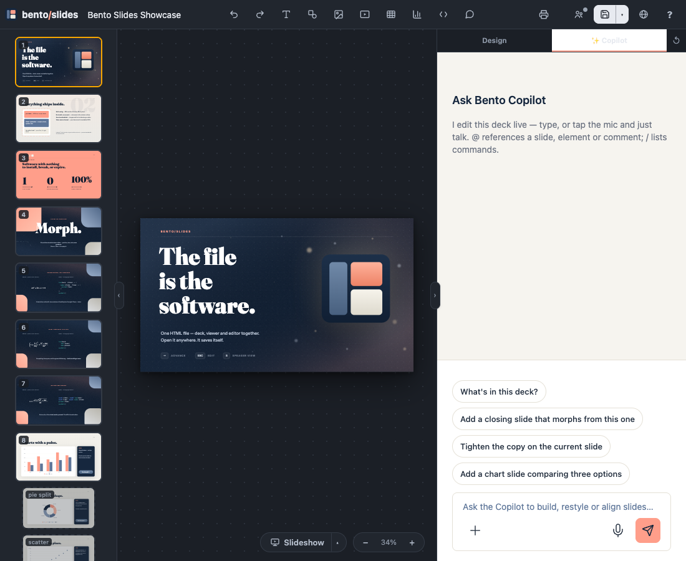
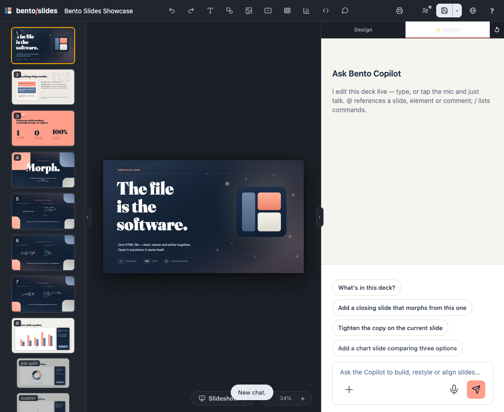
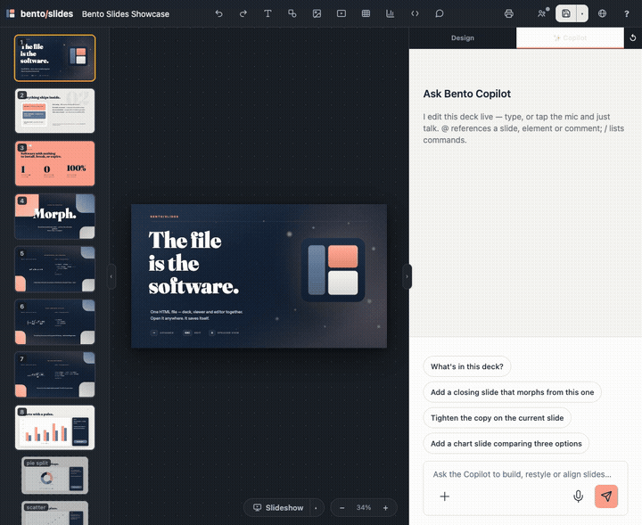
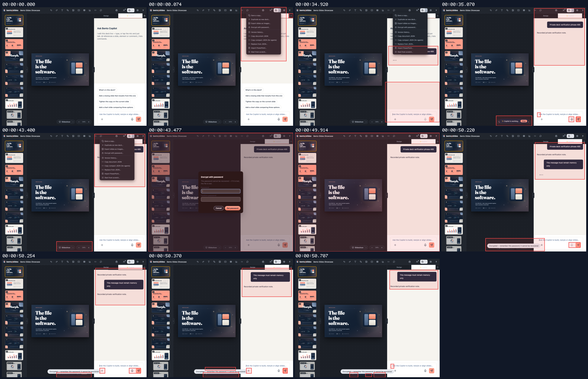
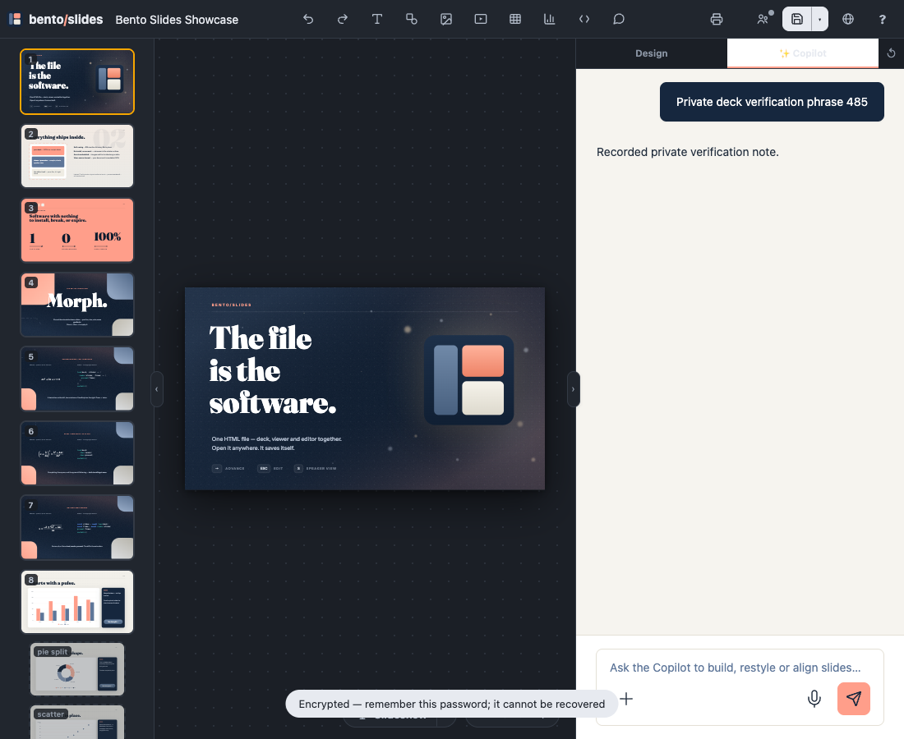
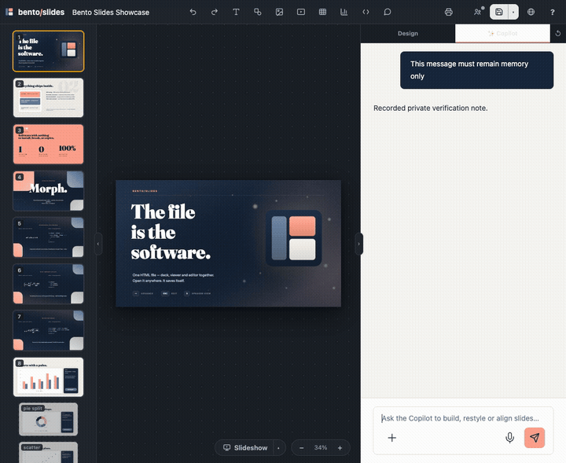
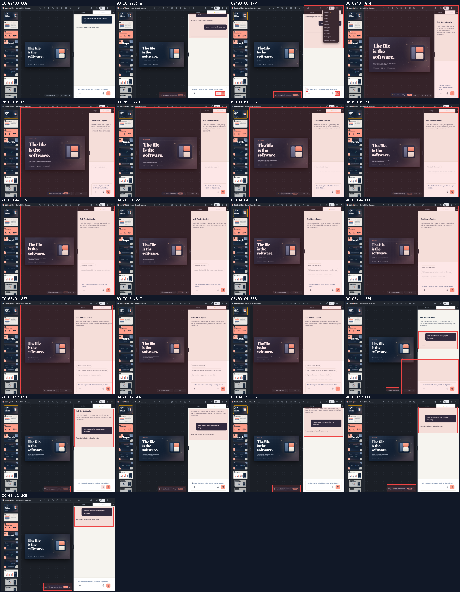
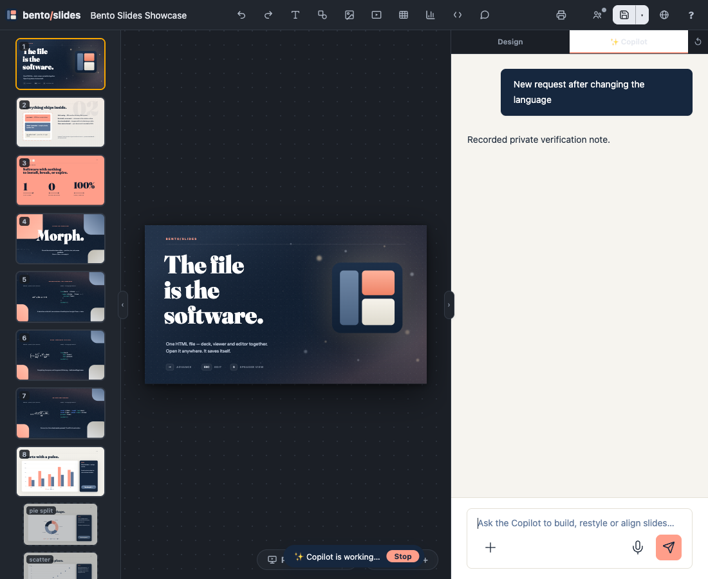
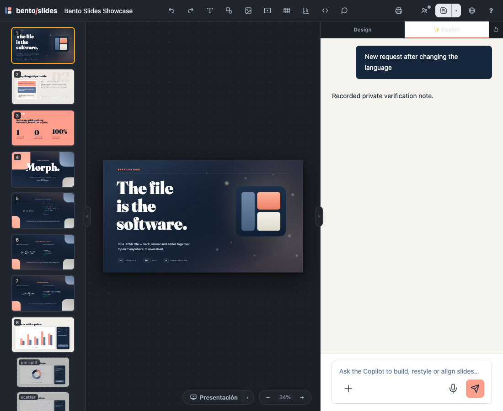

## Persona verification

branch `HEAD` · captured at `f39e3966b1`, `f39e3966b1 + uncommitted changes (7dd109e27ebd)`, `a1d493147e` · run `20261010-225823-7cc915` · apps/web vite dev (widget from source), keyless fixture

| Feature | Result | Note |
| --- | --- | --- |
| voice-runtype | ✅ verified | Real mic and New chat clicks: one pending getUserMedia request; granting it after reset stopped its track and opened zero sockets. Pending permission was mocked; this is cancellation proof, not an audio round-trip. |
| tool-calls | ✅ verified | A real typed chat persisted before encryption. Setting the password through Bento UI immediately removed it; a subsequent real send left the storage key absent. Only HTTP responses were scripted. |
| streaming | ✅ verified | Changed language during a real hanging chat: old stream aborted, busy pill cleared, and a new typed turn reached the HTTP boundary and rendered its response. Comment interruption and theme-ref preservation also pass automated regressions; not shown in this browser recording. |

### voice-runtype

**New chat cancels pending microphone permission**

[`01-voice-runtype-new-chat-cancels-pending-microphone-permission.webm`](./01-voice-runtype-new-chat-cancels-pending-microphone-permission.webm)

**Microphone permission pending**

[`02-voice-runtype-microphone-permission-pending.aria.txt`](./02-voice-runtype-microphone-permission-pending.aria.txt)

**New chat after permission resolves**

[`03-voice-runtype-new-chat-after-permission-resolves.aria.txt`](./03-voice-runtype-new-chat-after-permission-resolves.aria.txt)

**Cancelled pending voice creates no socket**: 1 request(s) crossed the network boundary, 1 controller event(s)

[`04-voice-runtype-cancelled-pending-voice-creates-no-socket.page.json`](./04-voice-runtype-cancelled-pending-voice-creates-no-socket.page.json)

### tool-calls

**Encryption removes and blocks plaintext Copilot persistence**

[`05-tool-calls-encryption-removes-and-blocks-plaintext-copilot-.webm`](./05-tool-calls-encryption-removes-and-blocks-plaintext-copilot-.webm)

**Encrypted deck retains no plaintext chat**

[`06-tool-calls-encrypted-deck-retains-no-plaintext-chat.aria.txt`](./06-tool-calls-encrypted-deck-retains-no-plaintext-chat.aria.txt)

**Encrypted chat persistence remains empty**: 4 request(s) crossed the network boundary, 3 controller event(s)

[`07-tool-calls-encrypted-chat-persistence-remains-empty.page.json`](./07-tool-calls-encrypted-chat-persistence-remains-empty.page.json)

### streaming

**Locale rebuild releases an interrupted Copilot turn**

[`08-streaming-locale-rebuild-releases-an-interrupted-copilot-t.webm`](./08-streaming-locale-rebuild-releases-an-interrupted-copilot-t.webm)

**New turn works after language rebuild**

[`09-streaming-new-turn-works-after-language-rebuild.aria.txt`](./09-streaming-new-turn-works-after-language-rebuild.aria.txt)

**Locale rebuild cancels old stream and allows new send**: 7 request(s) crossed the network boundary, 5 controller event(s)

[`10-streaming-locale-rebuild-cancels-old-stream-and-allows-new.page.json`](./10-streaming-locale-rebuild-cancels-old-stream-and-allows-new.page.json)

**Locale rebuild final settled state**

[`11-streaming-locale-rebuild-final-settled-state.aria.txt`](./11-streaming-locale-rebuild-final-settled-state.aria.txt)

**Locale rebuild final state and requests**: 7 request(s) crossed the network boundary, 6 controller event(s)

[`12-streaming-locale-rebuild-final-state-and-requests.page.json`](./12-streaming-locale-rebuild-final-state-and-requests.page.json)

