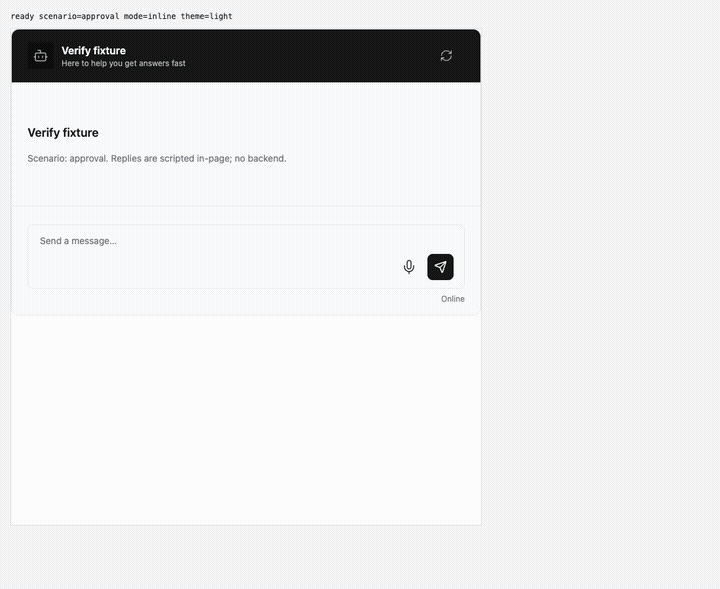
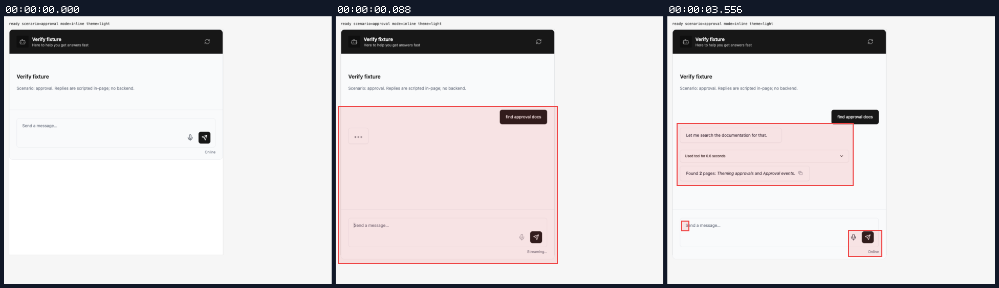
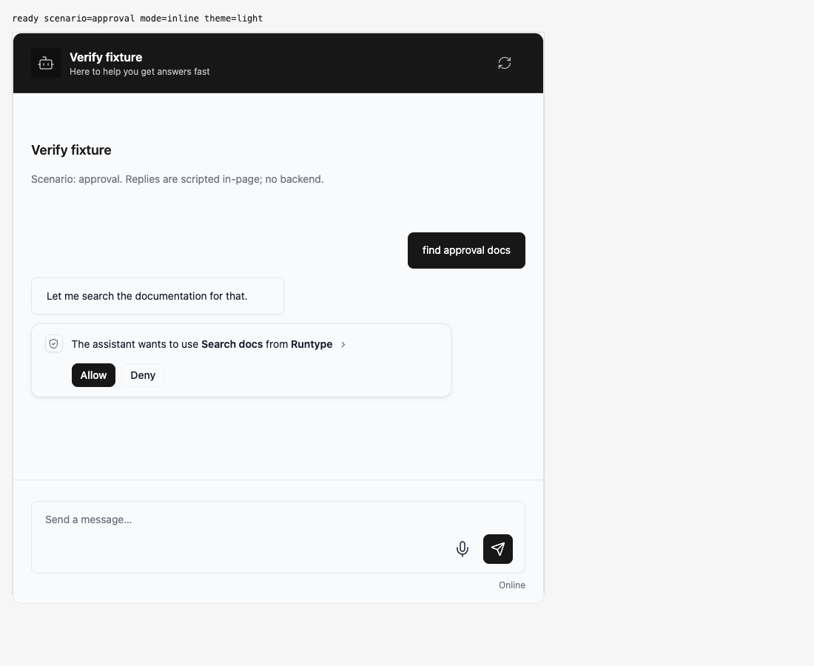
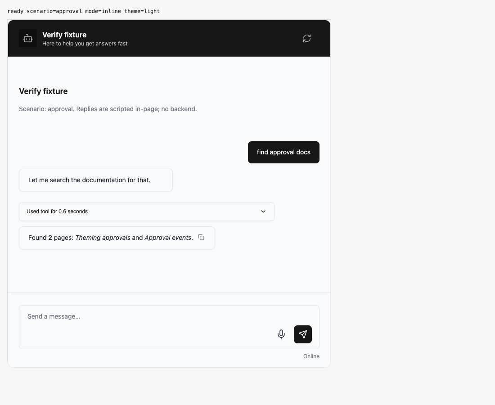

## Persona verification

branch `codex/webmcp-v6-migration` · captured at `9105551d47` · run `20261010-181003-2b8c94` · apps/web vite dev (widget from source), keyless fixture

| Feature | Result | Note |
| --- | --- | --- |
| approvals | ✅ verified | Generic approval UI regression. Actual v6 storefront Allow/Deny, duplicate-frame filtering, and calendar execution are covered by 3 passing Chromium tests. |

### approvals

**approval flow at PR revision**

[`01-approvals-approval-flow-at-pr-revision.webm`](./01-approvals-approval-flow-at-pr-revision.webm)

**pending approval**

[`02-approvals-pending-approval.aria.txt`](./02-approvals-pending-approval.aria.txt)

**settled result**

[`03-approvals-settled-result.aria.txt`](./03-approvals-settled-result.aria.txt)

**request and event evidence**: 2 request(s) crossed the network boundary, 14 controller event(s)

[`04-approvals-request-and-event-evidence.page.json`](./04-approvals-request-and-event-evidence.page.json)

