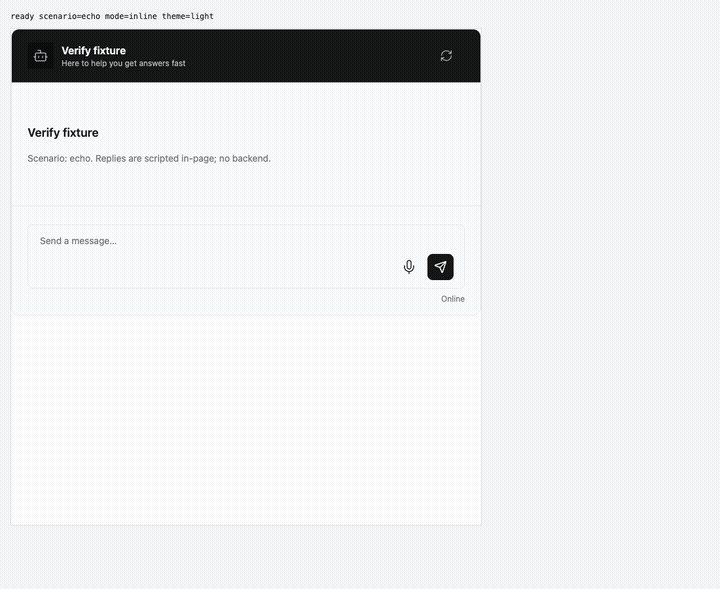
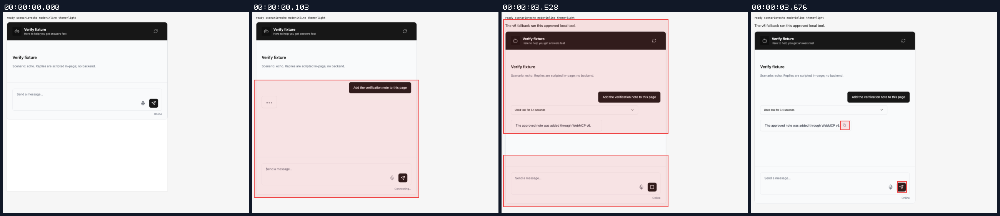
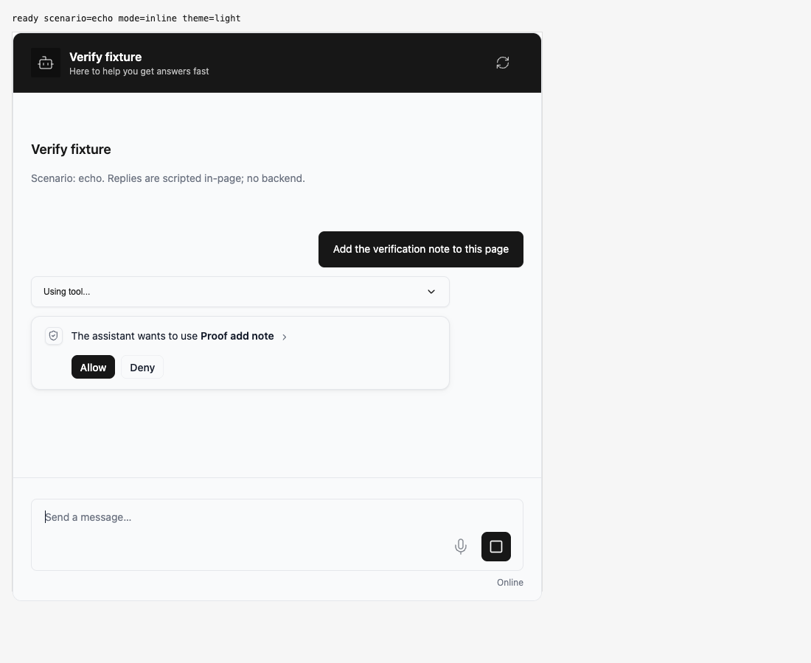
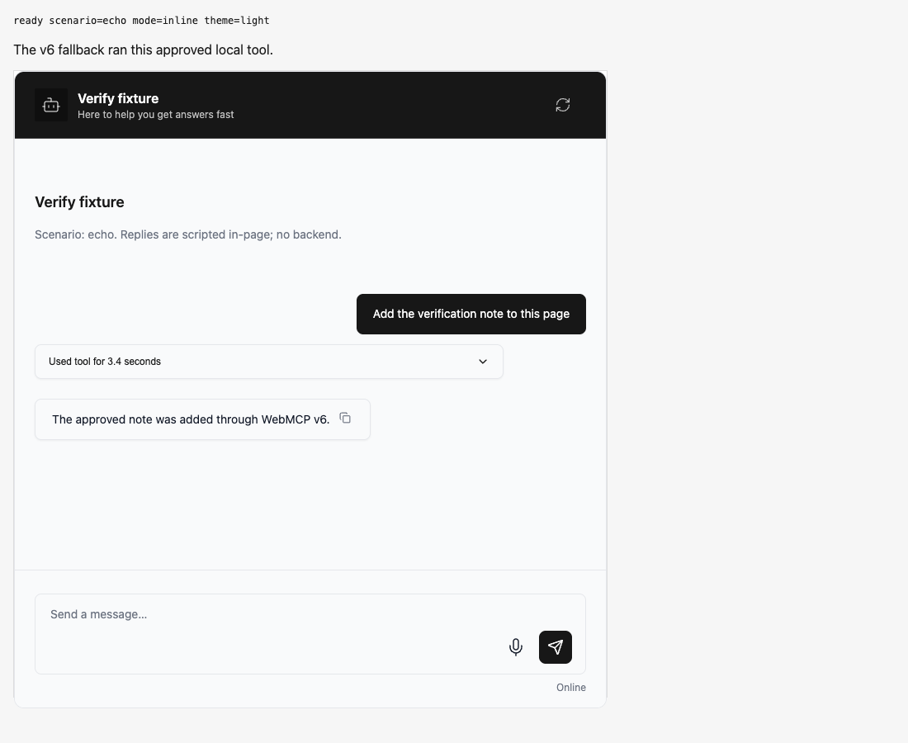

## Persona verification

branch `HEAD` · captured at `660e178ac1` · run `20261010-225727-91b719` · apps/web vite dev (widget from source), keyless fixture

| Feature | Result | Note |
| --- | --- | --- |
| tool-calls | ✅ verified | Browser boot installed the v6 fallback without a host runtime. A typed request plus Allow executed the local tool once with object input and AbortSignal, updated the page, posted its result to resume, and rendered the response. HTTP only was scripted; declaration build also passed. |

### tool-calls

**Fallback v6 executes an approved local tool**

[`01-tool-calls-fallback-v6-executes-an-approved-local-tool.webm`](./01-tool-calls-fallback-v6-executes-an-approved-local-tool.webm)

**Fallback v6 approval pending**

[`02-tool-calls-fallback-v6-approval-pending.aria.txt`](./02-tool-calls-fallback-v6-approval-pending.aria.txt)

**Fallback local tool result**

[`03-tool-calls-fallback-local-tool-result.aria.txt`](./03-tool-calls-fallback-local-tool-result.aria.txt)

**V6 tool input signal and resume payload**: 2 request(s) crossed the network boundary, 11 controller event(s)

[`04-tool-calls-v6-tool-input-signal-and-resume-payload.page.json`](./04-tool-calls-v6-tool-input-signal-and-resume-payload.page.json)

