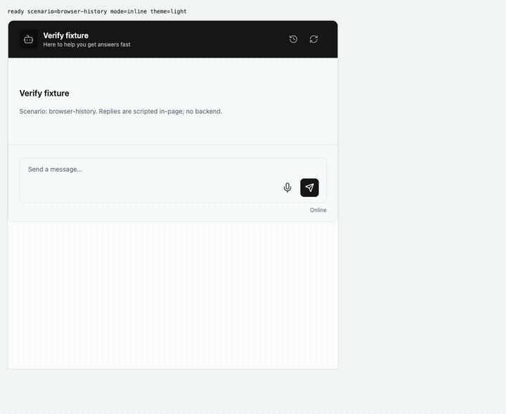
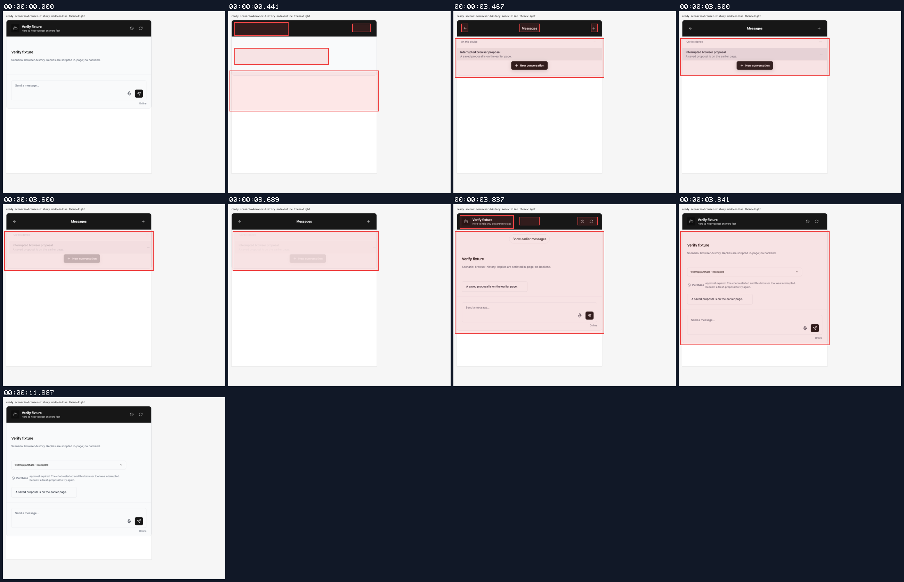
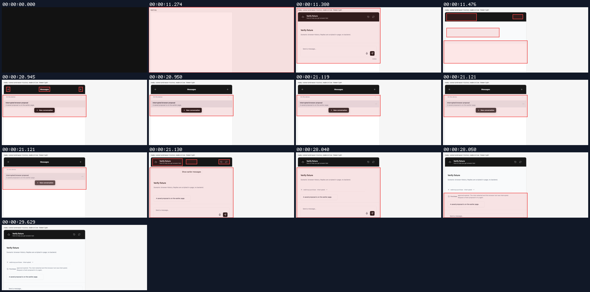
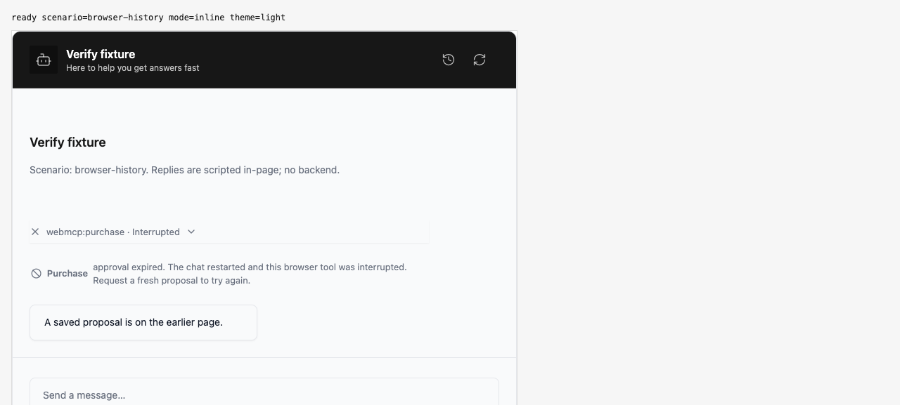

## Persona verification

branch `fix/restored-browser-tool-state` · captured at `789a866ac9` · run `20261011-071110-2adc8e` · apps/web vite dev (widget from source), keyless fixture

| Feature | Result | Note |
| --- | --- | --- |
| browser-history-card | ✅ verified | Clicked Messages, opened the saved conversation, and clicked Show earlier messages. Historical gate has no Allow/Deny; tool is Interrupted with no active timer or running activity. Exactly two provider page reads and no dispatch/resume. |
| browser-history-row | ✅ verified | Opened Messages and clicked Show earlier messages. Browser approval and grouped row show interruption; zero Allow/Deny, timer attributes, running activity or running animations. Text unchanged after 1.5 seconds. Only two history page reads; no dispatch/resume. |
| boot-reconciliation | ⏭️ not driven | Startup replacement and overlapping merge branches pass session regression tests; this visual run exercises older-page loading only. |

### browser-history-card

**Load an interrupted browser proposal from older history**

[`01-browser-history-card-load-an-interrupted-browser-proposal-from-older-.webm`](./01-browser-history-card-load-an-interrupted-browser-proposal-from-older-.webm)

**Earlier browser tool and approval are interrupted**

[`02-browser-history-card-earlier-browser-tool-and-approval-are-interrupte.aria.txt`](./02-browser-history-card-earlier-browser-tool-and-approval-are-interrupte.aria.txt)

**Only history pages fetched; no browser mutation or resume**: 2 request(s) crossed the network boundary, 1 controller event(s)

[`03-browser-history-card-only-history-pages-fetched-no-browser-mutation-o.page.json`](./03-browser-history-card-only-history-pages-fetched-no-browser-mutation-o.page.json)

### browser-history-row

**Paginate to an interrupted browser row**

[`04-browser-history-row-paginate-to-an-interrupted-browser-row.webm`](./04-browser-history-row-paginate-to-an-interrupted-browser-row.webm)

**Earlier row is interrupted with no animation or timer**

[`05-browser-history-row-earlier-row-is-interrupted-with-no-animation-or-.aria.txt`](./05-browser-history-row-earlier-row-is-interrupted-with-no-animation-or-.aria.txt)

**Pagination side effects**: 2 request(s) crossed the network boundary, 1 controller event(s)

[`06-browser-history-row-pagination-side-effects.page.json`](./06-browser-history-row-pagination-side-effects.page.json)

