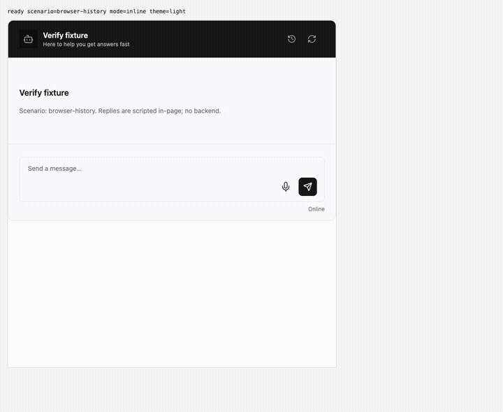
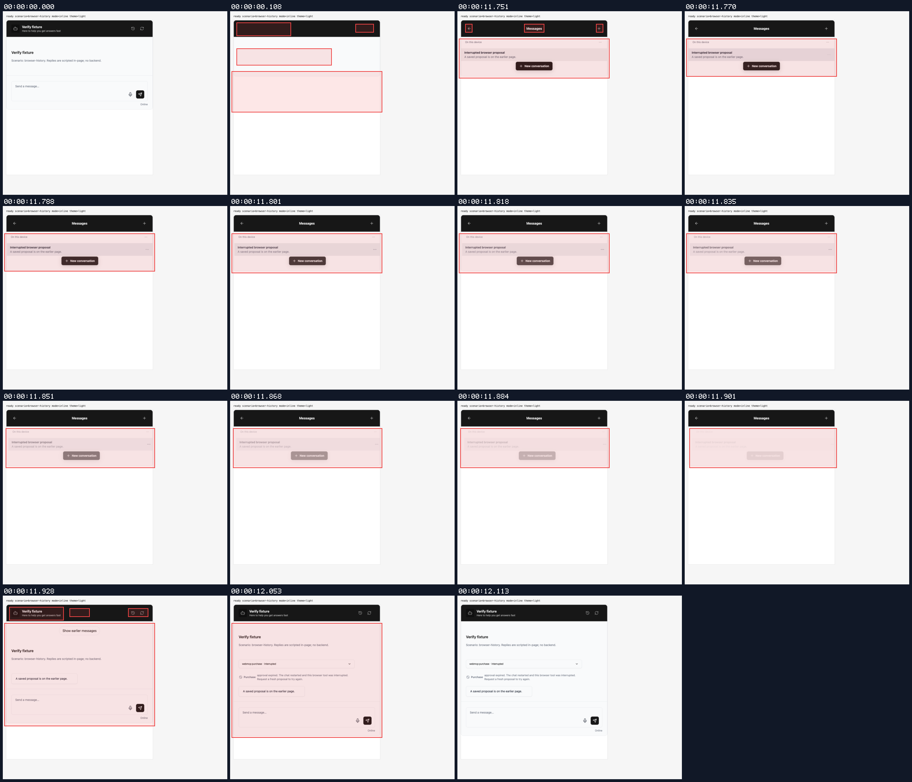
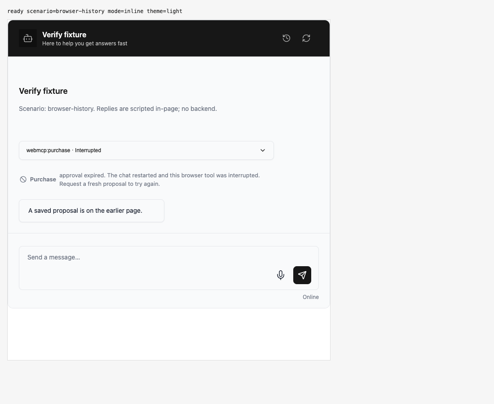
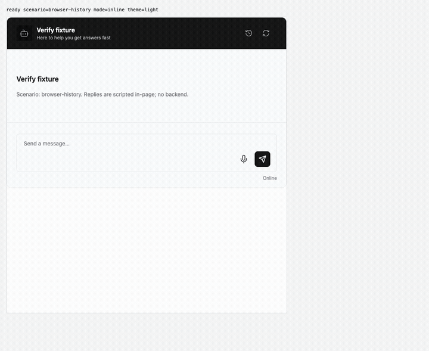
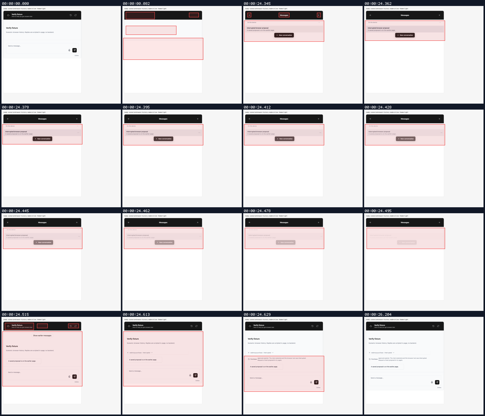
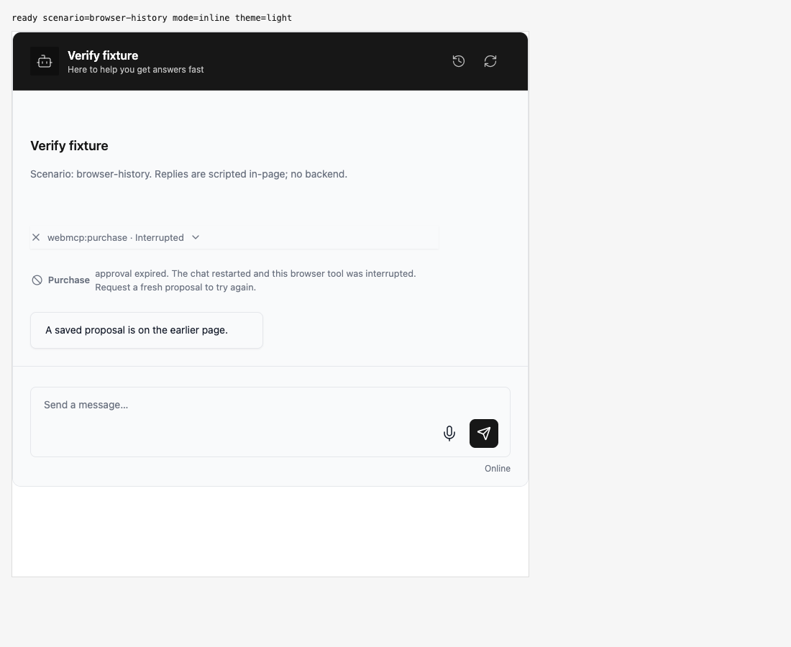

## Approval status compatibility

branch `fix/restored-browser-tool-state` · captured at `cf66ca7751` · run `20261012-015511-cf2bc2` · apps/web vite dev (widget from source), keyless fixture

| Feature | Result | Note |
| --- | --- | --- |
| approval-compatibility-card | ✅ verified | Opened saved history through Messages and Show earlier messages. Approval event contains status timeout and interrupted true. Expiry notice remains; zero Allow/Deny, timer or running activity. Only two history page reads and no dispatch/resume. |
| approval-compatibility-row | ✅ verified | Messages and Show earlier messages restore a gate with status timeout and interrupted true. No actionable approval buttons, active timers, running activity or running animations. Text stable after 1.5 seconds; only two history page reads and no dispatch/resume. |
| other-restoration-entry-points | ⏭️ not driven | Storage reload, initial/hook restoration, server continuations, fresh Allow/Deny and custom renderer compatibility are covered by automated tests; this recording drives custom history pagination. |

### approval-compatibility-card

**Restore a browser approval with timeout and interruption metadata**

[`01-approval-compatibility-card-restore-a-browser-approval-with-timeout-and-inte.webm`](./01-approval-compatibility-card-restore-a-browser-approval-with-timeout-and-inte.webm)

**Timeout metadata keeps the interruption explanation and hides actions**

[`02-approval-compatibility-card-timeout-metadata-keeps-the-interruption-explanat.aria.txt`](./02-approval-compatibility-card-timeout-metadata-keeps-the-interruption-explanat.aria.txt)

**Original status value and no execution side effects**: 2 request(s) crossed the network boundary, 1 controller event(s)

[`03-approval-compatibility-card-original-status-value-and-no-execution-side-effe.page.json`](./03-approval-compatibility-card-original-status-value-and-no-execution-side-effe.page.json)

### approval-compatibility-row

**Original approval statuses with interrupted browser rows**

[`04-approval-compatibility-row-original-approval-statuses-with-interrupted-brow.webm`](./04-approval-compatibility-row-original-approval-statuses-with-interrupted-brow.webm)

**Interrupted row and expired gate retain original approval statuses**

[`05-approval-compatibility-row-interrupted-row-and-expired-gate-retain-original.aria.txt`](./05-approval-compatibility-row-interrupted-row-and-expired-gate-retain-original.aria.txt)

**Timeout and interruption metadata in the approval event**: 2 request(s) crossed the network boundary, 1 controller event(s)

[`06-approval-compatibility-row-timeout-and-interruption-metadata-in-the-approva.page.json`](./06-approval-compatibility-row-timeout-and-interruption-metadata-in-the-approva.page.json)

