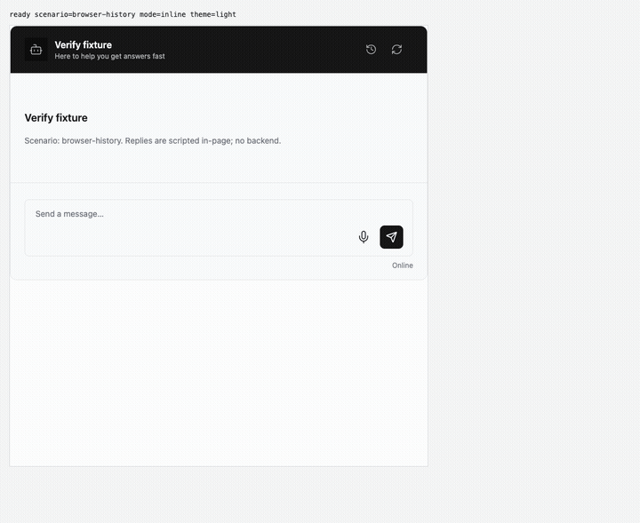
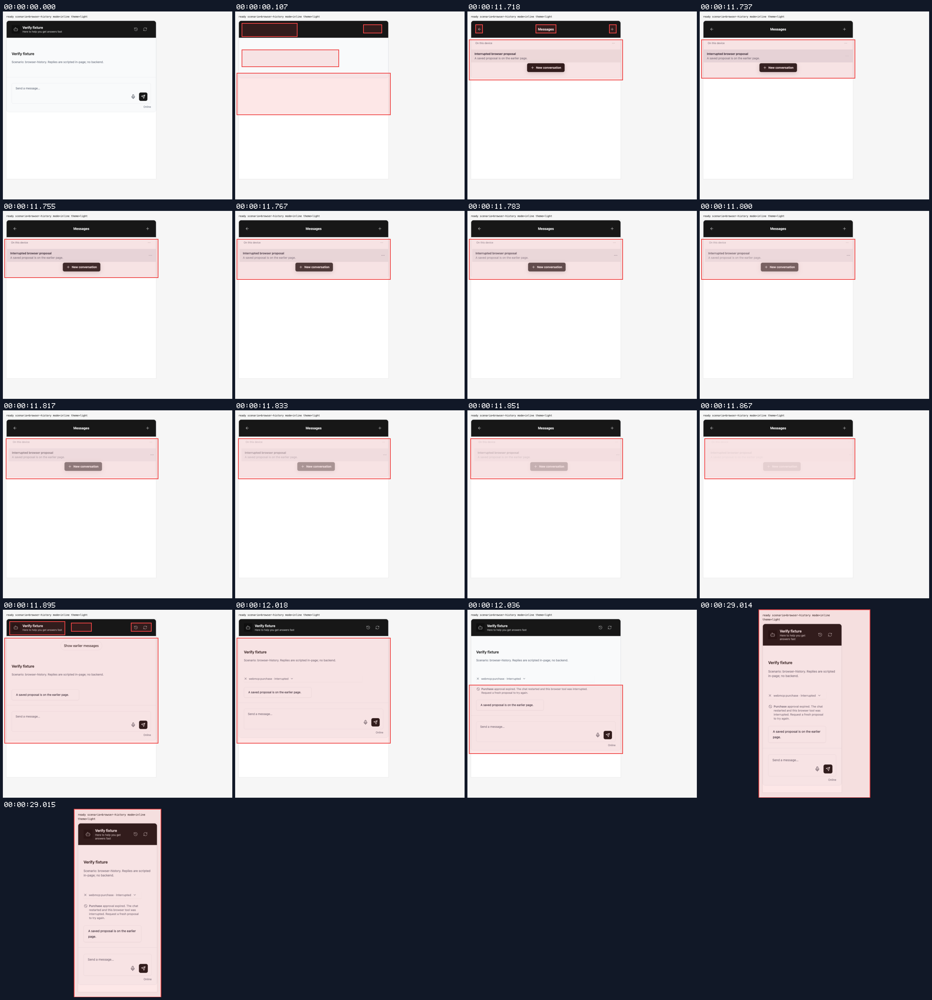
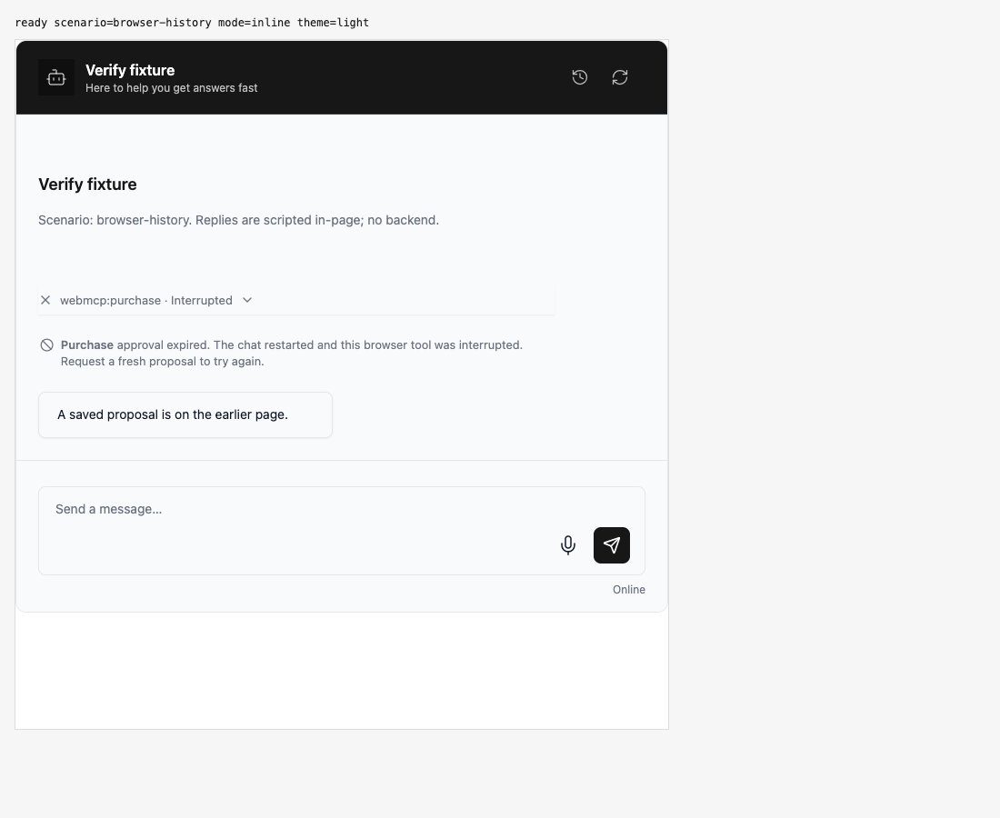
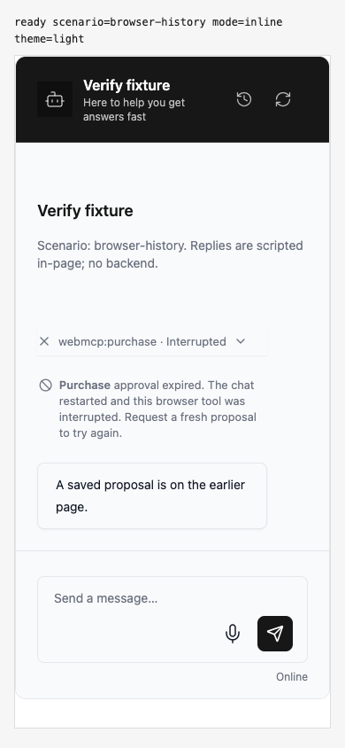
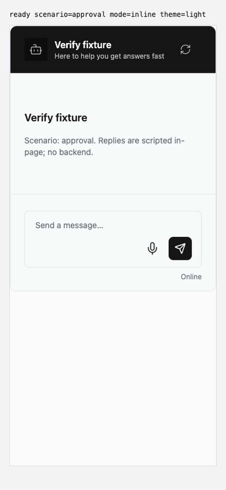
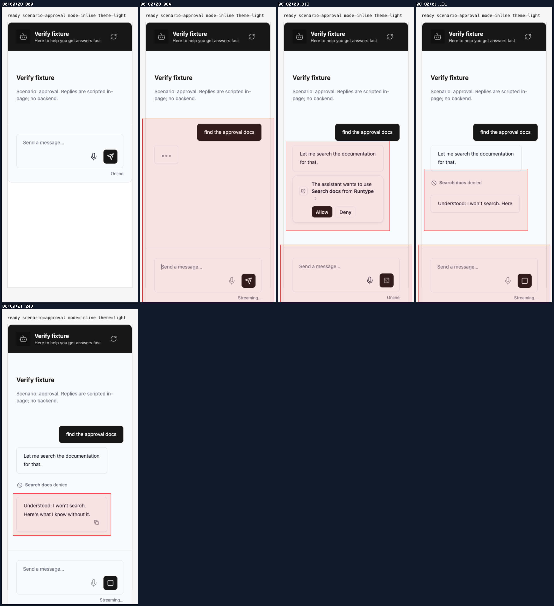
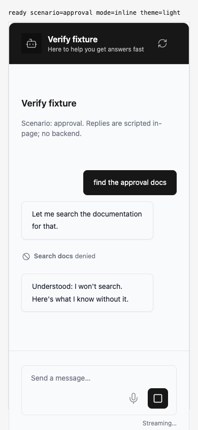
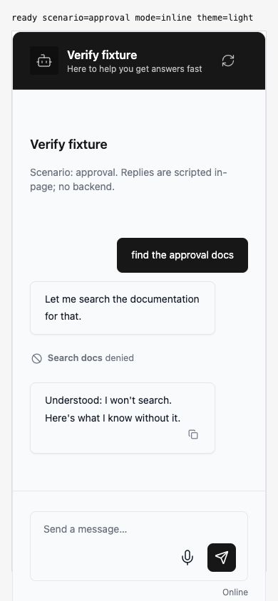

## Resolved approval notice alignment

branch `fix/restored-browser-tool-state` · captured at `cf66ca7751 + uncommitted changes (68173c544c68)`, `590ced8801` · run `20261013-074722-00e621` · apps/web vite dev (widget from source), keyless fixture

| Feature | Result | Note |
| --- | --- | --- |
| approval-alignment | ✅ verified | Opened Messages and Show earlier messages through the real UI. Tool name and explanation now flow together; icon stays on the first line. Verified at 1100px and 390px viewports with no horizontal overflow, approval buttons or browser execution. |
| other-entry-points | ⏭️ not driven | Recorded the interrupted history notice in row display at wide/narrow widths and ordinary denial. Storage restoration and fresh approvals also pass the seven built-package Chromium scenarios; other visual variants were not driven in this recording. |
| approval-denial | ✅ verified | Clicked Deny on a real pending card. Plain Search docs denied trace stays compact and aligned. Exactly one chat dispatch and one denied transport decision; four approval:resolved events were captured (known event duplication). Final screenshot shows the idle composer. |

### approval-alignment

**Open a wrapped browser approval notice**

[`01-approval-alignment-open-a-wrapped-browser-approval-notice.webm`](./01-approval-alignment-open-a-wrapped-browser-approval-notice.webm)

**Tool name and explanation share the first line**

[`02-approval-alignment-tool-name-and-explanation-share-the-first-line.aria.txt`](./02-approval-alignment-tool-name-and-explanation-share-the-first-line.aria.txt)

**Narrow width keeps the icon on the first line and wraps the notice naturally**

[`03-approval-alignment-narrow-width-keeps-the-icon-on-the-first-line-an.aria.txt`](./03-approval-alignment-narrow-width-keeps-the-icon-on-the-first-line-an.aria.txt)

**Only history page requests; approval remains expired**: 2 request(s) crossed the network boundary, 1 controller event(s)

[`04-approval-alignment-only-history-page-requests-approval-remains-expi.page.json`](./04-approval-alignment-only-history-page-requests-approval-remains-expi.page.json)

### approval-denial

**Ordinary denied approval keeps its compact trace**

[`05-approval-denial-ordinary-denied-approval-keeps-its-compact-trace.webm`](./05-approval-denial-ordinary-denied-approval-keeps-its-compact-trace.webm)

**Plain denial remains a short aligned notice**

[`06-approval-denial-plain-denial-remains-a-short-aligned-notice.aria.txt`](./06-approval-denial-plain-denial-remains-a-short-aligned-notice.aria.txt)

**One denied decision through the configured transport**: 2 request(s) crossed the network boundary, 9 controller event(s)

[`07-approval-denial-one-denied-decision-through-the-configured-trans.page.json`](./07-approval-denial-one-denied-decision-through-the-configured-trans.page.json)

**Denied approval after the reply finishes**

[`08-approval-denial-denied-approval-after-the-reply-finishes.aria.txt`](./08-approval-denial-denied-approval-after-the-reply-finishes.aria.txt)

