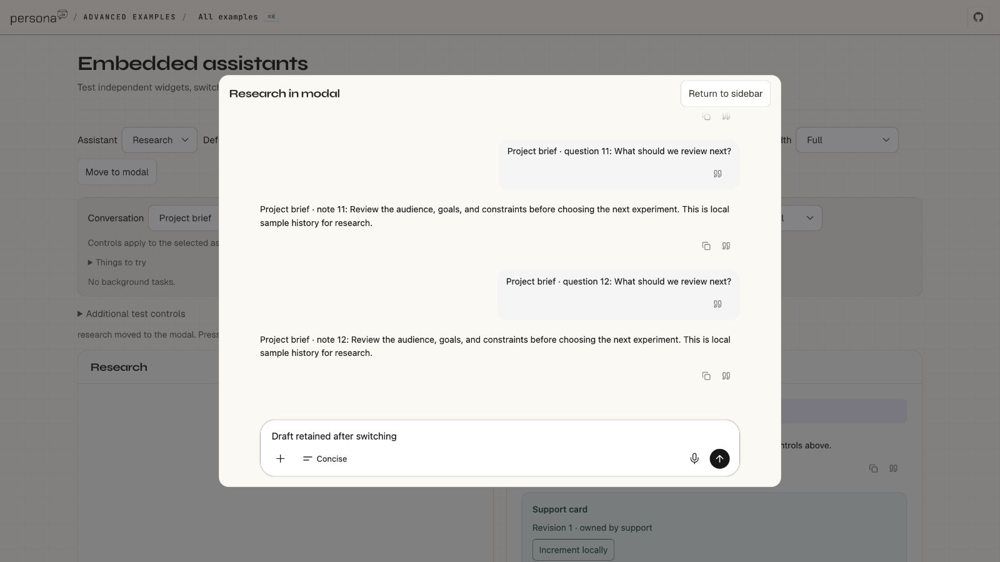
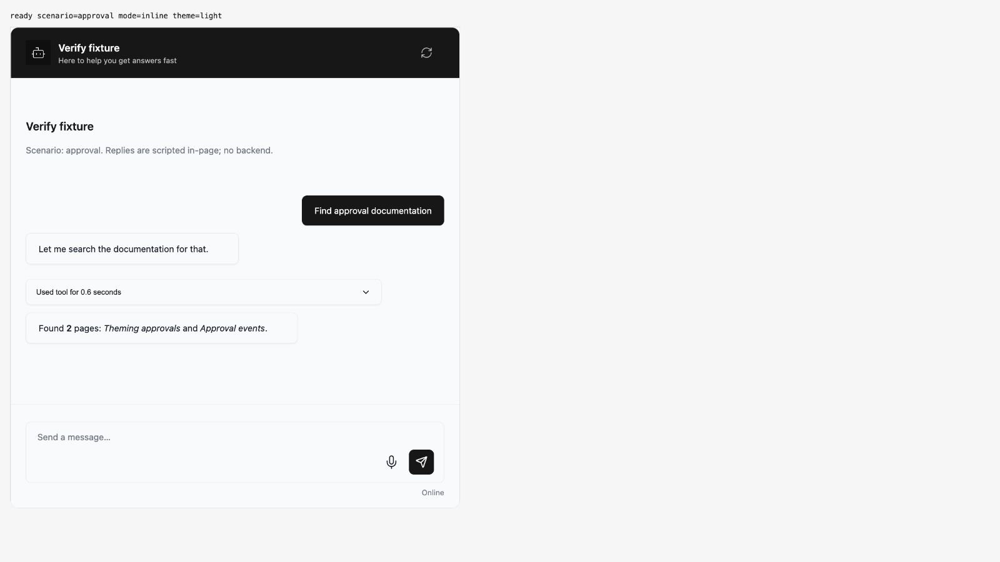
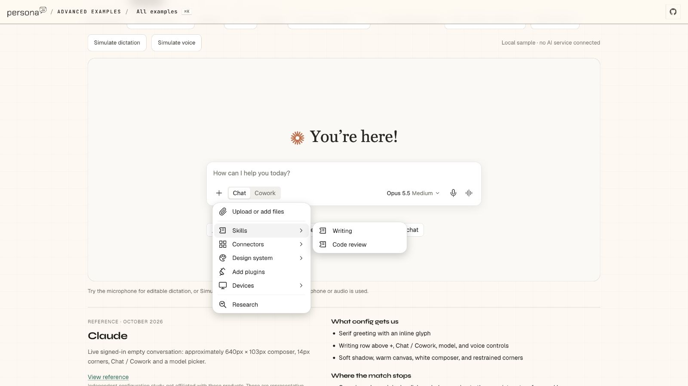

## Persona verification

branch `v5-defaults-refinements` · captured at `88e168b62c` · run `20261015-102338-1547fa` · apps/web vite dev (widget from source), keyless fixture

| Feature | Result | Note |
| --- | --- | --- |
| live-backend-and-audio | ⏭️ not driven | Not driven; browser checks used mocked replies. No real microphone or live voice-service verification. |
| full-browser-proof | ⏭️ not driven | Partial visual evidence only. In-app browser interactions passed, but video and network/controller capture were unavailable in this browser session. |

### embedded-host

**Retained draft after conversation switch and modal move**: Project brief → Release notes → Project brief restored the draft; moving the same widget to a modal retained it. Captured with the in-app browser before committing the same source tree. Screenshots only: no interaction recording or request/event capture.

### approvals

**Approved tool call resumes the reply**: Opened details, approved the mocked tool, observed the completed reply and idle Send button. Captured with the in-app browser before committing the same source tree. Screenshots only: no interaction recording or request/event capture.

### composer-menu

**Detached Claude-style submenu**: Opened Skills as a separate panel, then selected Research and observed its active mode control. Captured with the in-app browser before committing the same source tree. Screenshots only: no interaction recording or request/event capture.

