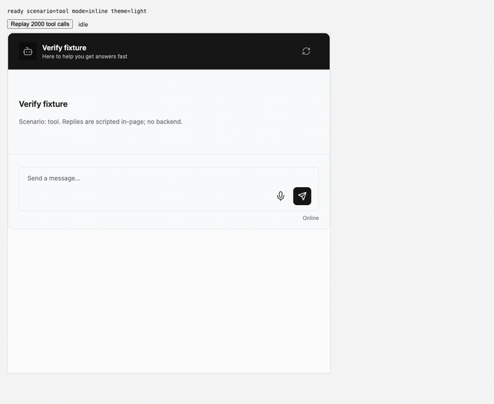
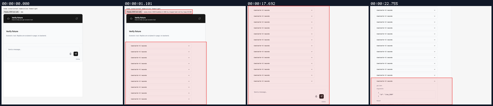
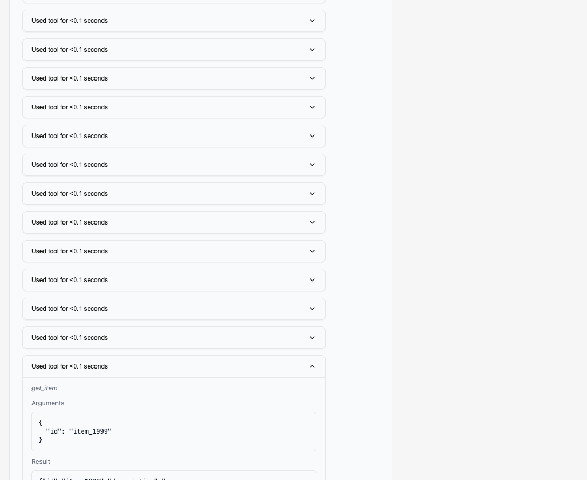
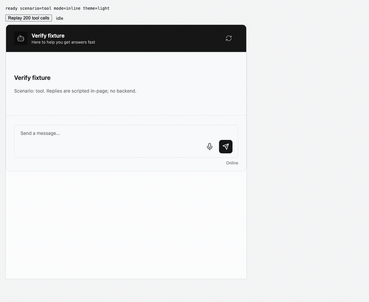
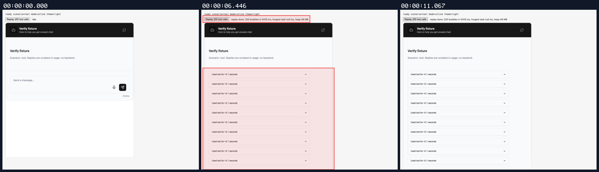
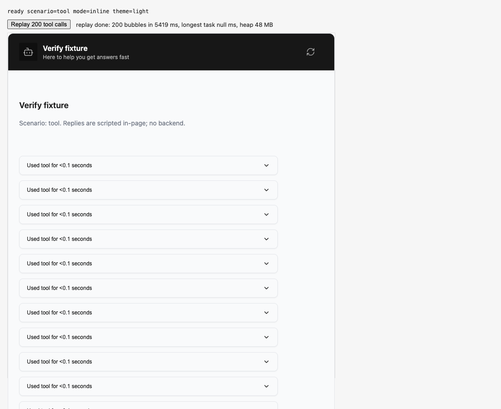
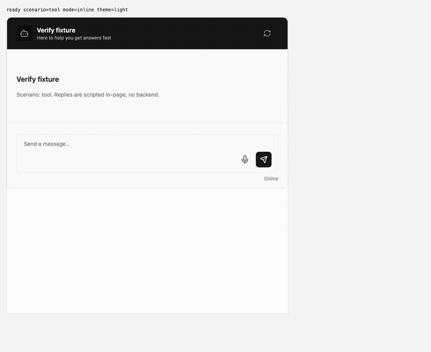
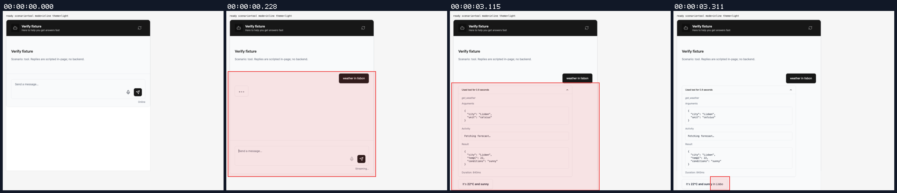
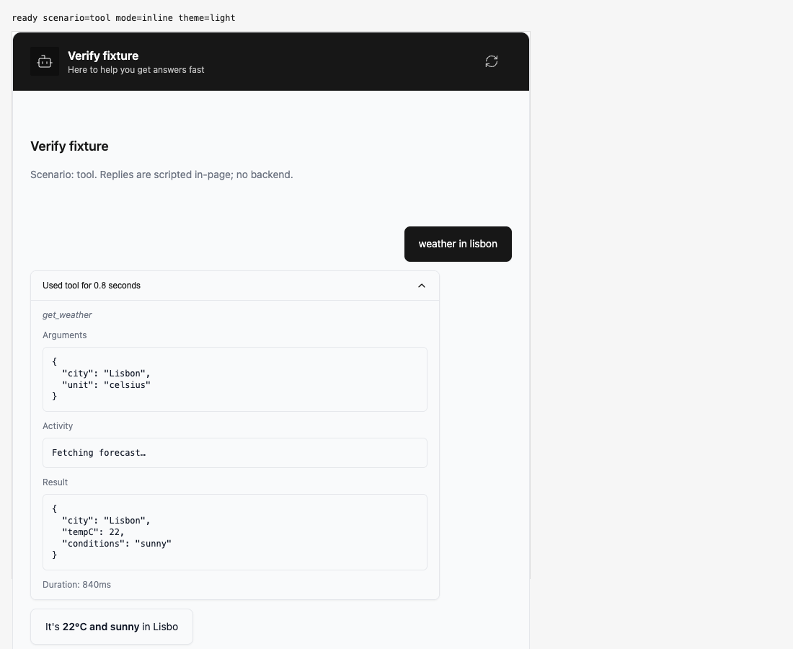

## Persona verification

branch `fix/connectstream-replay-coalescing` · captured at `2cb7fb54e4 + uncommitted changes (51dad451d3fc)`, `2cb7fb54e4 + uncommitted changes (452ef5887115)` · run `20261019-230830-0fc954` · apps/web vite dev (widget from source), keyless fixture

| Feature | Result | Note |
| --- | --- | --- |
| tool-calls | ✅ verified | Live tool turn via composer: tool bubble, answer streams, 'Used tool' expands to details; 1 request, assistant:complete x2 at same timings as main (1572/4085 ms vs 1611/4130 ms). |
| streaming | ⏭️ not driven | Plain text streaming not separately driven; covered by unit tests (ui.streaming-coalescing). |

### tool-calls

**replay 2000 tool calls - after fix**

[`01-tool-calls-replay-2000-tool-calls-after-fix.webm`](./01-tool-calls-replay-2000-tool-calls-after-fix.webm)

**2000 replayed, last bubble expanded**: connectStream replay of 2000 tool pairs: 298 ms, 2000 bubbles, heap 40 MB; last bubble expands to item_1999 details

[`02-tool-calls-2000-replayed-last-bubble-expanded.aria.txt`](./02-tool-calls-2000-replayed-last-bubble-expanded.aria.txt)

**replay 200 tool calls - before fix (main)**

[`03-tool-calls-replay-200-tool-calls-before-fix-main.webm`](./03-tool-calls-replay-200-tool-calls-before-fix-main.webm)

**before fix: 200 replayed on main**: main: connectStream replay of 200 tool pairs blocked the main thread for 5419 ms

[`04-tool-calls-before-fix-200-replayed-on-main.aria.txt`](./04-tool-calls-before-fix-200-replayed-on-main.aria.txt)

**live tool turn via composer**

[`05-tool-calls-live-tool-turn-via-composer.webm`](./05-tool-calls-live-tool-turn-via-composer.webm)

**live tool turn, details expanded**

[`06-tool-calls-live-tool-turn-details-expanded.aria.txt`](./06-tool-calls-live-tool-turn-details-expanded.aria.txt)

**live tool turn side effects**: 1 request(s) crossed the network boundary, 3 controller event(s)

[`07-tool-calls-live-tool-turn-side-effects.page.json`](./07-tool-calls-live-tool-turn-side-effects.page.json)

**main baseline events (comparison)**: 1 request(s) crossed the network boundary, 4 controller event(s)

[`08-tool-calls-main-baseline-events-comparison.page.json`](./08-tool-calls-main-baseline-events-comparison.page.json)

**live tool turn side effects (settled)**: 1 request(s) crossed the network boundary, 4 controller event(s)

[`09-tool-calls-live-tool-turn-side-effects-settled.page.json`](./09-tool-calls-live-tool-turn-side-effects-settled.page.json)

