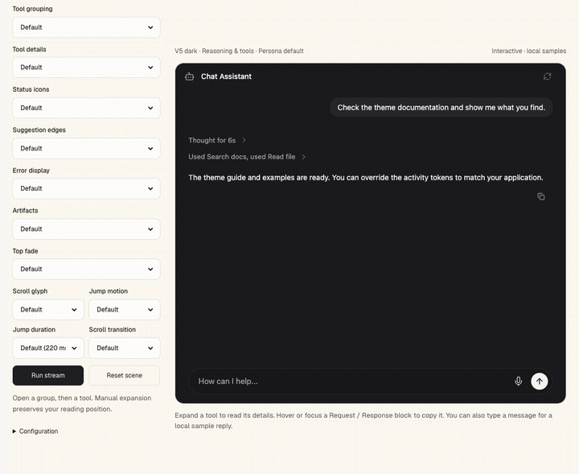
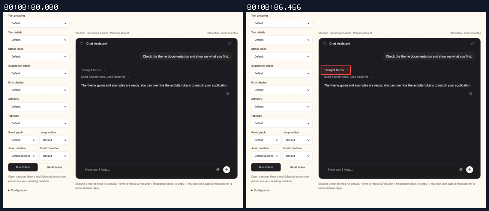
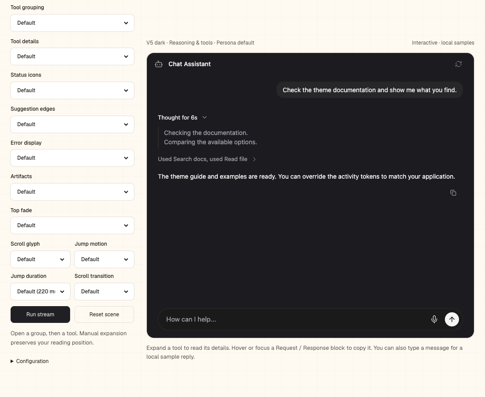
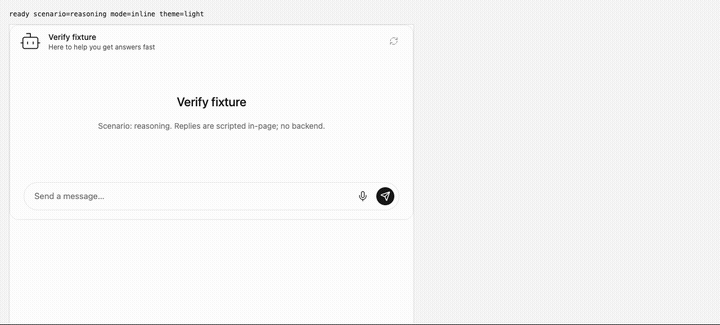
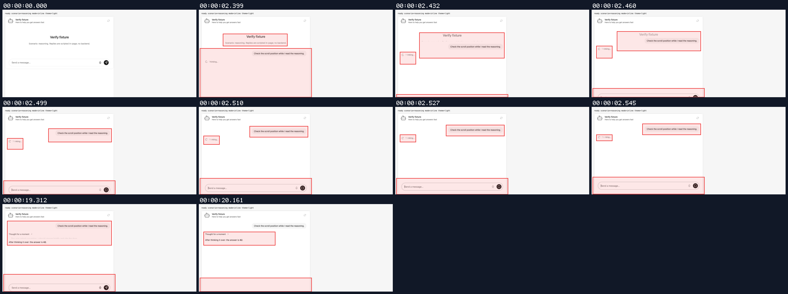
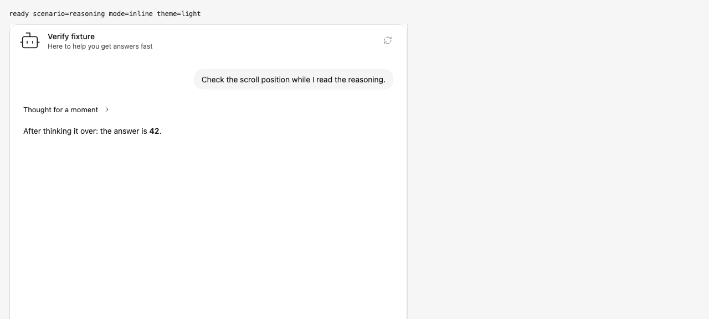

## Disclosure scroll proof (captured before final rebase)

branch `fix/activity-disclosure-scroll` · captured at `44c759fb50 + uncommitted changes (860ea69d7f9c)`, `44c759fb50 + uncommitted changes (8dd3528948a0)` · run `20261021-080843-aaf513` · apps/web vite dev (widget from source), keyless fixture

| Feature | Result | Note |
| --- | --- | --- |
| streaming | ✅ verified | Final main-based source: 12 browser cases pass, including mouse/keyboard, animated/reduced motion and rapid reversals. Actual session proof: one request, one user message, two assistant completions and matching run start/finish. Build, lint, typecheck and gzip checks pass; lazy activity allowance +50 bytes, CDN unchanged. |

### streaming

**Current main reasoning open and close**

[`01-streaming-current-main-reasoning-open-and-close.webm`](./01-streaming-current-main-reasoning-open-and-close.webm)

**Current main inset reasoning expanded**

[`02-streaming-current-main-inset-reasoning-expanded.aria.txt`](./02-streaming-current-main-inset-reasoning-expanded.aria.txt)

**Reasoning through the real session**

[`03-streaming-reasoning-through-the-real-session.webm`](./03-streaming-reasoning-through-the-real-session.webm)

**Completed reasoning after toggling**

[`04-streaming-completed-reasoning-after-toggling.aria.txt`](./04-streaming-completed-reasoning-after-toggling.aria.txt)

**Reasoning request and events**: 1 request(s) crossed the network boundary, 6 controller event(s)

[`05-streaming-reasoning-request-and-events.page.json`](./05-streaming-reasoning-request-and-events.page.json)

