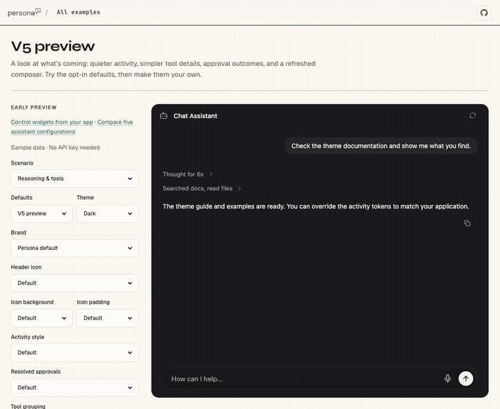
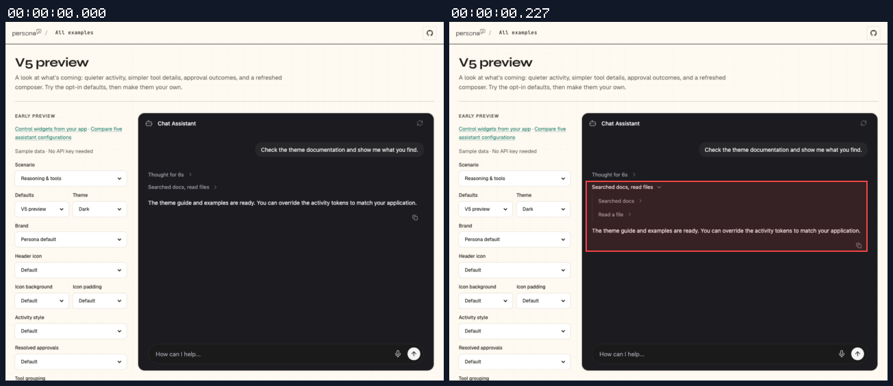
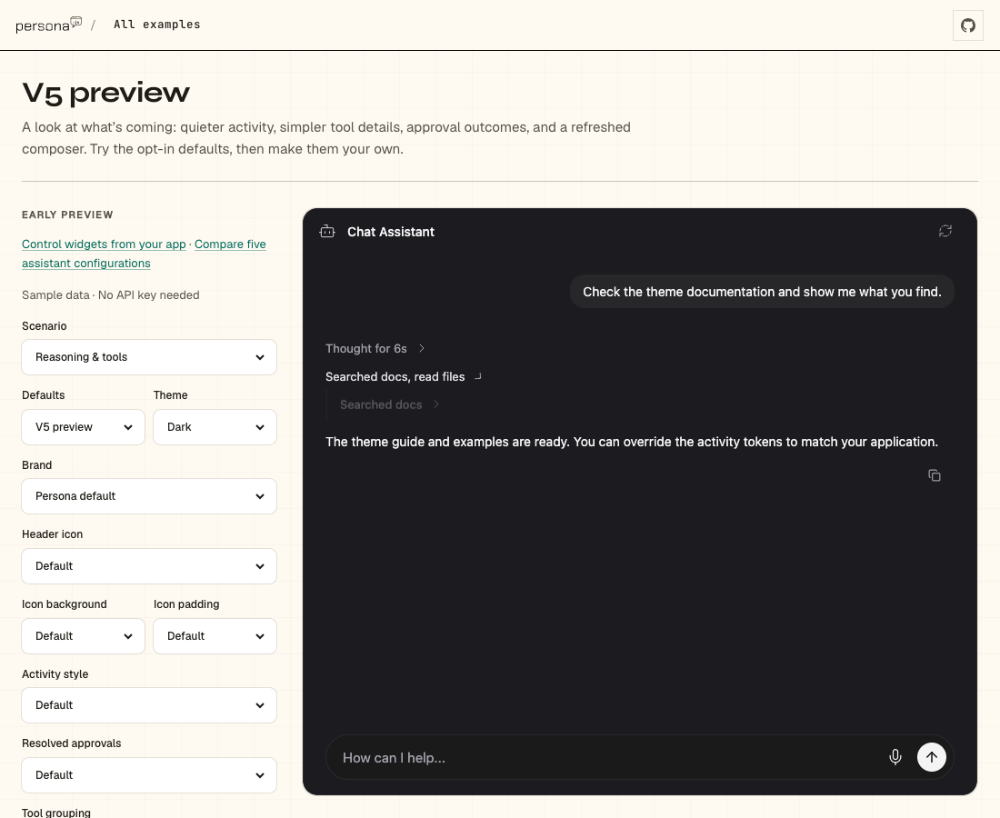
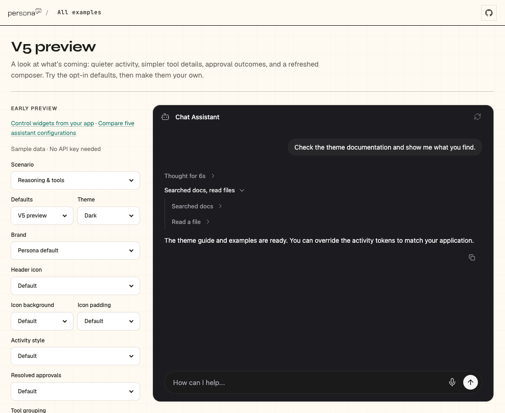

## Persona verification

branch `fix/default-tool-activity-labels` · captured at `fd690c9c20 + uncommitted changes (9fce7bbe89ca)` · run `20261021-171720-93c6c8` · apps/web vite dev (widget from source), keyless fixture

| Feature | Result | Note |
| --- | --- | --- |
| tool-calls | ✅ verified | V5 preview with Tool grouping set to Default: group reads Searched docs, read files; child rows read Searched docs and Read a file. Preview uses local sample injection, so no network request is expected. Full SDK streaming path is outside this label-only proof. |

### tool-calls

**Default descriptive labels**

[`01-tool-calls-default-descriptive-labels.webm`](./01-tool-calls-default-descriptive-labels.webm)

**Default grouped and individual action labels**

[`02-tool-calls-default-grouped-and-individual-action-labels.aria.txt`](./02-tool-calls-default-grouped-and-individual-action-labels.aria.txt)

**Settled default labels**

[`03-tool-calls-settled-default-labels.aria.txt`](./03-tool-calls-settled-default-labels.aria.txt)

