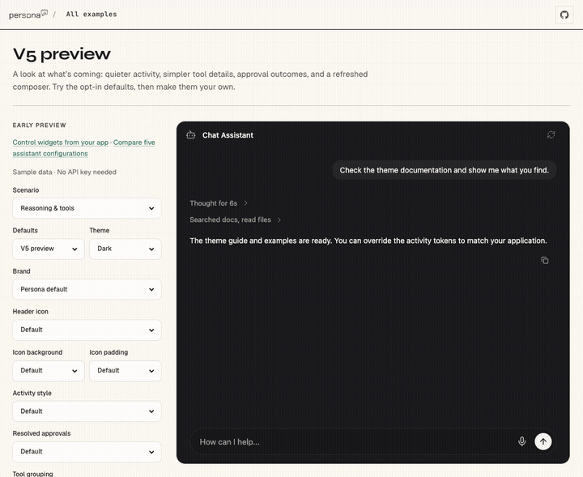
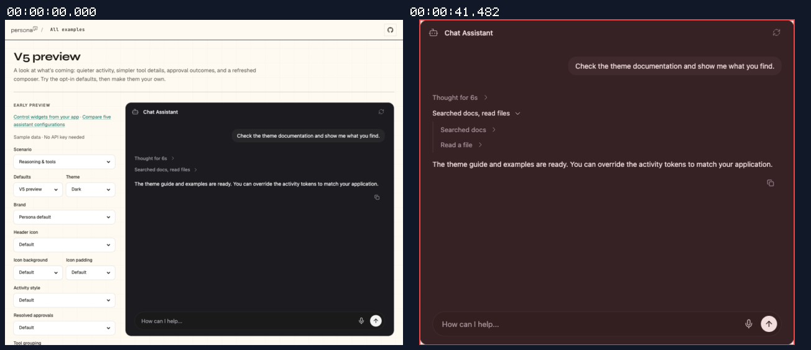
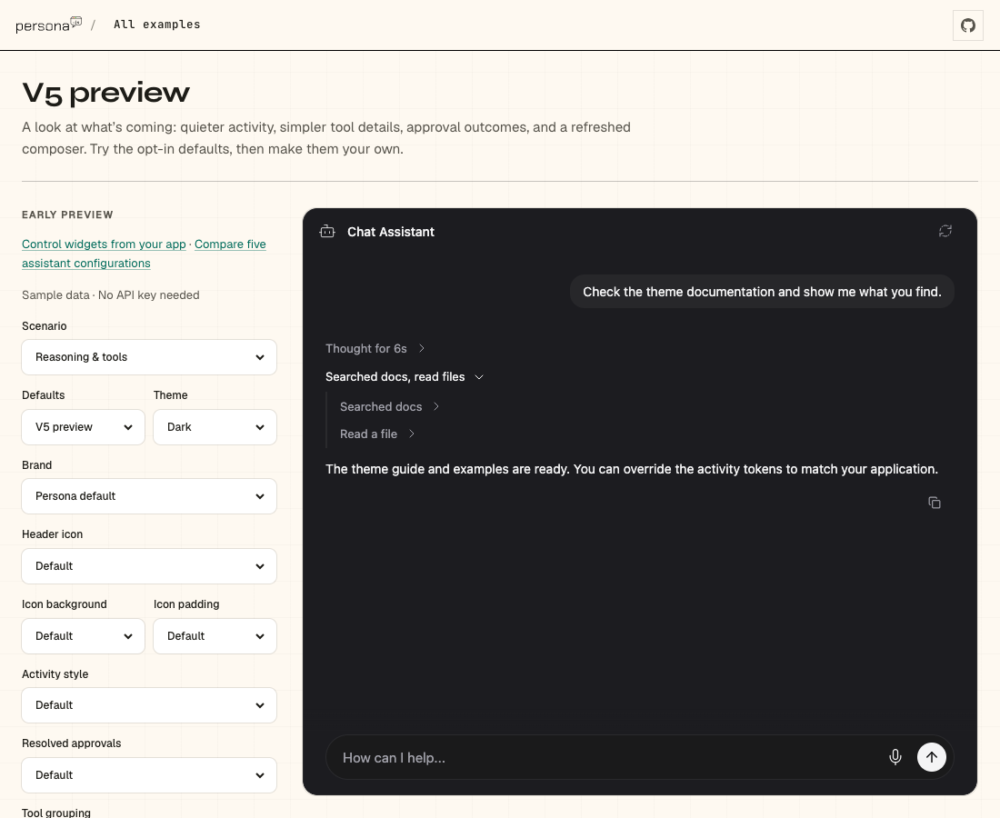

## Persona verification

branch `fix/default-tool-activity-labels` · captured at `866f4358b1 + uncommitted changes (5c5110850d98)` · run `20261021-205300-07daf6` · apps/web vite dev (widget from source), keyless fixture

| Feature | Result | Note |
| --- | --- | --- |
| tool-calls | ✅ verified | Live V5 default preview measures 28px child rows with 2px vertical padding; parent remains 32px. Browser tests cover the resolved default theme, 44px touch targets, V4 parity, authored heights/padding, multiline growth, and 12 disclosure-scroll cases. Local sample injection needs no network request; SDK streaming is outside this spacing proof. |

### tool-calls

**Compact V5 nested rows with resolved theme**

[`01-tool-calls-compact-v5-nested-rows-with-resolved-theme.webm`](./01-tool-calls-compact-v5-nested-rows-with-resolved-theme.webm)

**Compact default child rows at 28px**

[`02-tool-calls-compact-default-child-rows-at-28px.aria.txt`](./02-tool-calls-compact-default-child-rows-at-28px.aria.txt)

