## Persona verification

branch `fix/plain-assistant-brand-elevation` · captured at `d0c15abc9d + uncommitted changes (46e038b27465)` · run `20261021-204734-972eec` · apps/web vite dev (widget from source), keyless fixture

| Feature | Result | Note |
| --- | --- | --- |
| launcher-and-theme | ✅ verified | V5 Studio/Terminal light and dark preserve plain assistant prose; V4 dark retains elevated cards. Real sends verify plain compact replies and custom padded bubbles with brand shadows, each with one request and completed assistant/run events. V4 light and custom dark bubbles covered by unit tests only; other launcher/layout entry points not driven. |

### launcher-and-theme

**V5 Studio and Terminal compared with V4**

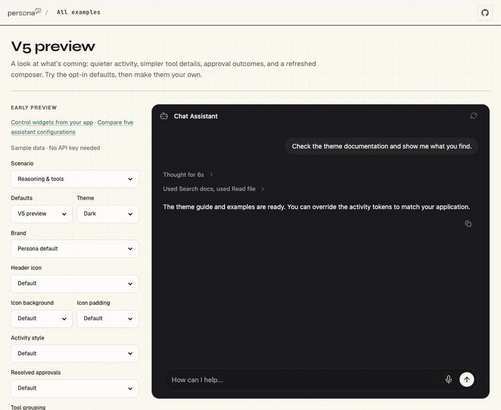

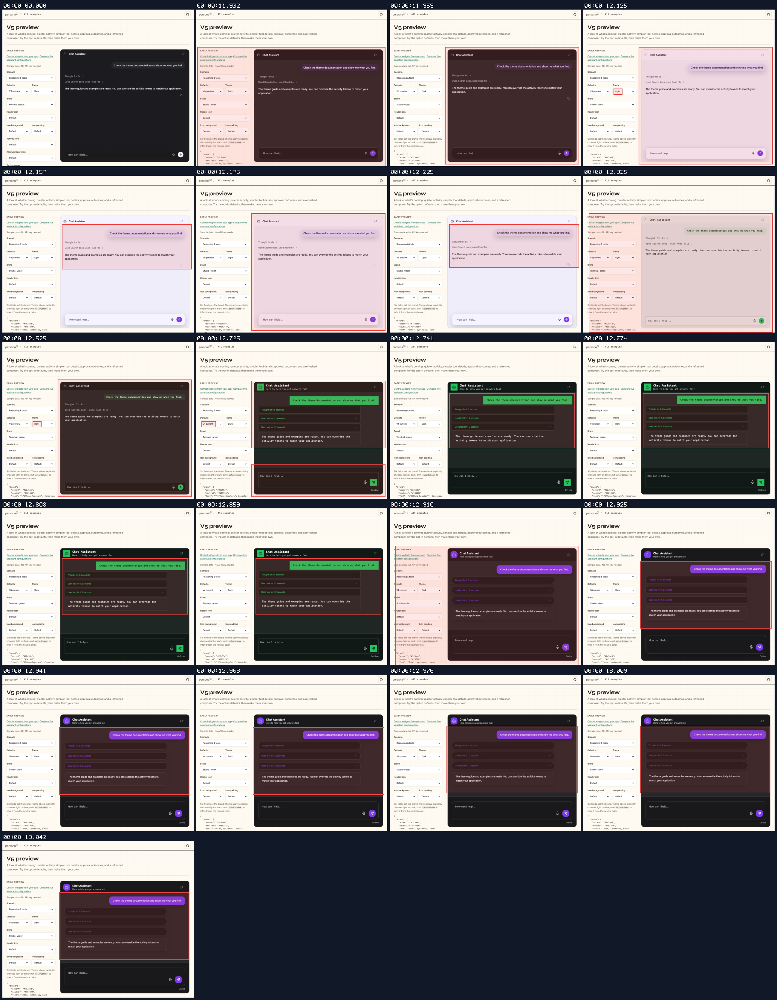

[`01-launcher-and-theme-v5-studio-and-terminal-compared-with-v4.webm`](./01-launcher-and-theme-v5-studio-and-terminal-compared-with-v4.webm)

**V5 default dark baseline**: Captured before selecting Studio.

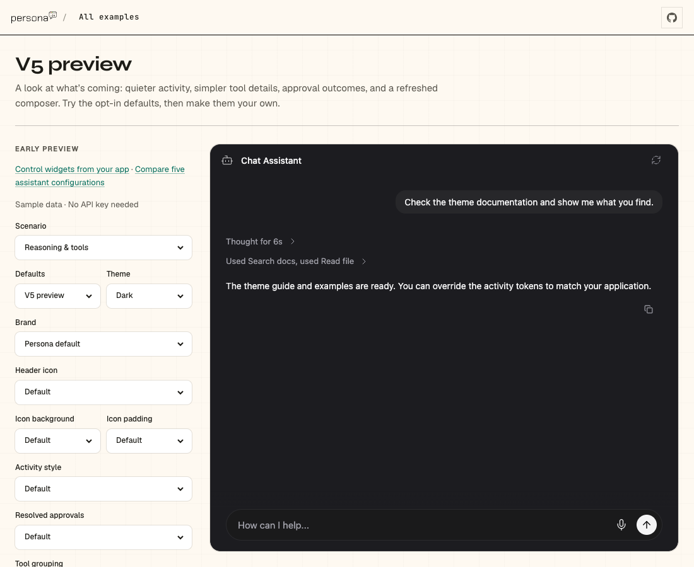

[`02-launcher-and-theme-v5-studio-dark.aria.txt`](./02-launcher-and-theme-v5-studio-dark.aria.txt)

**V5 Studio dark verified**

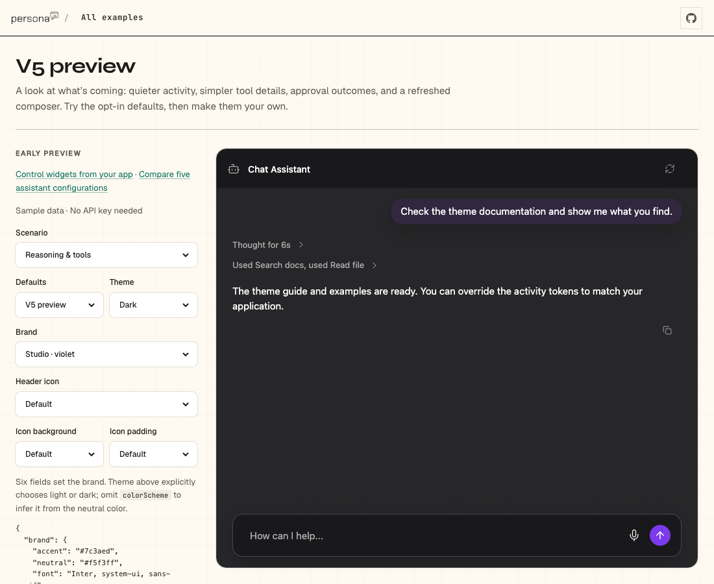

[`03-launcher-and-theme-v5-studio-dark-verified.aria.txt`](./03-launcher-and-theme-v5-studio-dark-verified.aria.txt)

**V5 Studio light**

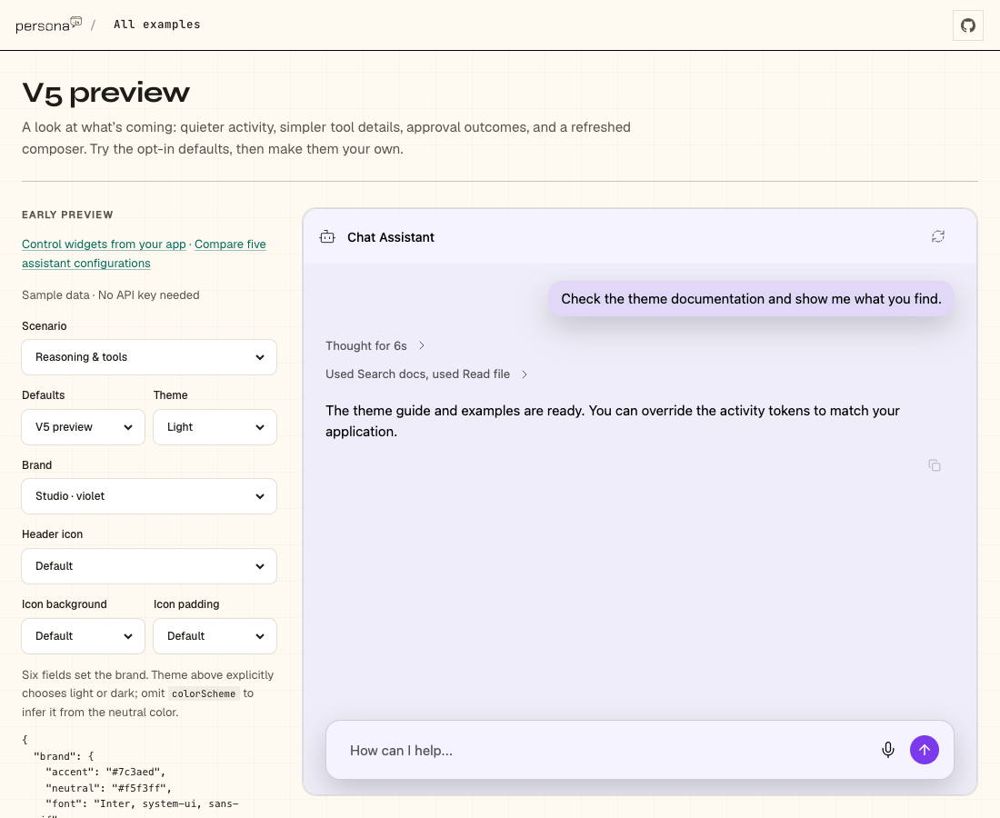

[`04-launcher-and-theme-v5-studio-light.aria.txt`](./04-launcher-and-theme-v5-studio-light.aria.txt)

**V5 Terminal light**

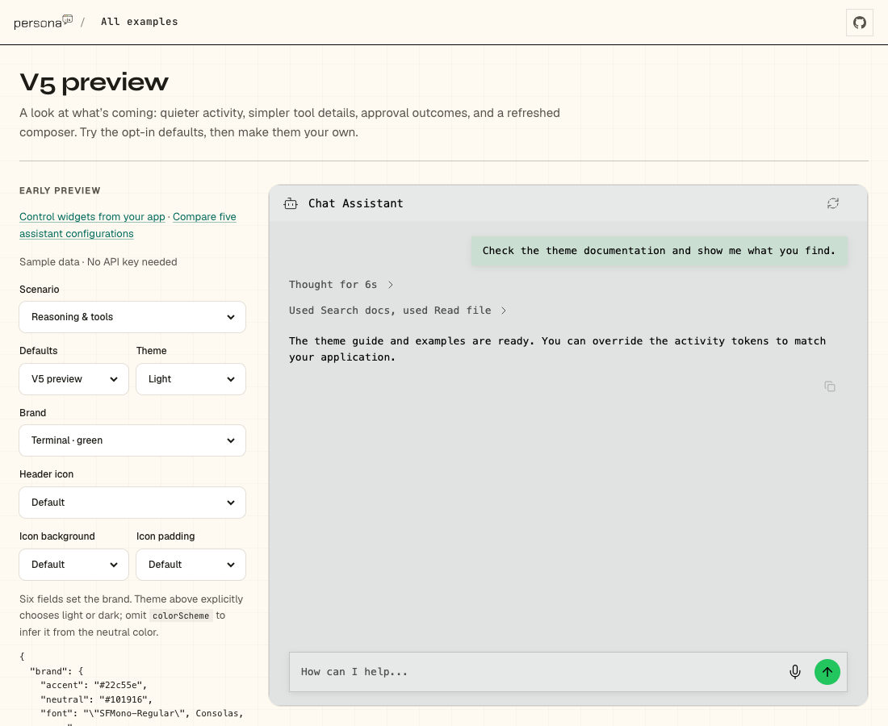

[`05-launcher-and-theme-v5-terminal-light.aria.txt`](./05-launcher-and-theme-v5-terminal-light.aria.txt)

**V5 Terminal dark**

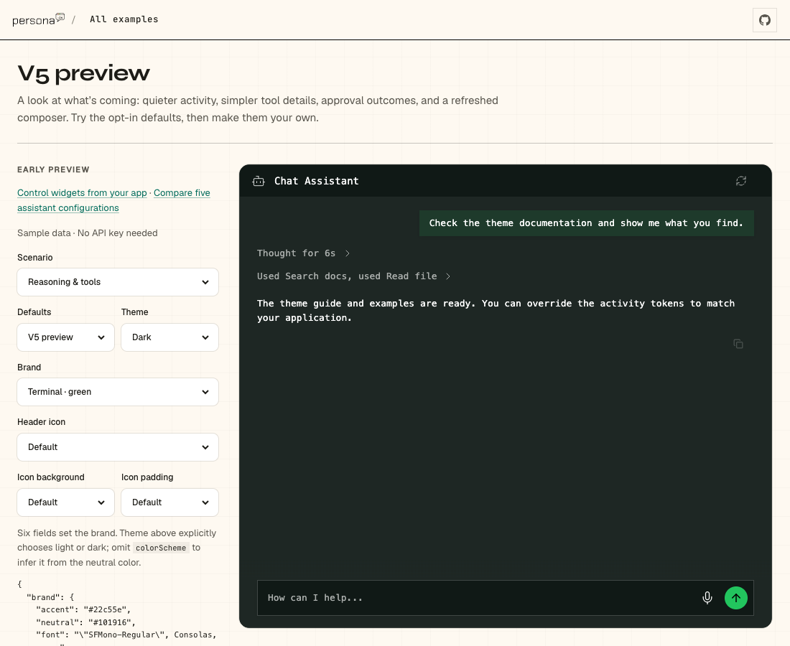

[`06-launcher-and-theme-v5-terminal-dark.aria.txt`](./06-launcher-and-theme-v5-terminal-dark.aria.txt)

**V4 Terminal dark elevated replies**

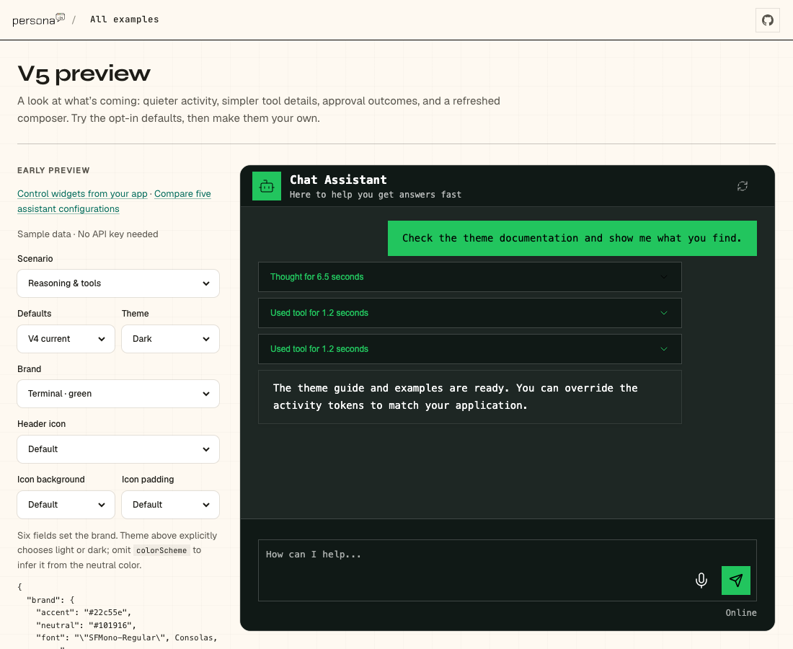

[`07-launcher-and-theme-v4-terminal-dark-elevated-replies.aria.txt`](./07-launcher-and-theme-v4-terminal-dark-elevated-replies.aria.txt)

**V4 Studio dark elevated replies**

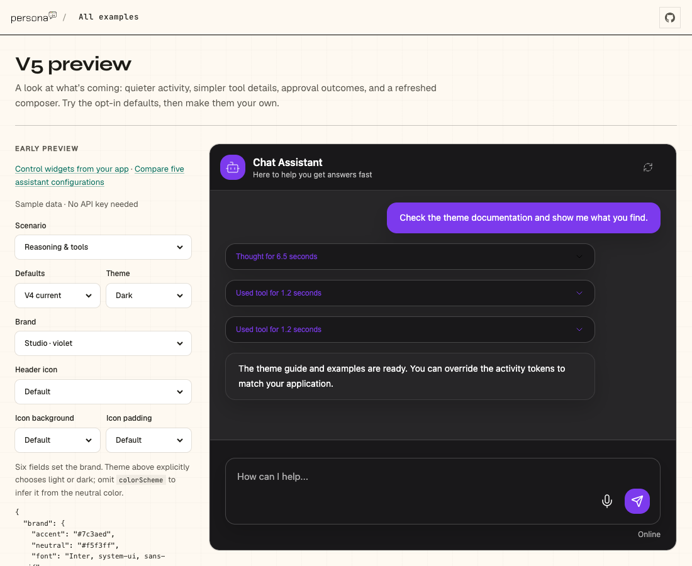

[`08-launcher-and-theme-v4-studio-dark-elevated-replies.aria.txt`](./08-launcher-and-theme-v4-studio-dark-elevated-replies.aria.txt)

**Custom padded assistant bubble follows raised elevation**

[`09-launcher-and-theme-custom-padded-assistant-bubble-follows-raised-el.webm`](./09-launcher-and-theme-custom-padded-assistant-bubble-follows-raised-el.webm)

**Custom padded assistant bubble with brand shadow**

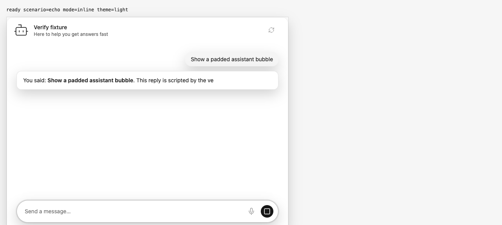

[`10-launcher-and-theme-custom-padded-assistant-bubble-with-brand-shadow.aria.txt`](./10-launcher-and-theme-custom-padded-assistant-bubble-with-brand-shadow.aria.txt)

**Custom bubble during streaming**: 1 request(s) crossed the network boundary, 3 controller event(s)

[`11-launcher-and-theme-custom-bubble-completed-conversation.page.json`](./11-launcher-and-theme-custom-bubble-completed-conversation.page.json)

**Plain V5 assistant at compact density with raised brand**

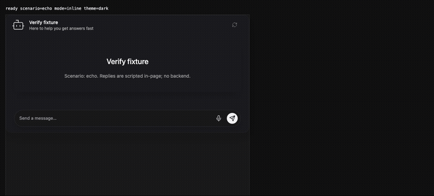

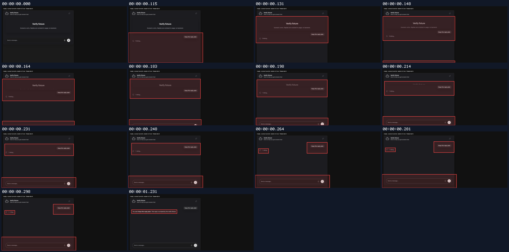

[`12-launcher-and-theme-plain-v5-assistant-at-compact-density-with-raise.webm`](./12-launcher-and-theme-plain-v5-assistant-at-compact-density-with-raise.webm)

**Plain V5 assistant after a real send**

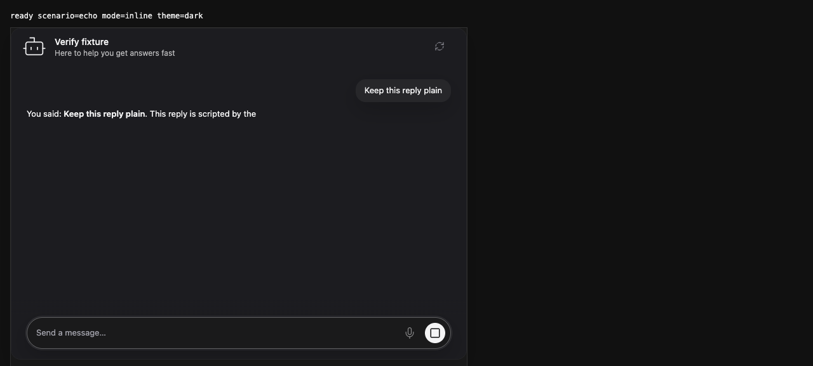

[`13-launcher-and-theme-plain-v5-assistant-after-a-real-send.aria.txt`](./13-launcher-and-theme-plain-v5-assistant-after-a-real-send.aria.txt)

**Plain V5 during streaming**: 1 request(s) crossed the network boundary, 3 controller event(s)

[`14-launcher-and-theme-plain-v5-completed-conversation.page.json`](./14-launcher-and-theme-plain-v5-completed-conversation.page.json)

**Plain V5 reply finished**

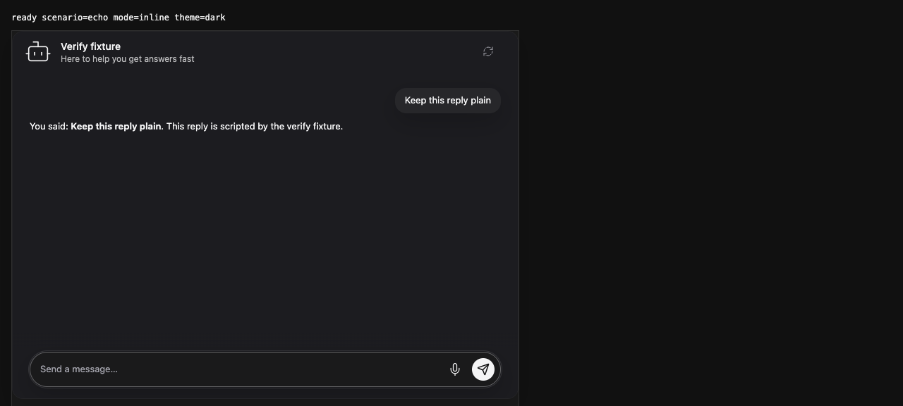

[`15-launcher-and-theme-plain-v5-reply-finished.aria.txt`](./15-launcher-and-theme-plain-v5-reply-finished.aria.txt)

**Plain V5 finished request and events**: 1 request(s) crossed the network boundary, 5 controller event(s)

[`16-launcher-and-theme-plain-v5-finished-request-and-events.page.json`](./16-launcher-and-theme-plain-v5-finished-request-and-events.page.json)

**Custom assistant bubble complete send**

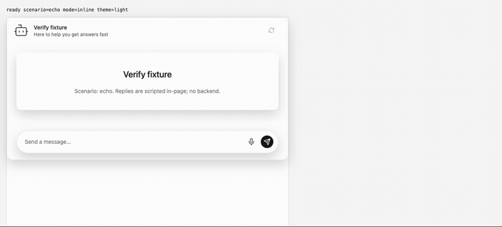

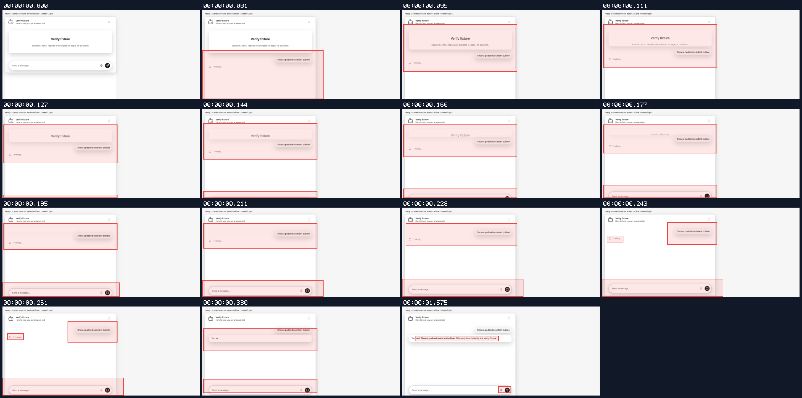

[`17-launcher-and-theme-custom-assistant-bubble-complete-send.webm`](./17-launcher-and-theme-custom-assistant-bubble-complete-send.webm)

**Custom padded assistant reply finished**

[`18-launcher-and-theme-custom-padded-assistant-reply-finished.aria.txt`](./18-launcher-and-theme-custom-padded-assistant-reply-finished.aria.txt)

**Custom bubble finished request and events**: 1 request(s) crossed the network boundary, 5 controller event(s)

[`19-launcher-and-theme-custom-bubble-finished-request-and-events.page.json`](./19-launcher-and-theme-custom-bubble-finished-request-and-events.page.json)

