## anchor-top keeps the submitted message anchored

branch `anchor-top-update` · captured at `465d95ea6d + uncommitted changes (c83cf7cc8c55)`, `465d95ea6d + uncommitted changes (a43adb5621cd)` · run `20261027-080816-9e8e3b` · apps/web vite dev (widget from source), keyless fixture

| Feature | Result | Note |
| --- | --- | --- |
| anchor-top | ⏭️ not driven | launcher mode not driven; inline fixture with launcher.fullHeight=true so the transcript scrolls inside the 760px host |

### anchor-top

**long message stays pinned while the answer grows**

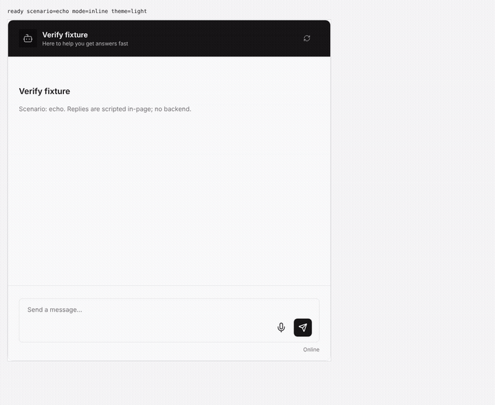

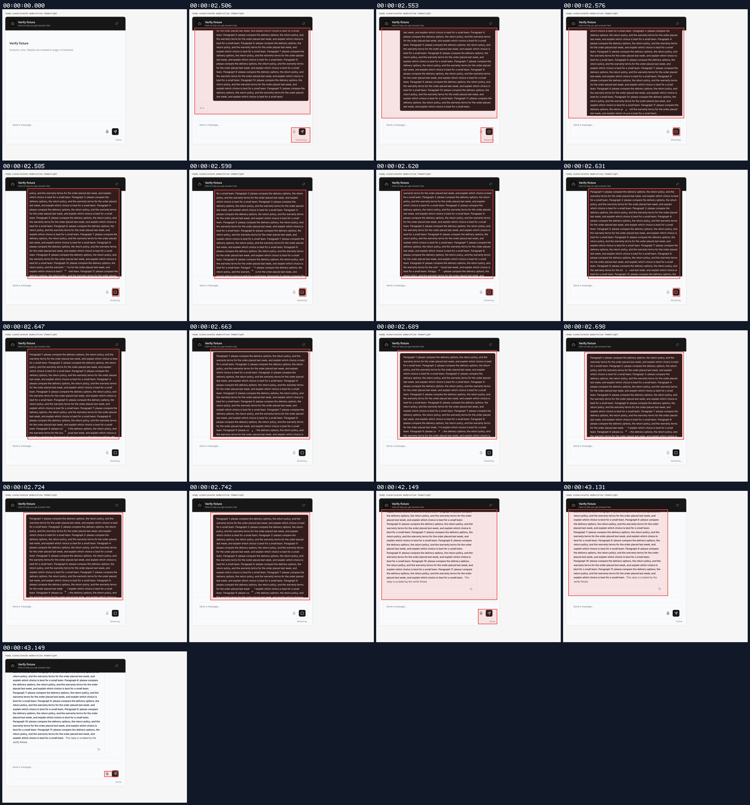

[`01-anchor-top-long-message-stays-pinned-while-the-answer-grows.webm`](./01-anchor-top-long-message-stays-pinned-while-the-answer-grows.webm)

**pinned after reply completes**: 637px question in a 508px transcript stays 16px from the top; jump-to-latest visible

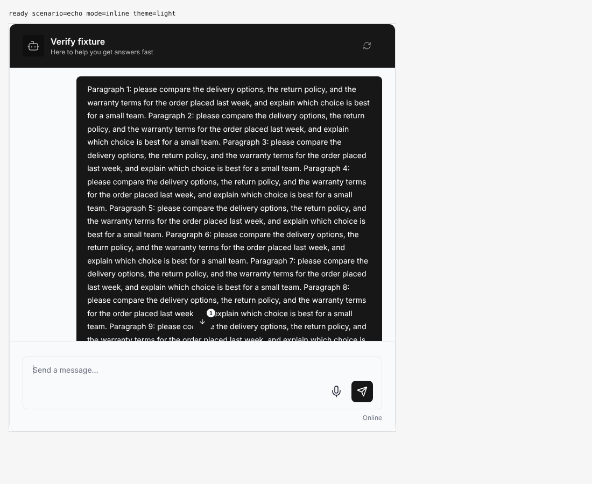

[`02-anchor-top-pinned-after-reply-completes.aria.txt`](./02-anchor-top-pinned-after-reply-completes.aria.txt)

**jump-to-latest reveals the answer**: after clicking Jump to latest: scrolled to the end of the answer, control hidden

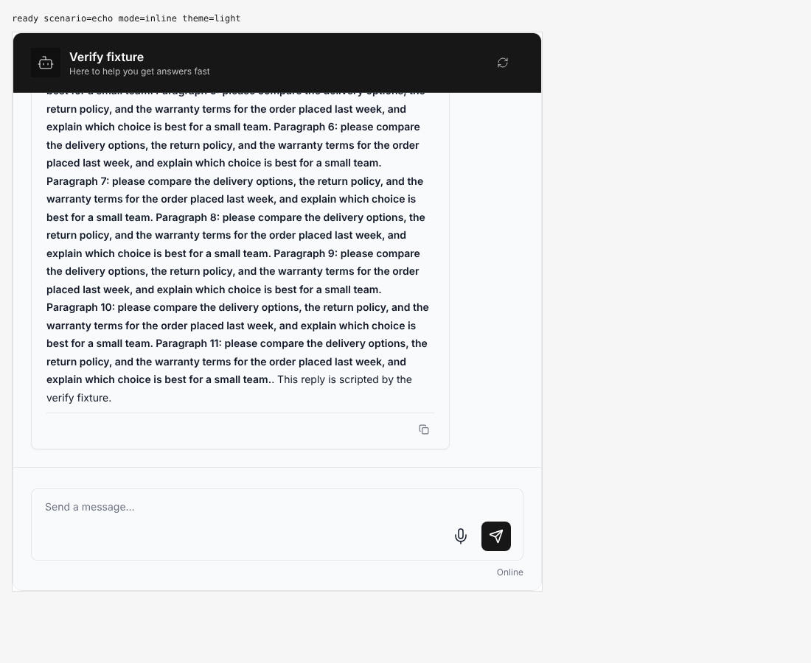

[`03-anchor-top-jump-to-latest-reveals-the-answer.aria.txt`](./03-anchor-top-jump-to-latest-reveals-the-answer.aria.txt)

**long message side effects**: 1 request(s) crossed the network boundary, 5 controller event(s)

[`04-anchor-top-long-message-side-effects.page.json`](./04-anchor-top-long-message-side-effects.page.json)

**tool-heavy reply does not force a handoff**

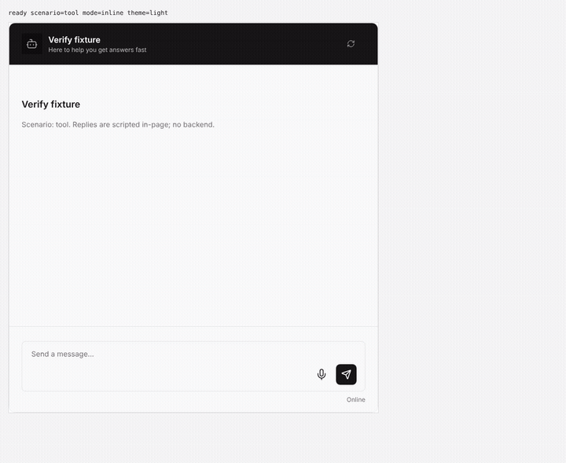

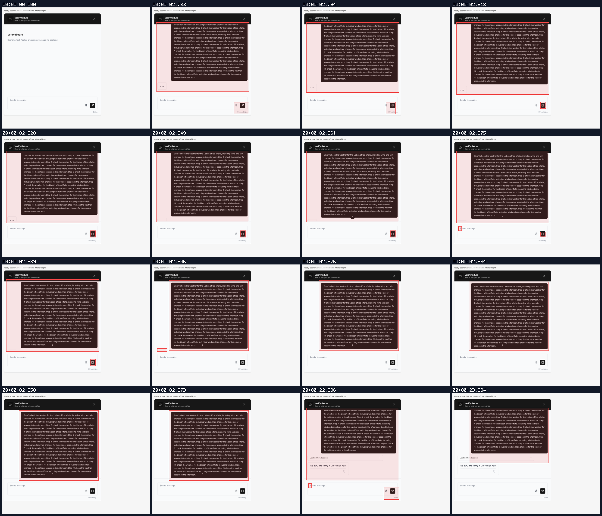

[`05-anchor-top-tool-heavy-reply-does-not-force-a-handoff.webm`](./05-anchor-top-tool-heavy-reply-does-not-force-a-handoff.webm)

**tool reply below the fold, question still pinned**: 490px question + tool bubble; answer starts at 571px in a 508px transcript; question stays 16px from top; jump-to-latest visible

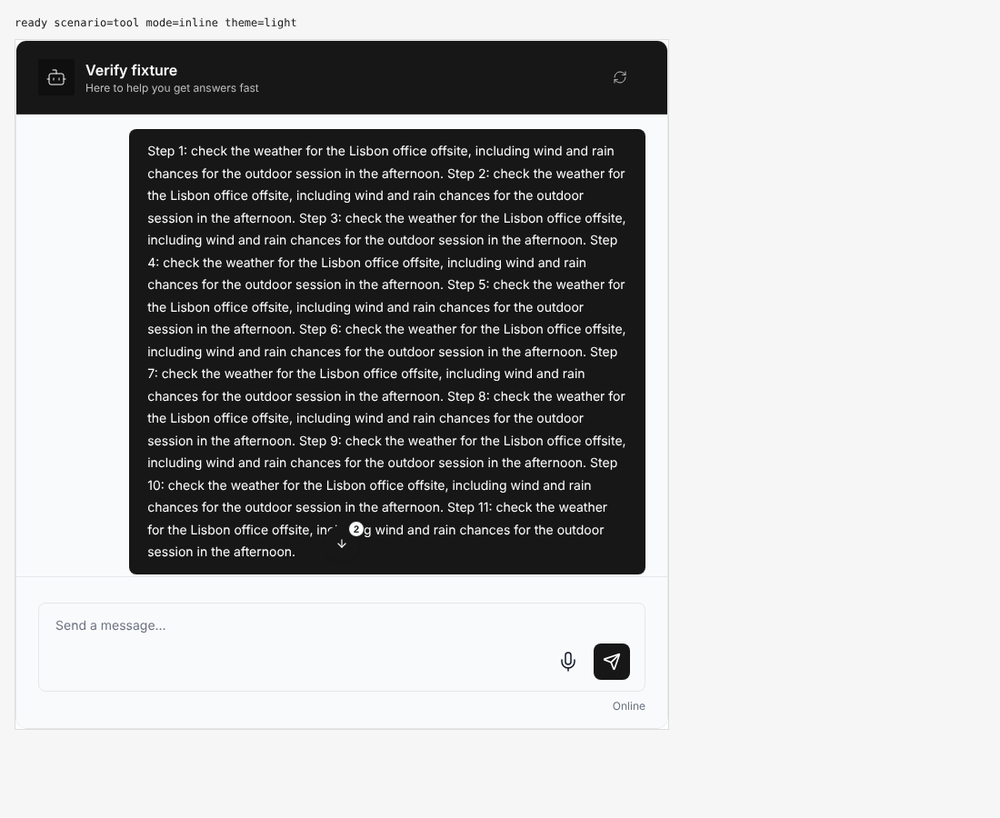

[`06-anchor-top-tool-reply-below-the-fold-question-still-pinned.aria.txt`](./06-anchor-top-tool-reply-below-the-fold-question-still-pinned.aria.txt)

**jump-to-latest reveals the tool answer**

[`07-anchor-top-jump-to-latest-reveals-the-tool-answer.aria.txt`](./07-anchor-top-jump-to-latest-reveals-the-tool-answer.aria.txt)

**tool reply side effects**: 1 request(s) crossed the network boundary, 6 controller event(s)

[`08-anchor-top-tool-reply-side-effects.page.json`](./08-anchor-top-tool-reply-side-effects.page.json)

**manual navigation is respected, next send re-anchors**

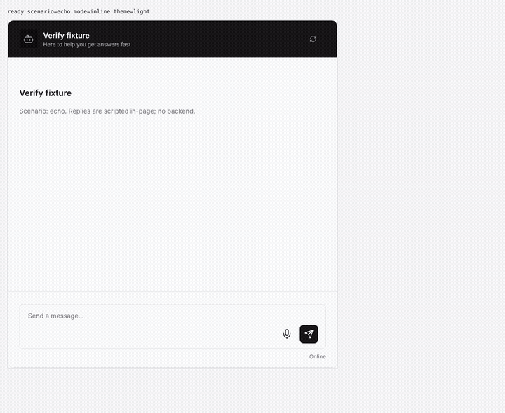

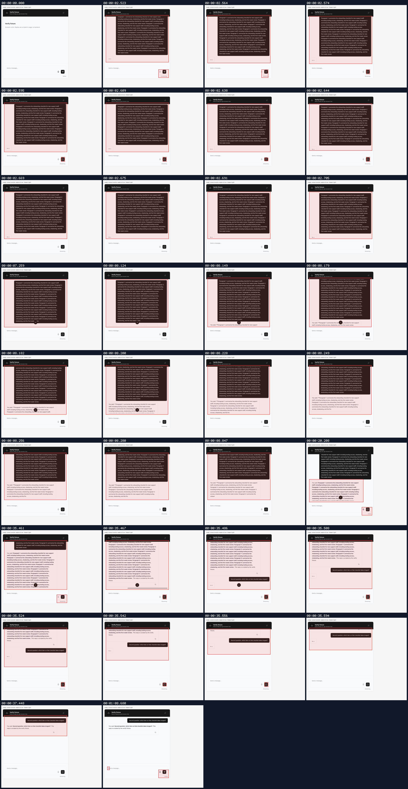

[`09-anchor-top-manual-navigation-is-respected-next-send-re-anch.webm`](./09-anchor-top-manual-navigation-is-respected-next-send-re-anch.webm)

**reader position held through the rest of the stream**: after PageDown mid-stream, scrollTop stays 354 while content grows 862->1201px

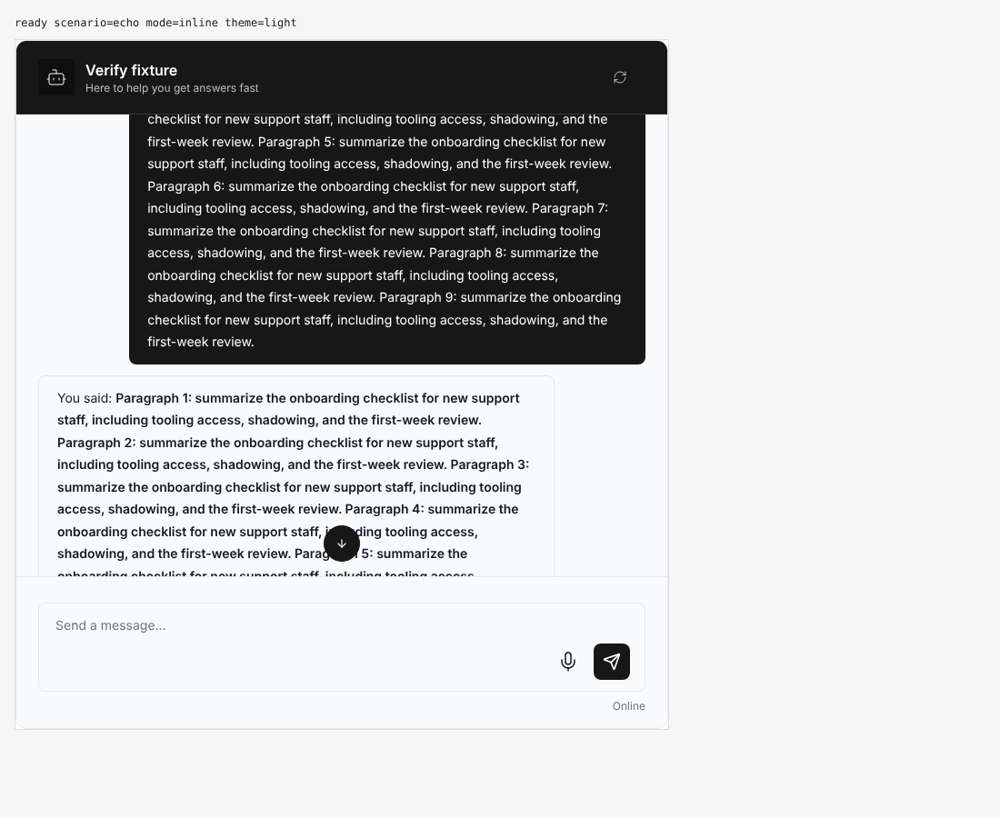

[`10-anchor-top-reader-position-held-through-the-rest-of-the-str.aria.txt`](./10-anchor-top-reader-position-held-through-the-rest-of-the-str.aria.txt)

**next send creates a new anchor**: second question rests 16px from the top

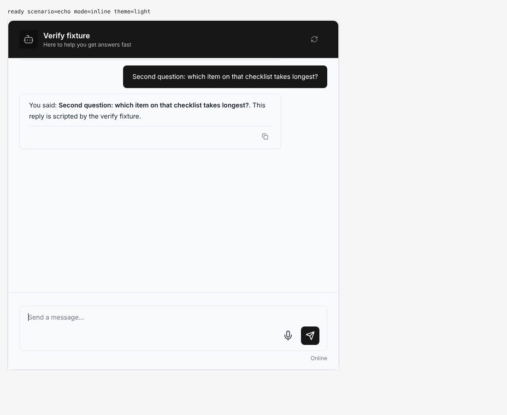

[`11-anchor-top-next-send-creates-a-new-anchor.aria.txt`](./11-anchor-top-next-send-creates-a-new-anchor.aria.txt)

**manual navigation side effects**: 2 request(s) crossed the network boundary, 10 controller event(s)

[`12-anchor-top-manual-navigation-side-effects.page.json`](./12-anchor-top-manual-navigation-side-effects.page.json)

**BEFORE (origin/main): tool reply hands off and scrolls the question away**: same input on origin/main 465d95e: anchor jumps to the answer

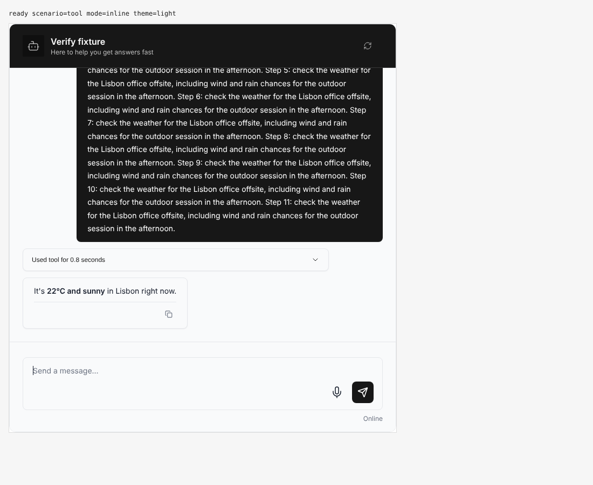

[`13-anchor-top-before-origin-main-tool-reply-hands-off-and-scro.aria.txt`](./13-anchor-top-before-origin-main-tool-reply-hands-off-and-scro.aria.txt)

