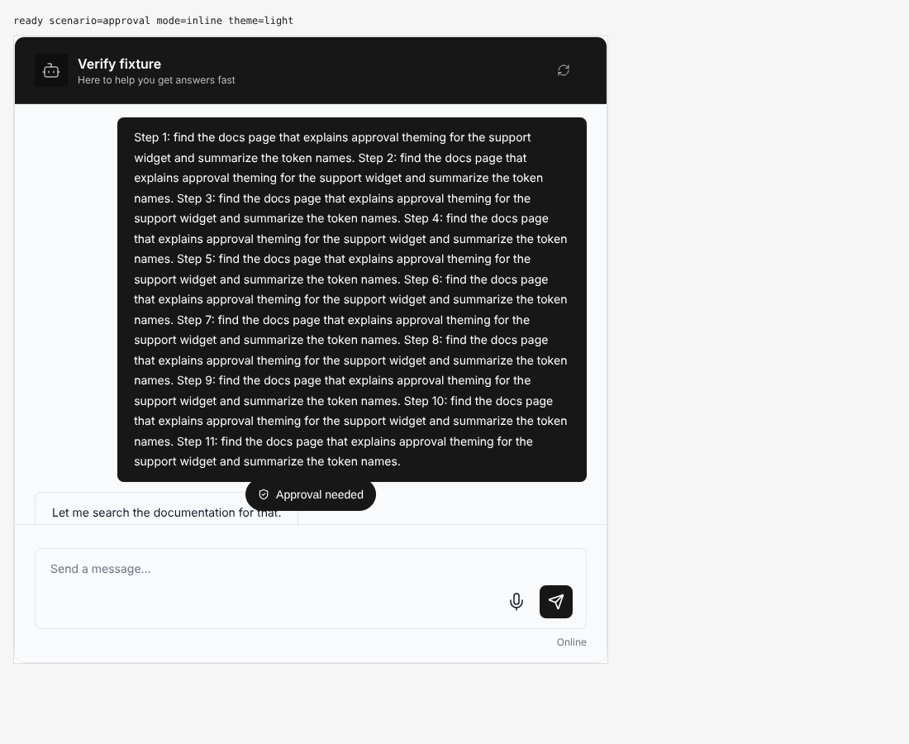
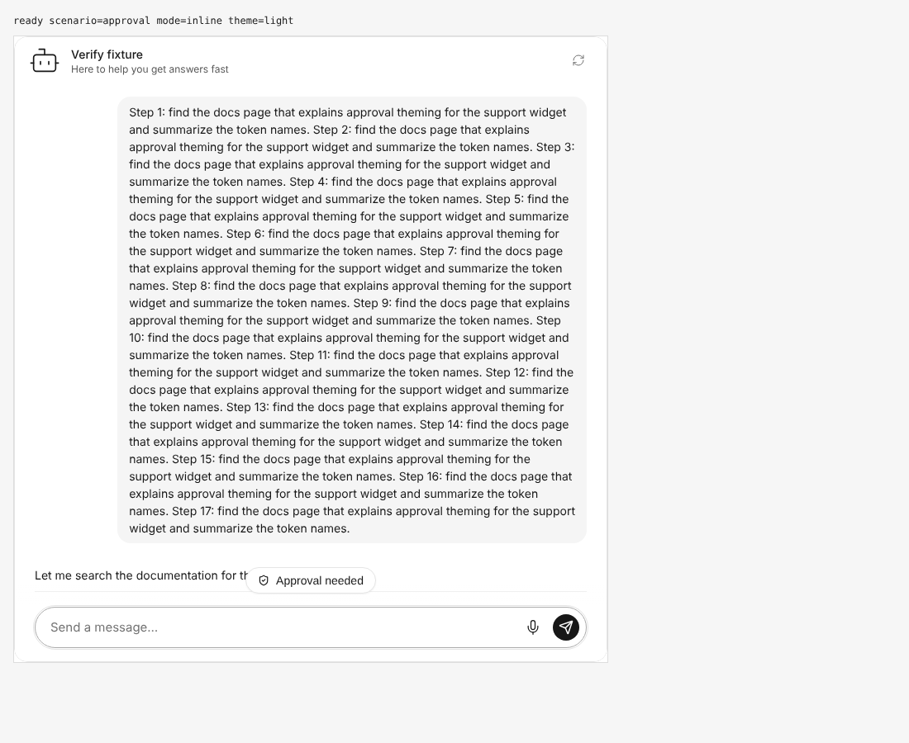
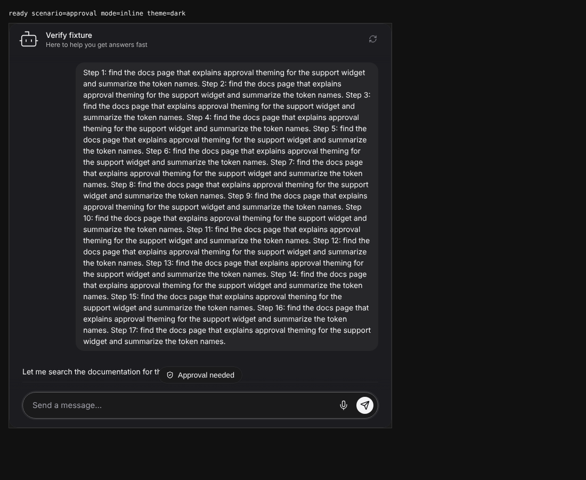
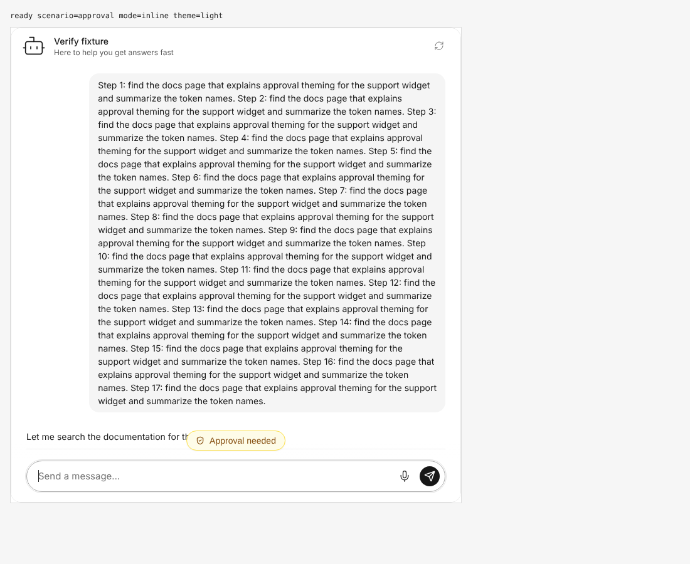
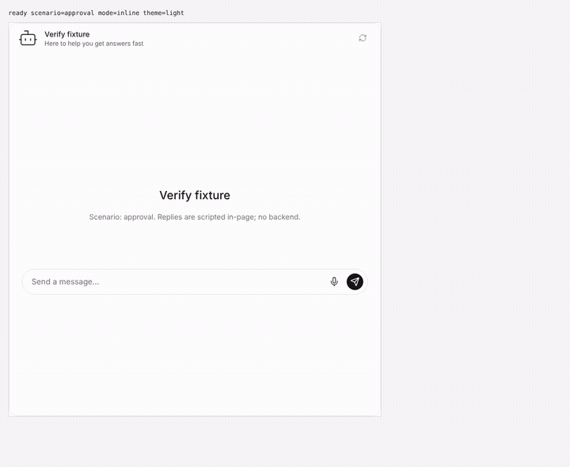
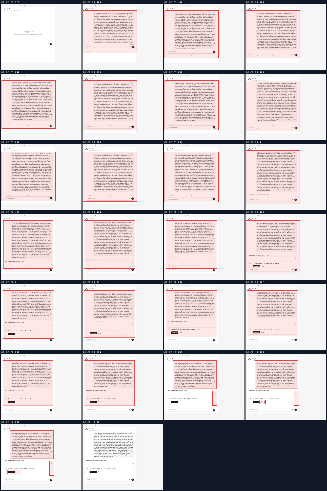
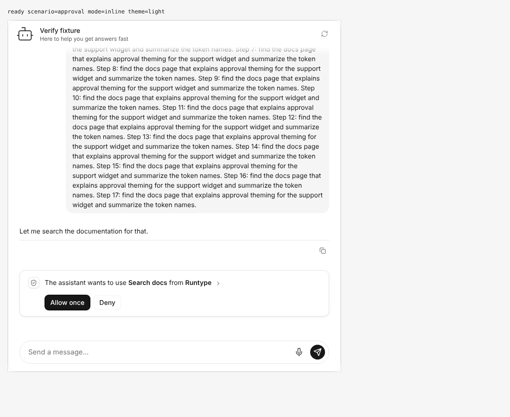
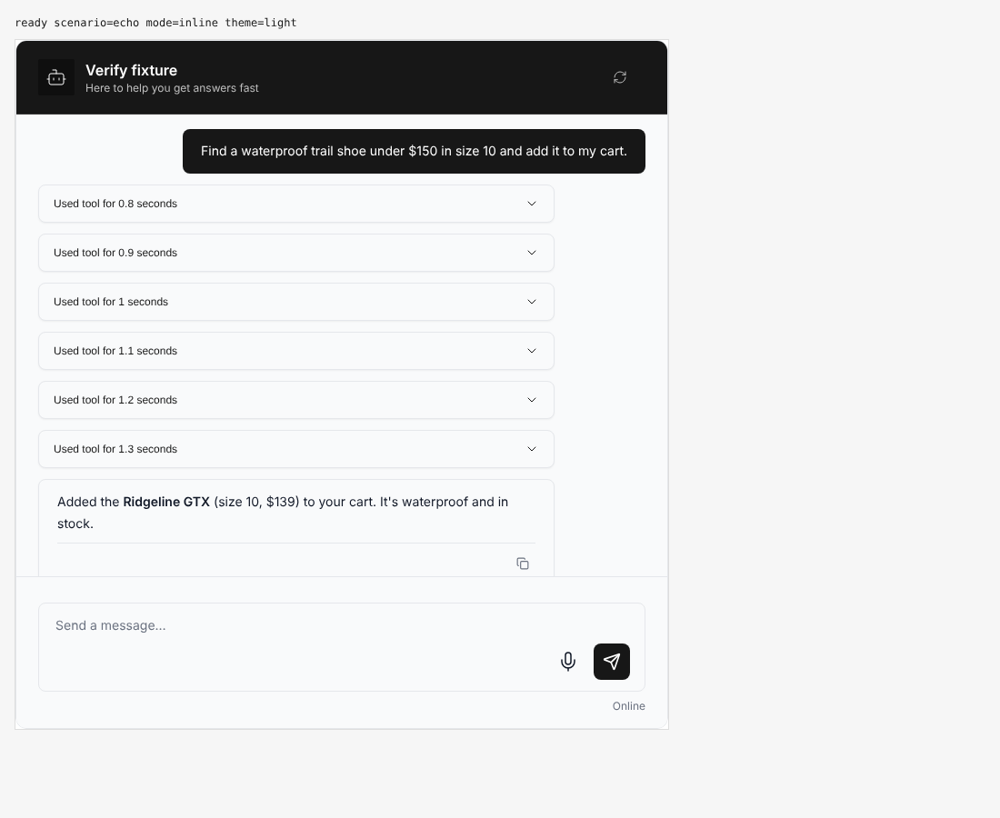
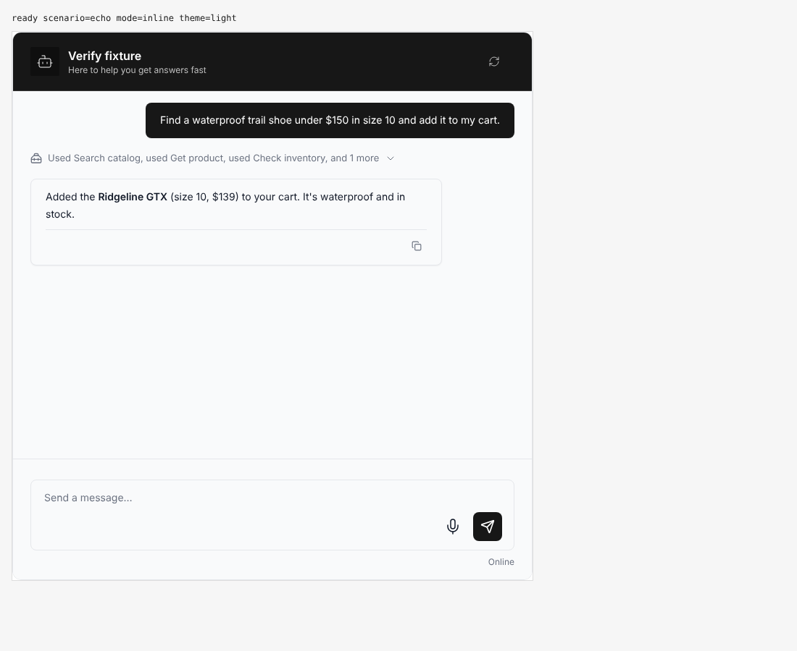

## Approval needed jump control and demo grouping

branch `anchor-top-update` · captured at `cfbc7d17c8 + uncommitted changes (fd8dd9427887)` · run `20261028-225350-46e7e6` · apps/web vite dev (widget from source), keyless fixture

| Feature | Result | Note |
| --- | --- | --- |
| demo-grouping | ✅ verified | V4 with the demos' new toolCallDisplay folds six tool cards into one collapsible row |
| approval-jump | ⏭️ not driven | V4 dark: the fixture renders V4 without a dark theme, so V4 dark matches V4 light; launcher mode not driven |

### approval-jump

**V4 light: Approval needed pill**: approval card below the fold; anchor held at the question; focus stays in the composer

[`01-approval-jump-v4-light-approval-needed-pill.aria.txt`](./01-approval-jump-v4-light-approval-needed-pill.aria.txt)

**V5 light: Approval needed pill**

[`02-approval-jump-v5-light-approval-needed-pill.aria.txt`](./02-approval-jump-v5-light-approval-needed-pill.aria.txt)

**V5 dark: Approval needed pill**

[`03-approval-jump-v5-dark-approval-needed-pill.aria.txt`](./03-approval-jump-v5-dark-approval-needed-pill.aria.txt)

**V5 light with approval accent tokens**: theme.components.scrollToBottom.approval set to warning palette

[`04-approval-jump-v5-light-with-approval-accent-tokens.aria.txt`](./04-approval-jump-v5-light-with-approval-accent-tokens.aria.txt)

**V5 approval below the fold, jump, focus Allow once**

[`05-approval-jump-v5-approval-below-the-fold-jump-focus-allow-once.webm`](./05-approval-jump-v5-approval-below-the-fold-jump-focus-allow-once.webm)

**after the jump: Allow once focused and in view**: keyboard focus ring shown after Tab/Shift+Tab

[`06-approval-jump-after-the-jump-allow-once-focused-and-in-view.aria.txt`](./06-approval-jump-after-the-jump-allow-once-focused-and-in-view.aria.txt)

### demo-grouping

**V4 six-tool turn, grouping off**: display check: turn injected via controller (WebMCP demos need the live proxy); demo config now sets toolCallDisplay grouped+collapsible

[`07-demo-grouping-v4-six-tool-turn-grouping-off.aria.txt`](./07-demo-grouping-v4-six-tool-turn-grouping-off.aria.txt)

**V4 six-tool turn, grouping on**: display check: turn injected via controller (WebMCP demos need the live proxy); demo config now sets toolCallDisplay grouped+collapsible

[`08-demo-grouping-v4-six-tool-turn-grouping-on.aria.txt`](./08-demo-grouping-v4-six-tool-turn-grouping-on.aria.txt)

