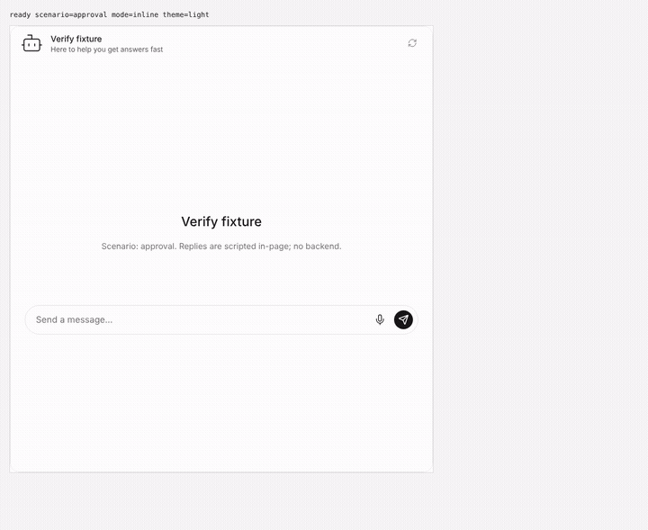
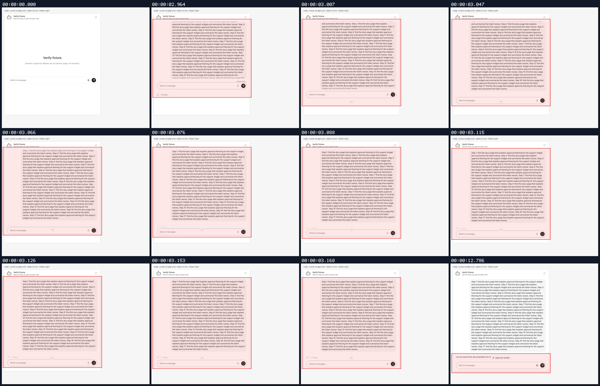
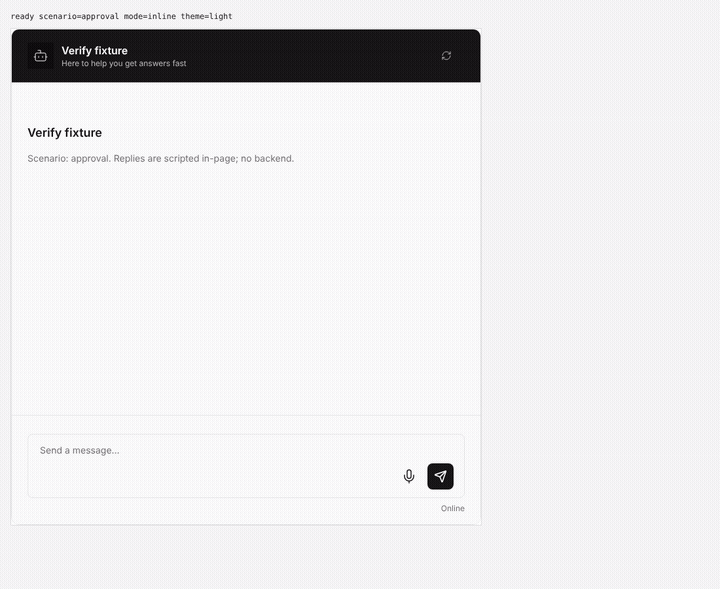
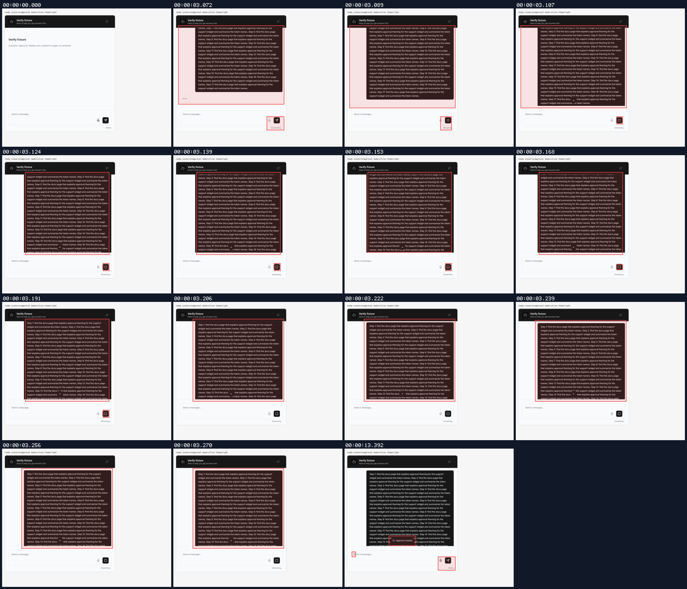
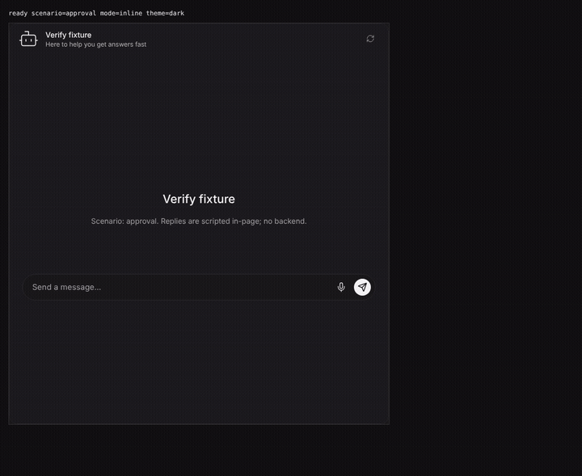
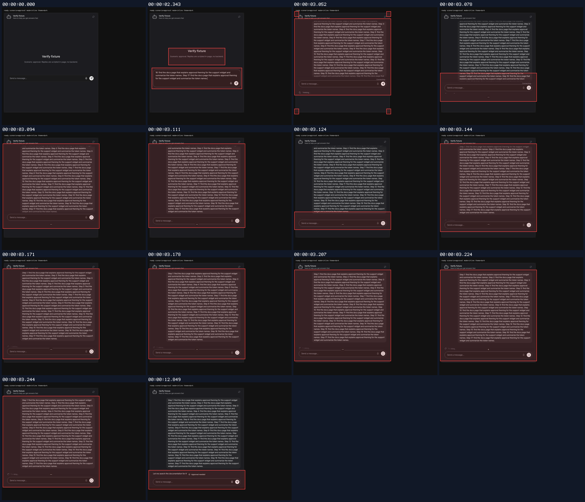
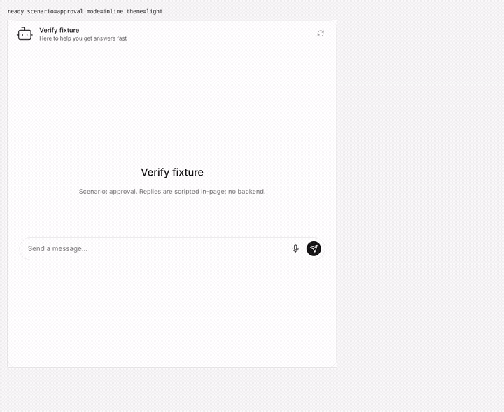
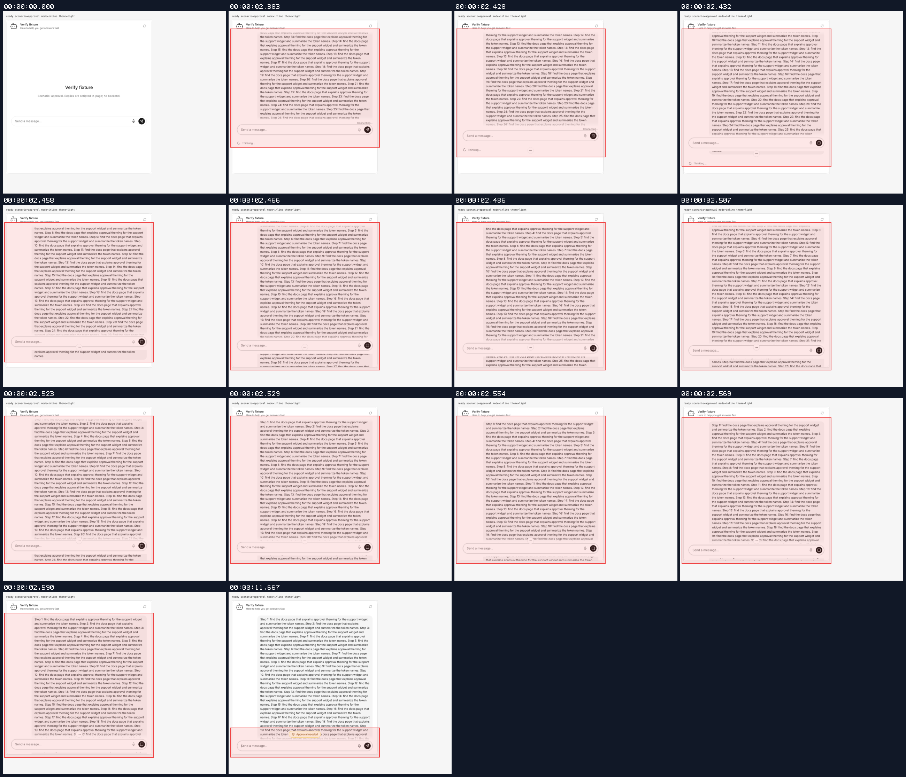

## Arrow to Approval needed morph

branch `anchor-top-update` · captured at `e2391aafde + uncommitted changes (3b06457b3f3a)` · run `20261029-011724-c7047c` · apps/web vite dev (widget from source), keyless fixture

| Feature | Result | Note |
| --- | --- | --- |
| approval-morph | ⏭️ not driven | pill->arrow and reduced motion verified by unit tests, not recorded |

### approval-morph

**V5 light: streaming dots morph into the Approval needed pill**

[`01-approval-morph-v5-light-streaming-dots-morph-into-the-approval-.webm`](./01-approval-morph-v5-light-streaming-dots-morph-into-the-approval-.webm)

**V4 light: streaming arrow morphs into the Approval needed pill**

[`02-approval-morph-v4-light-streaming-arrow-morphs-into-the-approva.webm`](./02-approval-morph-v4-light-streaming-arrow-morphs-into-the-approva.webm)

**V5 dark: streaming dots morph into the Approval needed pill**

[`03-approval-morph-v5-dark-streaming-dots-morph-into-the-approval-n.webm`](./03-approval-morph-v5-dark-streaming-dots-morph-into-the-approval-n.webm)

**slow motion (1400ms): V5 with amber approval accent**

[`04-approval-morph-slow-motion-1400ms-v5-with-amber-approval-accent.webm`](./04-approval-morph-slow-motion-1400ms-v5-with-amber-approval-accent.webm)

