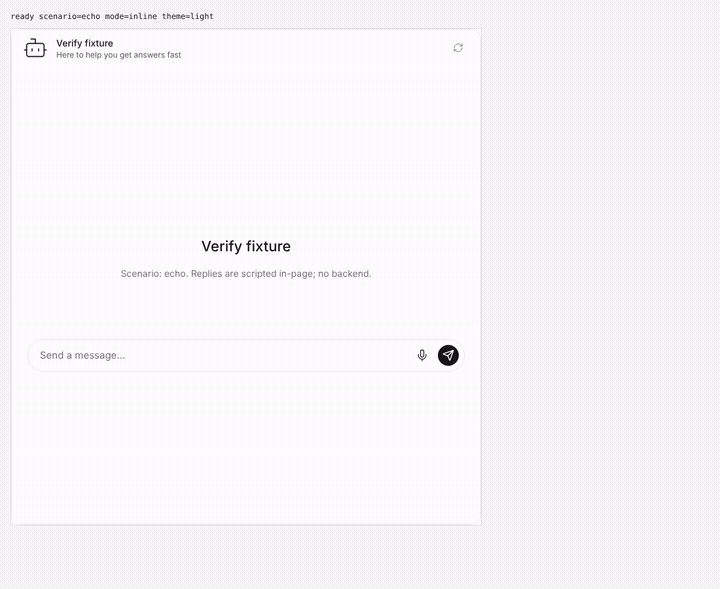
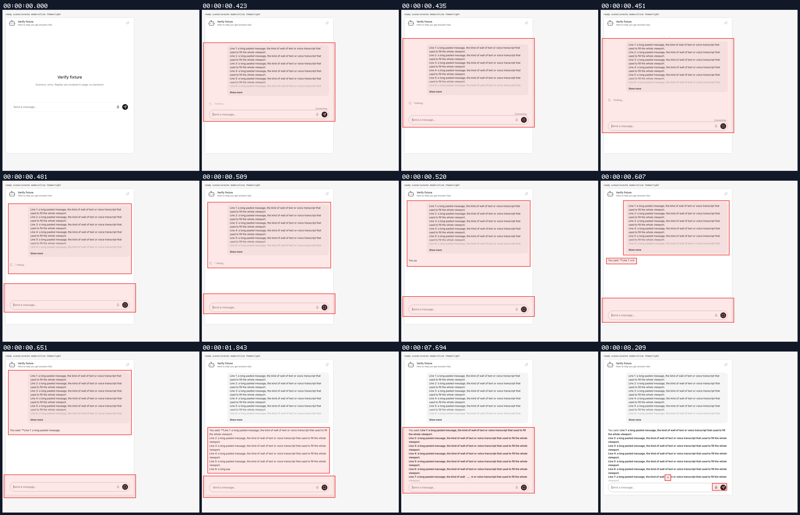
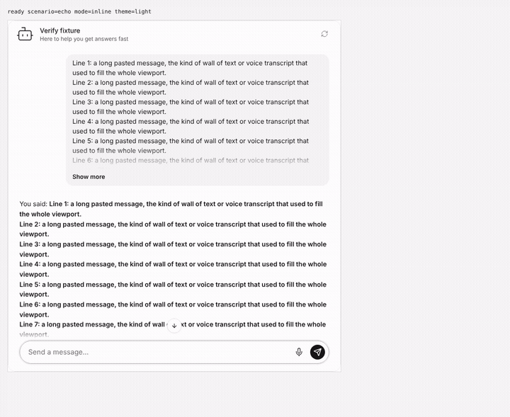
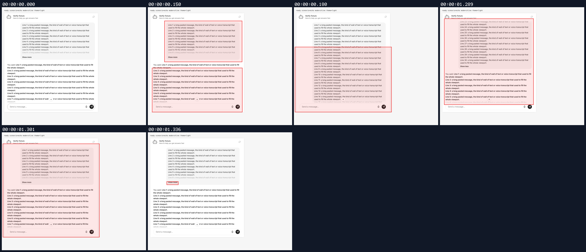
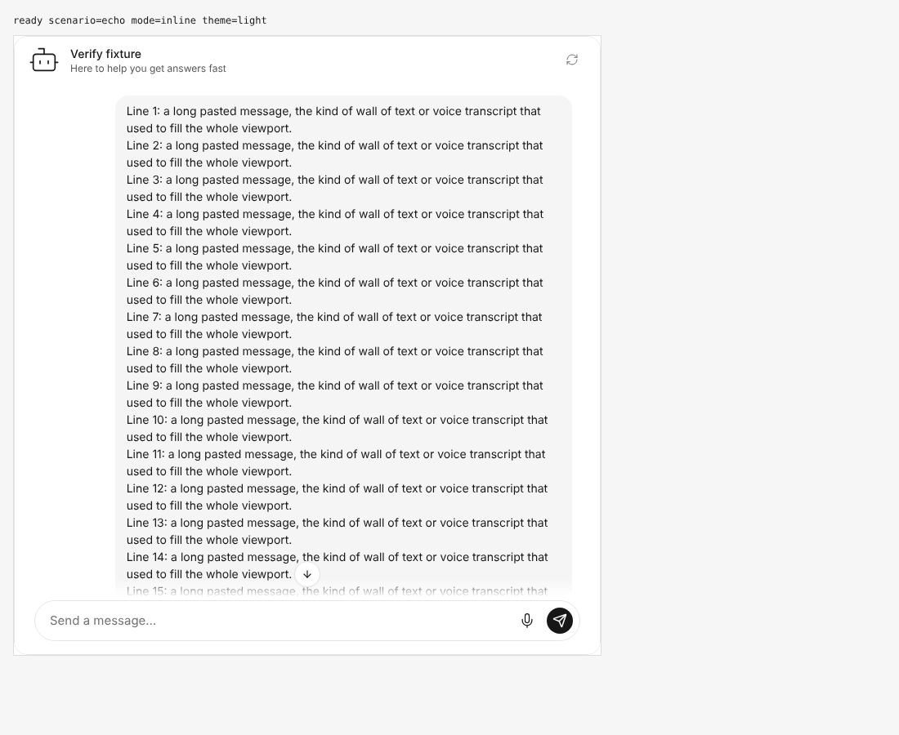
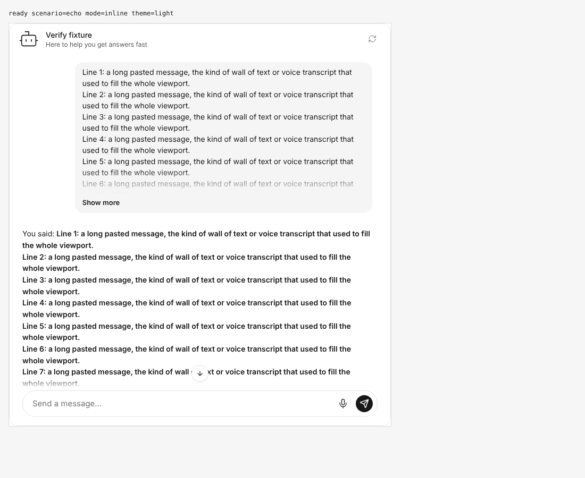
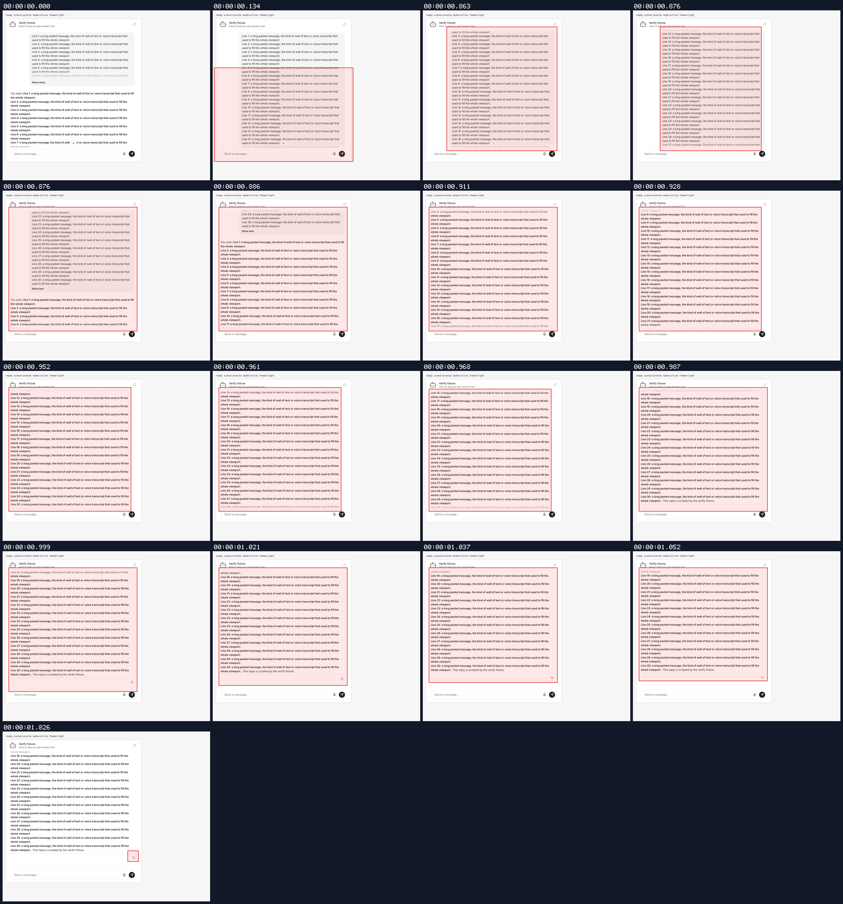
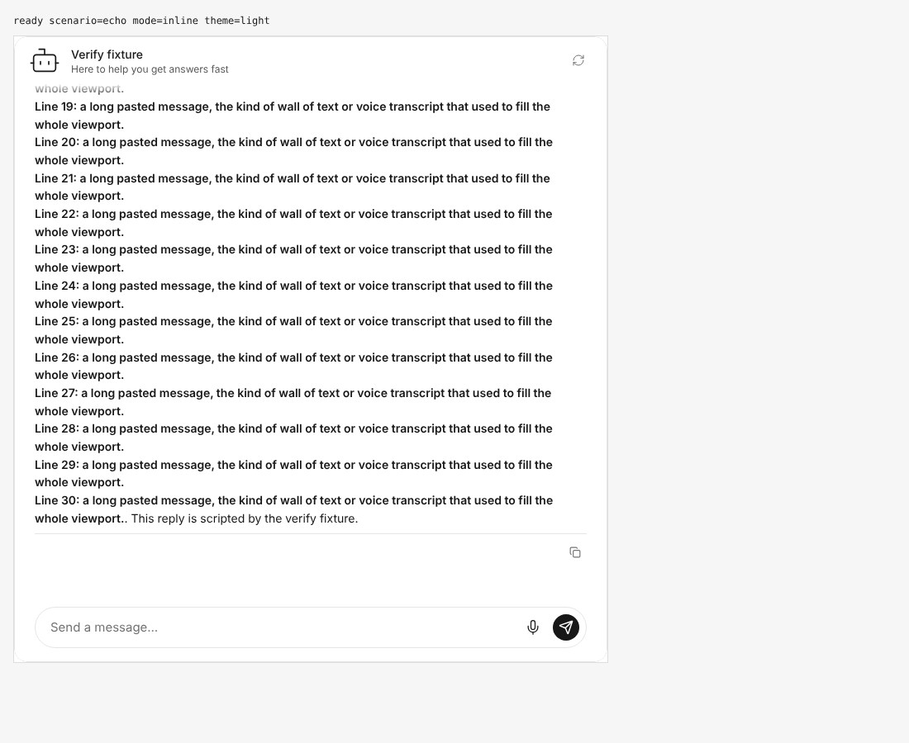
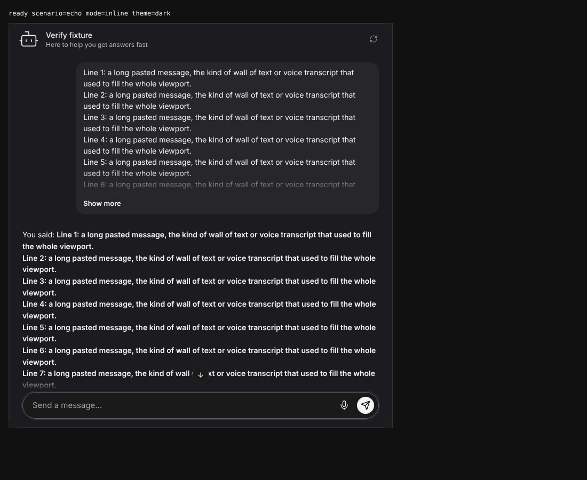

## Persona verification

branch `collapse-long-user-messages` · captured at `465d95ea6d + uncommitted changes (2f8288992747)` · run `20261028-100617-b766a6` · apps/web vite dev (widget from source), keyless fixture

| Feature | Result | Note |
| --- | --- | --- |
| user-message-collapse | ⏭️ not driven | Voice transcripts: covered by Vitest (interim stays expanded, final collapses, viewport held); not driven in a browser |

### user-message-collapse

**send a long message**

[`01-user-message-collapse-send-a-long-message.webm`](./01-user-message-collapse-send-a-long-message.webm)

**collapsed after send**: V5 defaults, no explicit flag: the 30-line message is clipped to 240px with a fade and a Show more button, pinned 16px under the header while the reply streams below

[`02-user-message-collapse-collapsed-after-send.aria.txt`](./02-user-message-collapse-collapsed-after-send.aria.txt)

**show more then show less**

[`03-user-message-collapse-show-more-then-show-less.webm`](./03-user-message-collapse-show-more-then-show-less.webm)

**expanded via show more**: Show more expands the full message downward; the bubble top stays 16px under the header and scrollTop is unchanged (no jump)

[`04-user-message-collapse-expanded-via-show-more.aria.txt`](./04-user-message-collapse-expanded-via-show-more.aria.txt)

**collapsed via show less**: Show less collapses back to 240px; the click scrolled the toggle into view first, so the bubble returns to the 16px anchor offset with the toggle visible

[`05-user-message-collapse-collapsed-via-show-less.aria.txt`](./05-user-message-collapse-collapsed-via-show-less.aria.txt)

**expanded then jump to latest**

[`06-user-message-collapse-expanded-then-jump-to-latest.webm`](./06-user-message-collapse-expanded-then-jump-to-latest.webm)

**reply reached via jump to latest**: With the message expanded, jump-to-latest still drops the anchor and lands on the end of the reply

[`07-user-message-collapse-reply-reached-via-jump-to-latest.aria.txt`](./07-user-message-collapse-reply-reached-via-jump-to-latest.aria.txt)

**request and events**: 1 request(s) crossed the network boundary, 5 controller event(s)

[`08-user-message-collapse-request-and-events.page.json`](./08-user-message-collapse-request-and-events.page.json)

**collapsed in dark scheme**: Dark scheme: the mask fade works on the dark bubble fill and the toggle inherits the bubble text color

[`09-user-message-collapse-collapsed-in-dark-scheme.aria.txt`](./09-user-message-collapse-collapsed-in-dark-scheme.aria.txt)

