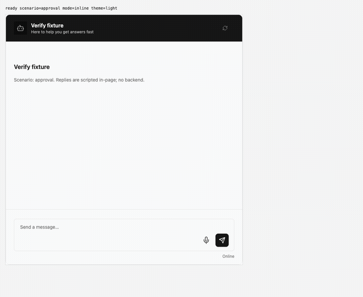
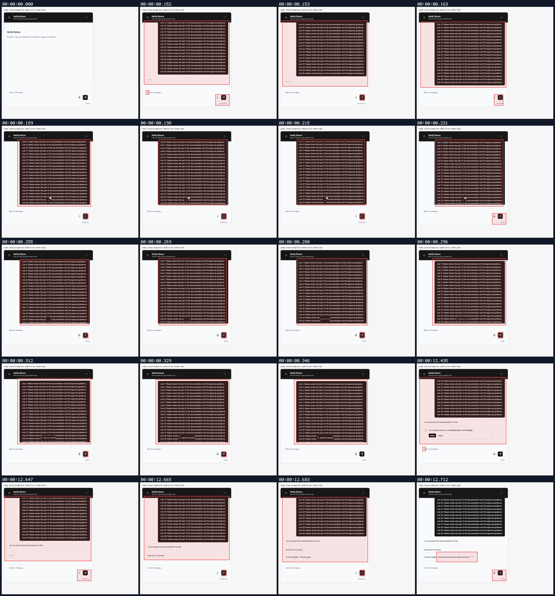
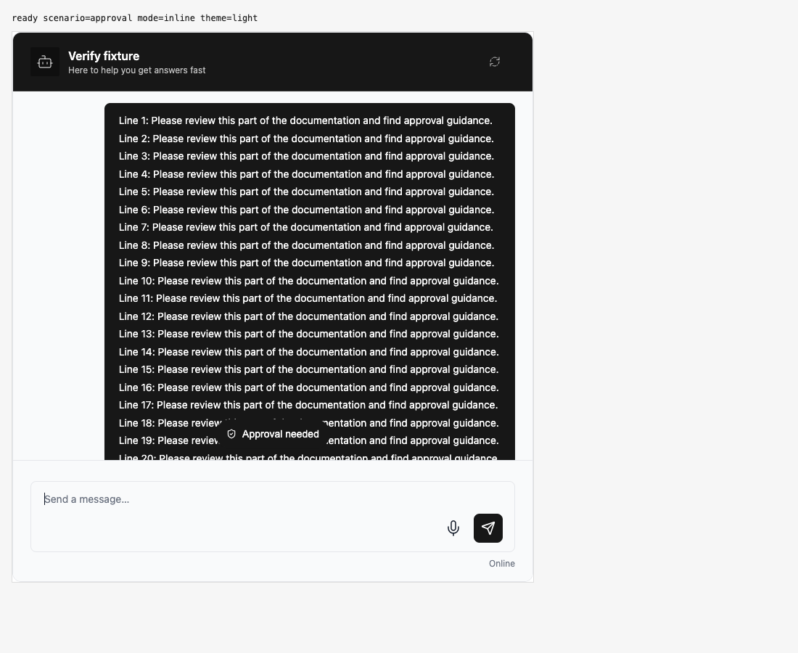
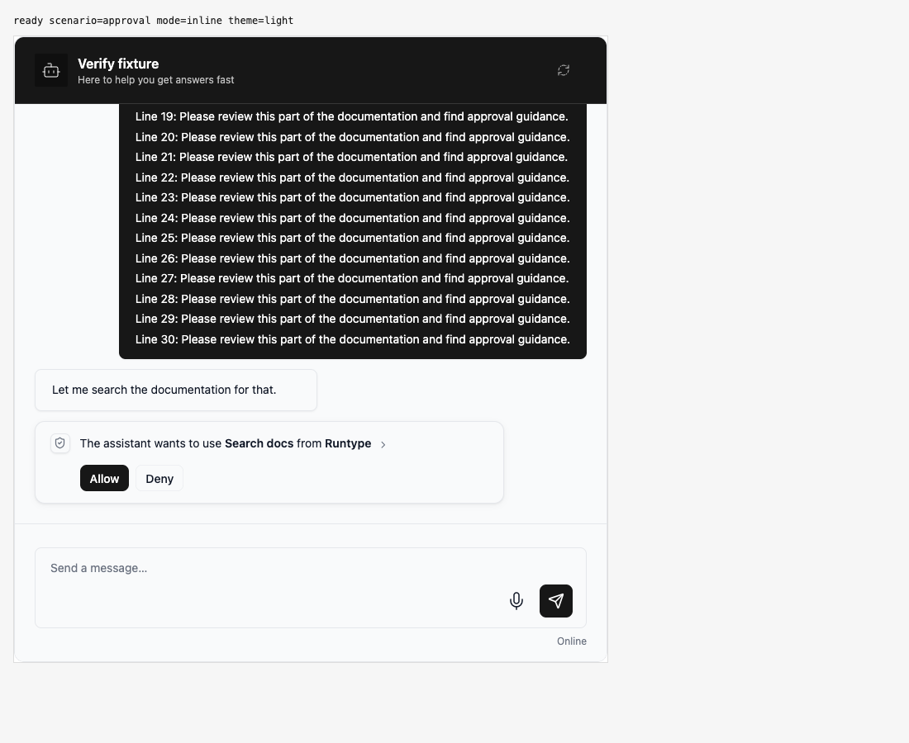
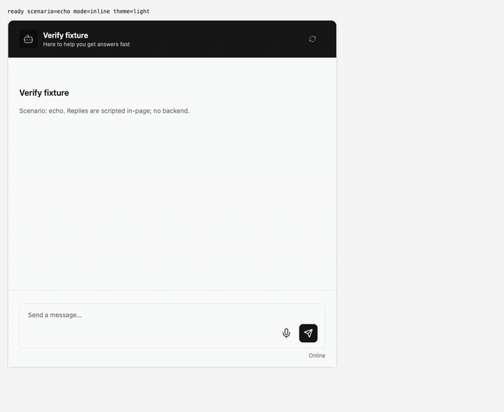
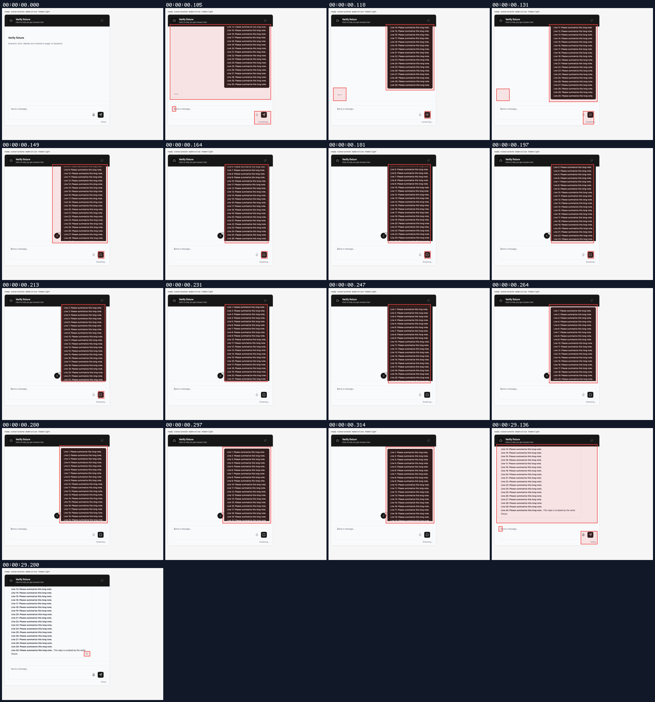
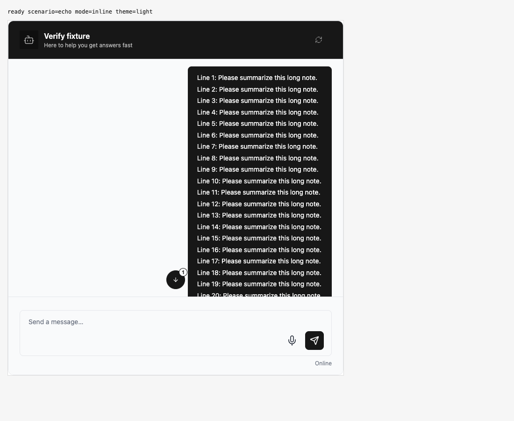
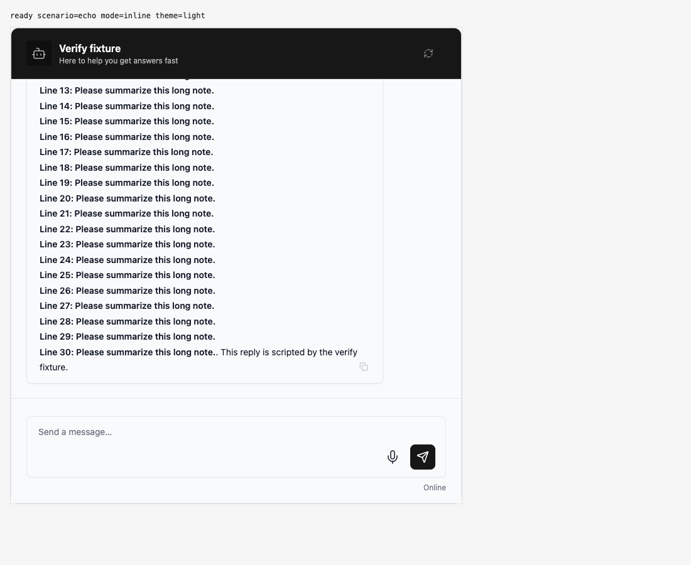

## Persona verification

branch `fix/reduce-widget-dom-bundle` · captured at `396b53dbc1 + uncommitted changes (fc36195c9170)`, `396b53dbc1 + uncommitted changes (c5de4df39fec)` · run `20261031-064842-261354` · apps/web vite dev (widget from source), keyless fixture

| Feature | Result | Note |
| --- | --- | --- |
| scroll-to-bottom | ✅ verified | Regular arrow and unread-count badge render correctly; clicking reaches the latest reply. Approval-needed glyph and label also render, and clicking reaches the approval card. Captures show one user dispatch per scenario and one approved decision. Approval fixture emitted 5 approval:resolved events (documented repeated-event behavior). |
| event-stream | ⏭️ not driven | Shared control covered by existing event-stream unit tests; browser proof covered the transcript entry point only. |

### scroll-to-bottom

**approval below long message**

[`01-scroll-to-bottom-approval-below-long-message.webm`](./01-scroll-to-bottom-approval-below-long-message.webm)

**approval jump control**

[`02-scroll-to-bottom-approval-jump-control.aria.txt`](./02-scroll-to-bottom-approval-jump-control.aria.txt)

**approval reached**

[`03-scroll-to-bottom-approval-reached.aria.txt`](./03-scroll-to-bottom-approval-reached.aria.txt)

**approval jump side effects**: 2 request(s) crossed the network boundary, 13 controller event(s)

[`04-scroll-to-bottom-approval-jump-side-effects.page.json`](./04-scroll-to-bottom-approval-jump-side-effects.page.json)

**regular jump to latest**

[`05-scroll-to-bottom-regular-jump-to-latest.webm`](./05-scroll-to-bottom-regular-jump-to-latest.webm)

**arrow and unread badge**

[`06-scroll-to-bottom-arrow-and-unread-badge.aria.txt`](./06-scroll-to-bottom-arrow-and-unread-badge.aria.txt)

**latest reply reached**

[`07-scroll-to-bottom-latest-reply-reached.aria.txt`](./07-scroll-to-bottom-latest-reply-reached.aria.txt)

**regular jump side effects**: 1 request(s) crossed the network boundary, 5 controller event(s)

[`08-scroll-to-bottom-regular-jump-side-effects.page.json`](./08-scroll-to-bottom-regular-jump-side-effects.page.json)

