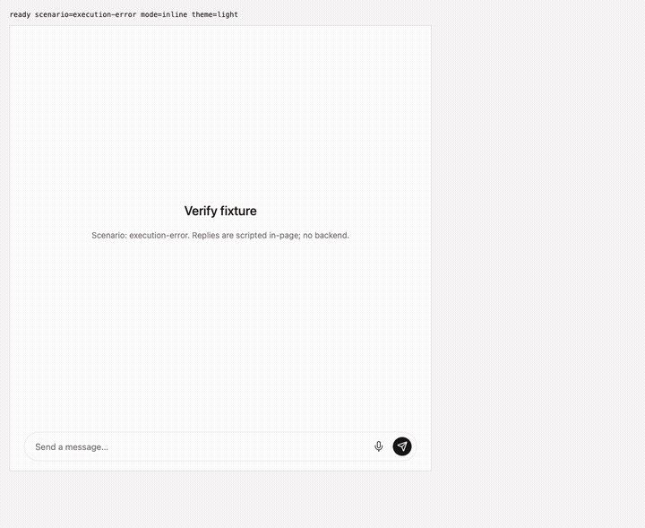
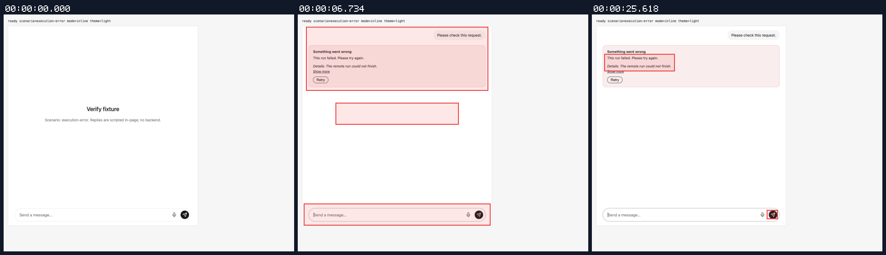
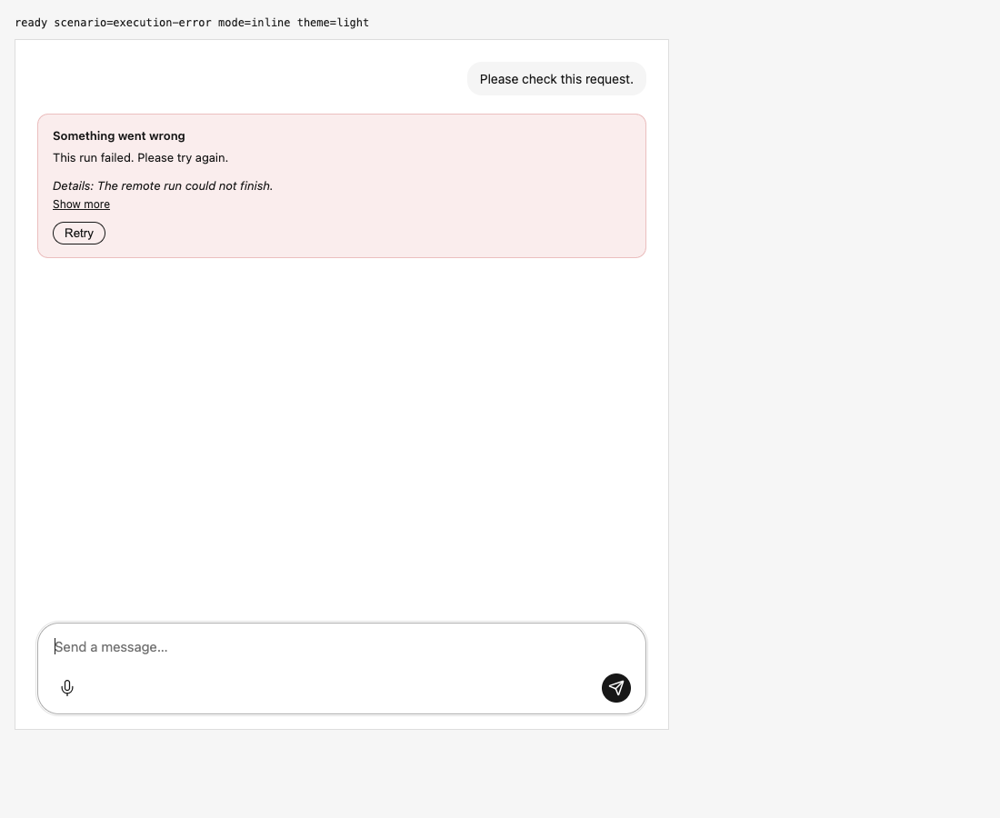

## Terminal run failure stays visible without Offline warning

branch `fix/run-failure-connection-status` · captured at `7b47ee525f` · run `20261106-053409-dfb8be` · apps/web vite dev (widget from source), keyless fixture

| Feature | Result | Note |
| --- | --- | --- |
| streaming | ✅ verified | Native execution_error: one inline failure card with remote detail and Retry; composer enabled; Online status hidden; one failed run outcome. Session tests cover custom parser, failed completion, host rendering, real stream read failure and durable reconnect. |

### streaming

**Native embedded run failure at committed candidate**

[`05-streaming-native-embedded-run-failure-at-committed-candida.webm`](./05-streaming-native-embedded-run-failure-at-committed-candida.webm)

**Native inline failure and ready composer**: Clean Persona candidate 7b47ee52. Embedded V5; native SSE execution_error. One inline failure, server detail and Retry; no Offline status; composer ready.

[`06-streaming-native-inline-failure-and-ready-composer.aria.txt`](./06-streaming-native-inline-failure-and-ready-composer.aria.txt)

**Committed native terminal failure side effects**: 1 request(s) crossed the network boundary, 4 controller event(s)

[`07-streaming-committed-native-terminal-failure-side-effects.page.json`](./07-streaming-committed-native-terminal-failure-side-effects.page.json)

