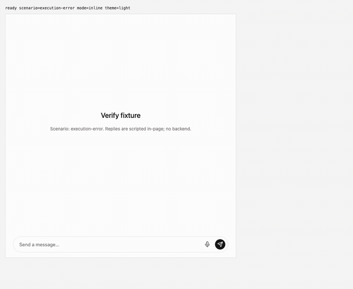
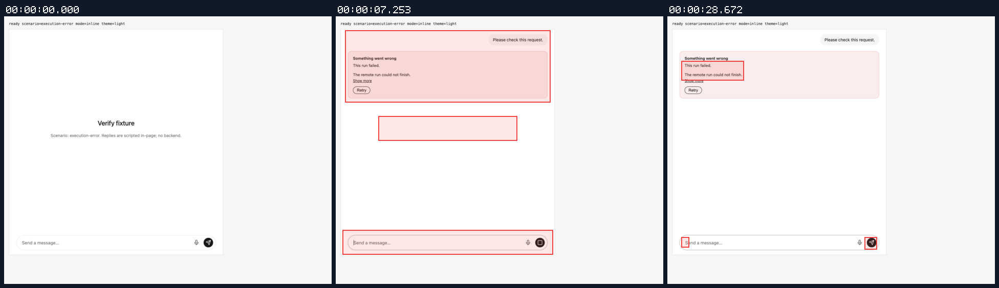
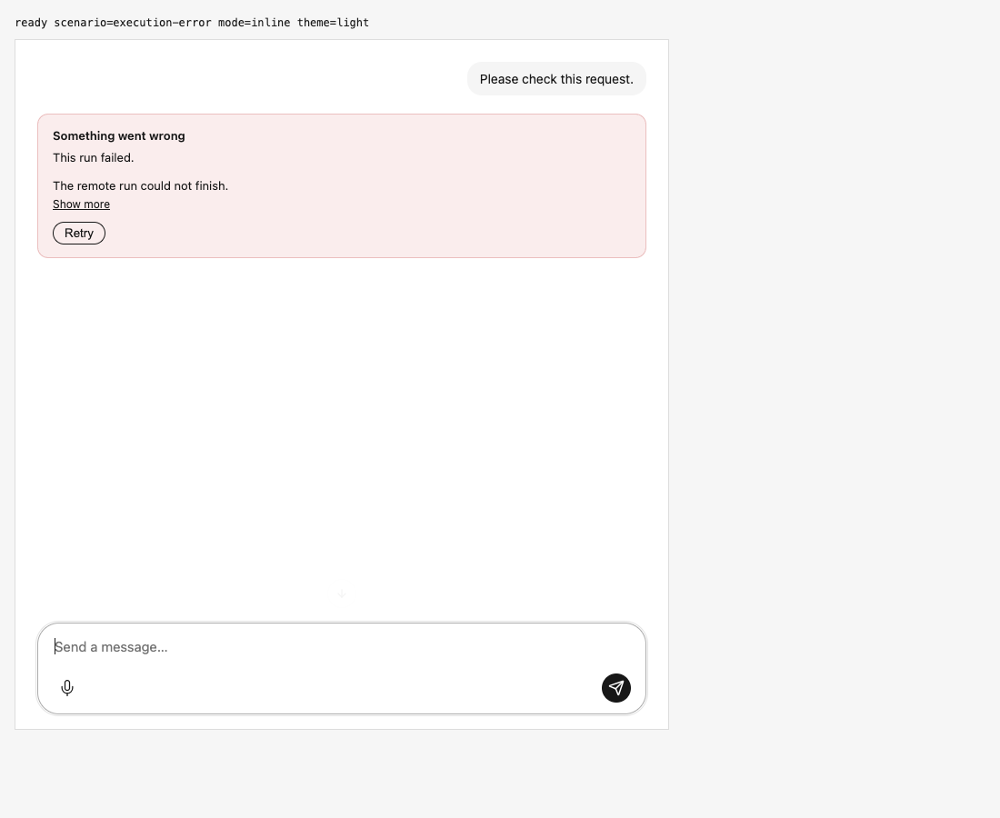

## Terminal run failure stays visible without Offline warning

branch `fix/run-failure-connection-status` · captured at `1ef6ba950a` · run `20261106-055636-1dec6b` · apps/web vite dev (widget from source), keyless fixture

| Feature | Result | Note |
| --- | --- | --- |
| streaming | ✅ verified | Native execution_error renders one inline failure with server detail and Retry; composer enabled, Online status hidden, run finished as error. Session tests cover custom parsers, completion failures, host display, empty detail, network read errors and durable reconnect. |

### streaming

**Native terminal failure on final candidate**

[`01-streaming-native-terminal-failure-on-final-candidate.webm`](./01-streaming-native-terminal-failure-on-final-candidate.webm)

**Final inline failure and ready composer**: Clean Persona commit 1ef6ba95. Native execution_error shows one inline card, remote detail and Retry; composer enabled; no Offline warning.

[`02-streaming-final-inline-failure-and-ready-composer.aria.txt`](./02-streaming-final-inline-failure-and-ready-composer.aria.txt)

**Final terminal failure side effects**: 1 request(s) crossed the network boundary, 4 controller event(s)

[`03-streaming-final-terminal-failure-side-effects.page.json`](./03-streaming-final-terminal-failure-side-effects.page.json)

