## Visual evidence

branch `fix/run-failure-connection-status` · captured at `5a59497881`, `4401a861e2 + uncommitted changes (00d6d9cff644)` · run `20261106-114255-6c63c4` · apps/web vite dev (widget from source), keyless fixture

| Feature | Result | Note |
| --- | --- | --- |
| streaming | ✅ verified | Desktop v5 recovery, 390px compact recovery, delayed initial request, automatic reconnect and terminal execution failure driven through the real composer. One dispatch per journey; reconnect preserves execution/cursor; completion fires once after recovery. Matched merge-base screenshots use the same fixture overlay. |
| other-entry-points | ⏭️ not driven | Dark theme, voice, approval/tool UI and custom host labels were not manually driven in this capture; reconnect lifecycle and configuration variants are covered by automated regression tests. |

### streaming

**after exhausted recovery**

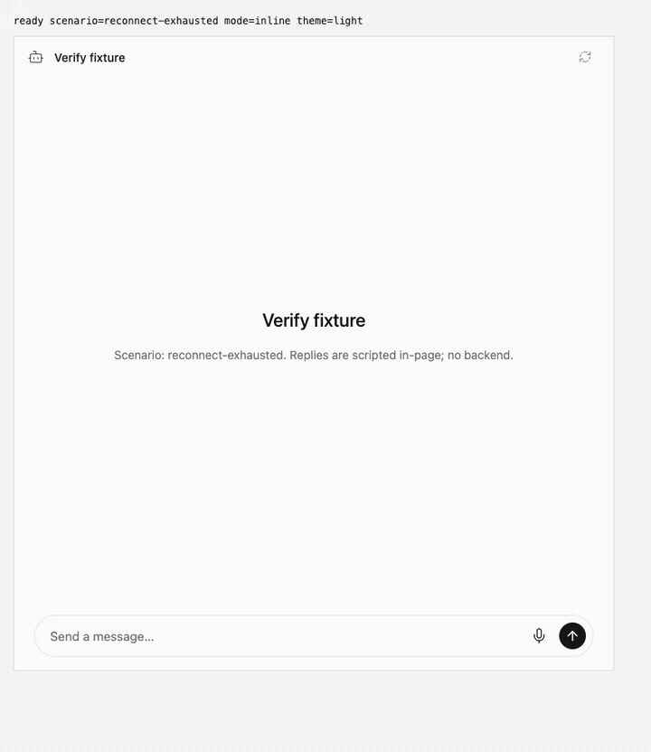

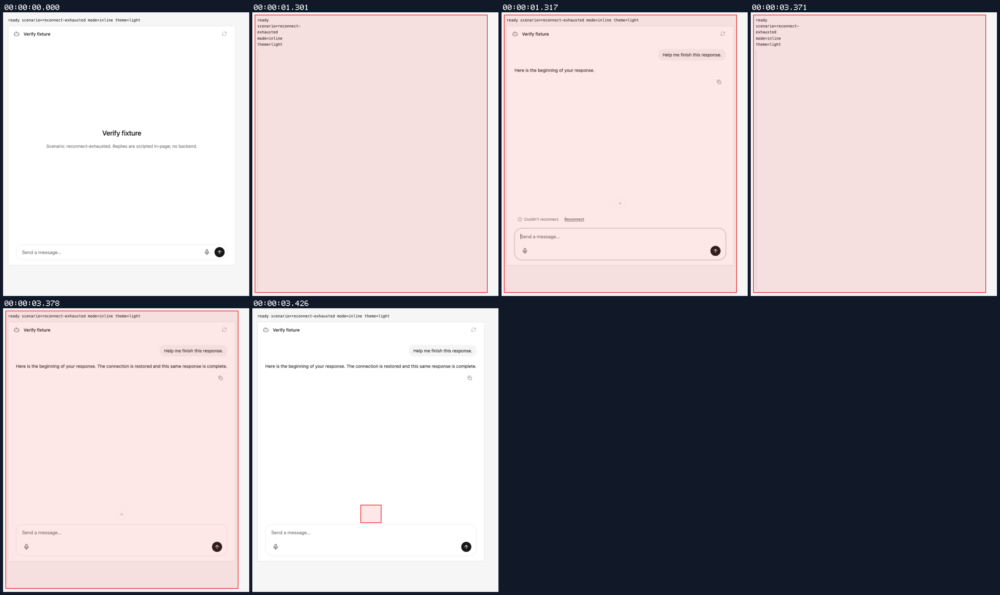

[`01-streaming-after-exhausted-recovery.webm`](./01-streaming-after-exhausted-recovery.webm)

**after recovery needed**

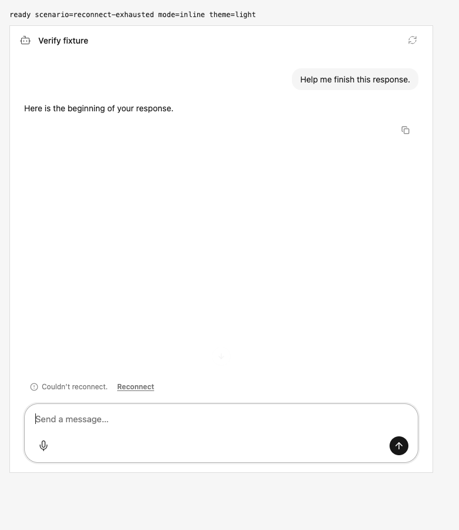

[`02-streaming-after-recovery-needed.aria.txt`](./02-streaming-after-recovery-needed.aria.txt)

**after recovered response**

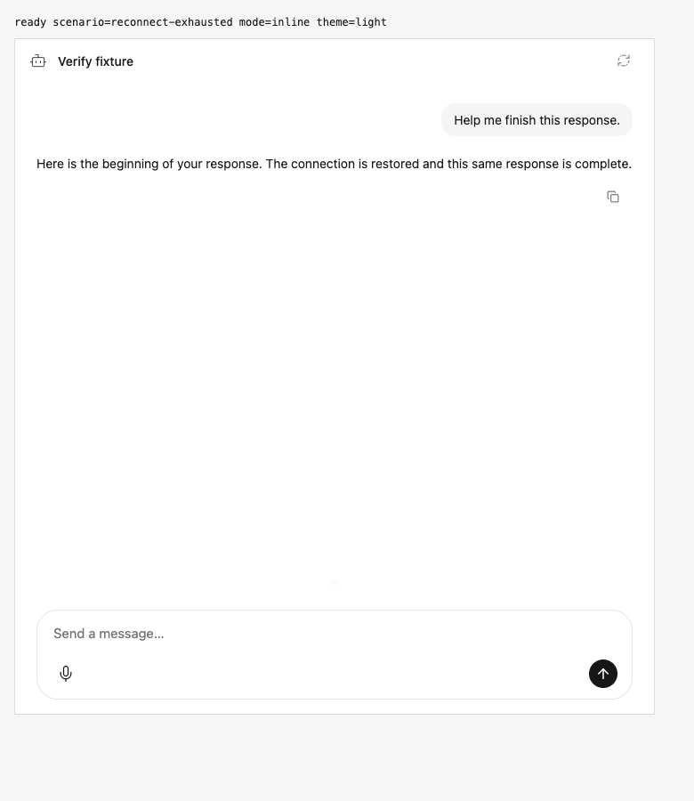

[`03-streaming-after-recovered-response.aria.txt`](./03-streaming-after-recovered-response.aria.txt)

**after recovery requests**: 4 request(s) crossed the network boundary, 11 controller event(s)

[`04-streaming-after-recovery-requests.page.json`](./04-streaming-after-recovery-requests.page.json)

**after initial request**

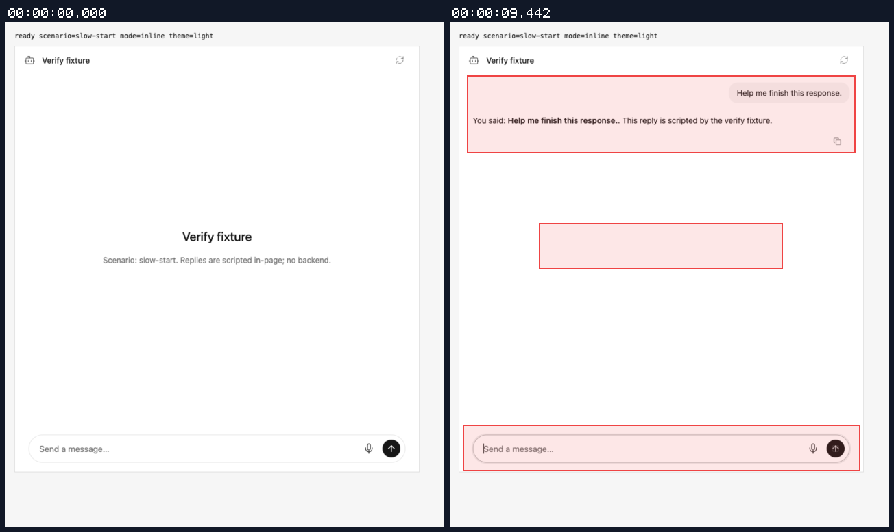

[`05-streaming-after-initial-request.webm`](./05-streaming-after-initial-request.webm)

**after working indicator**

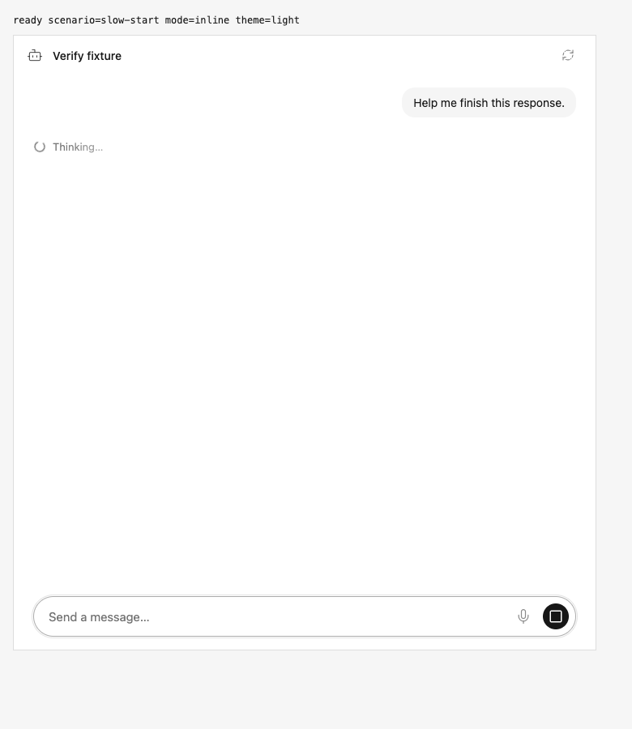

[`06-streaming-after-working-indicator.aria.txt`](./06-streaming-after-working-indicator.aria.txt)

**after initial request**: 1 request(s) crossed the network boundary, 5 controller event(s)

[`07-streaming-after-initial-request.page.json`](./07-streaming-after-initial-request.page.json)

**after compact recovery**

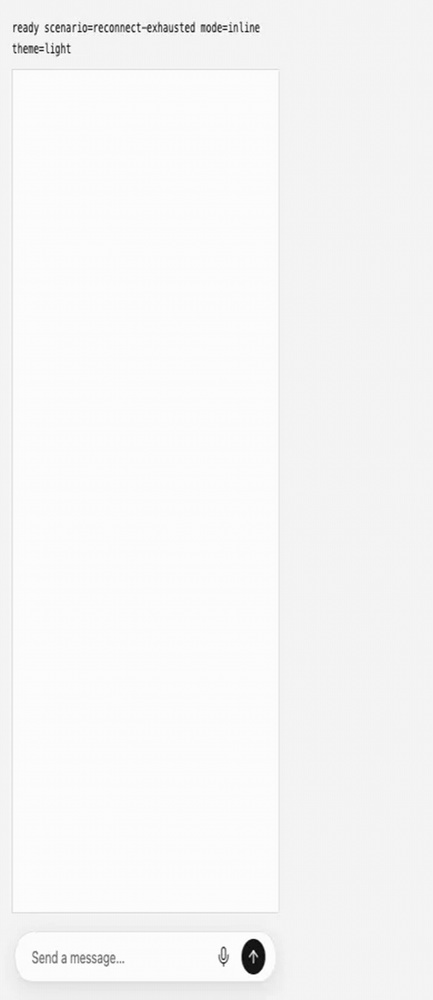

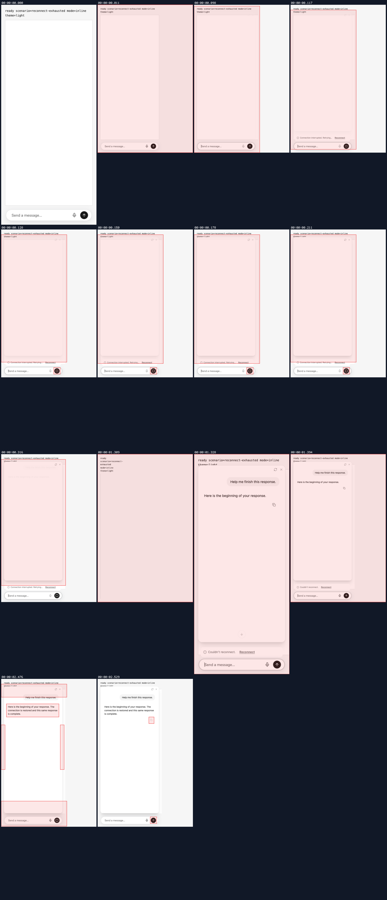

[`08-streaming-after-compact-recovery.webm`](./08-streaming-after-compact-recovery.webm)

**after compact recovery needed**

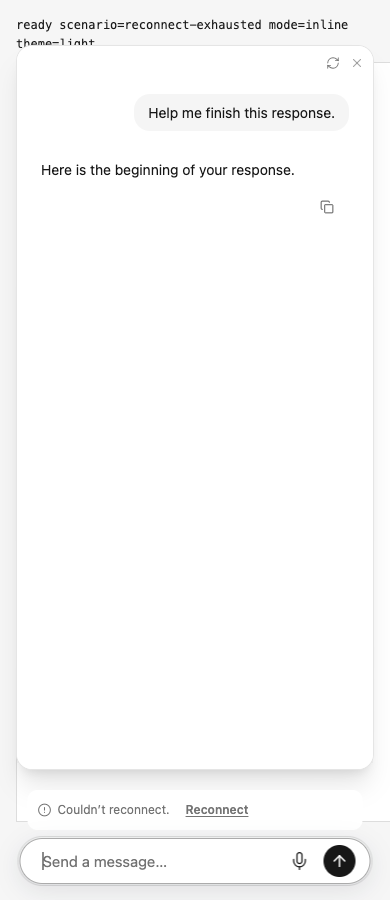

[`09-streaming-after-compact-recovery-needed.aria.txt`](./09-streaming-after-compact-recovery-needed.aria.txt)

**after compact recovery requests**: 4 request(s) crossed the network boundary, 12 controller event(s)

[`10-streaming-after-compact-recovery-requests.page.json`](./10-streaming-after-compact-recovery-requests.page.json)

**after automatic reconnect**

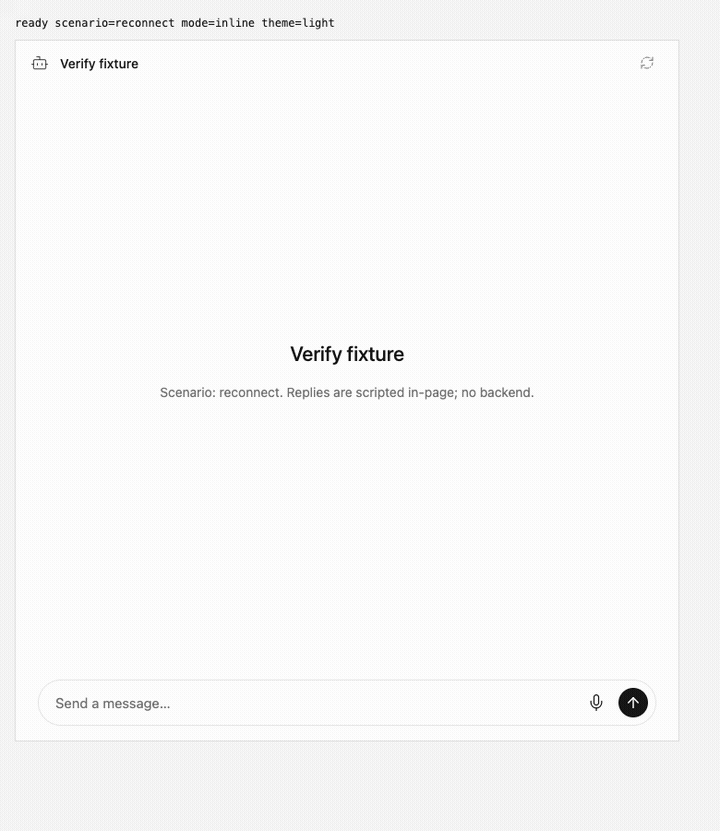

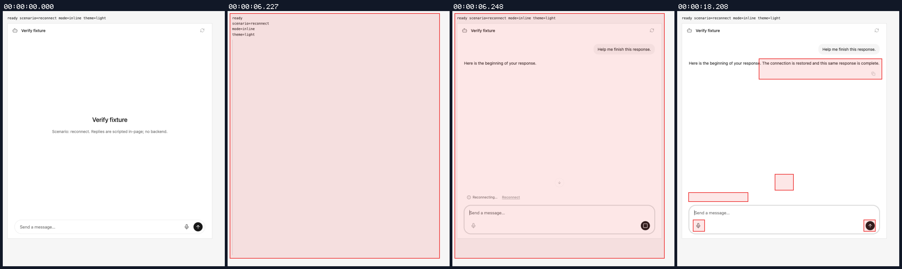

[`11-streaming-after-automatic-reconnect.webm`](./11-streaming-after-automatic-reconnect.webm)

**after waiting to reconnect**

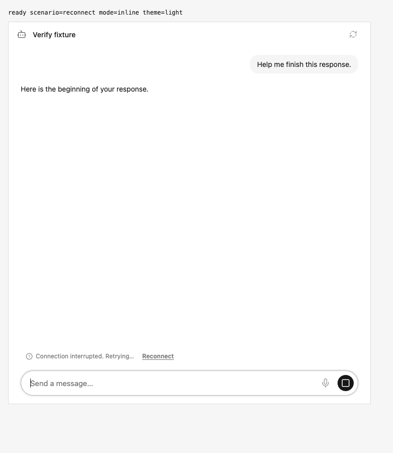

[`12-streaming-after-waiting-to-reconnect.aria.txt`](./12-streaming-after-waiting-to-reconnect.aria.txt)

**after reconnect request in flight**

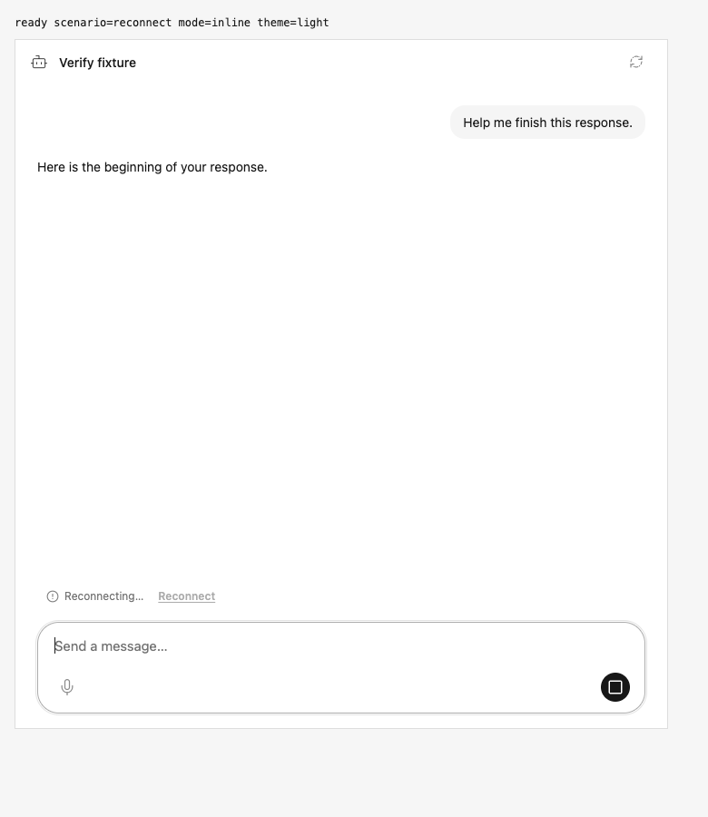

[`13-streaming-after-reconnect-request-in-flight.aria.txt`](./13-streaming-after-reconnect-request-in-flight.aria.txt)

**after automatic reconnect requests**: 3 request(s) crossed the network boundary, 9 controller event(s)

[`14-streaming-after-automatic-reconnect-requests.page.json`](./14-streaming-after-automatic-reconnect-requests.page.json)

**after execution failure**

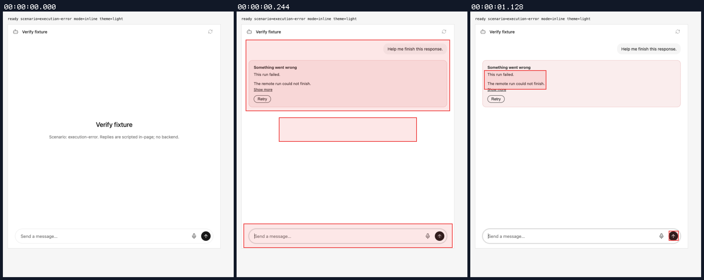

[`15-streaming-after-execution-failure.webm`](./15-streaming-after-execution-failure.webm)

**after execution failure**

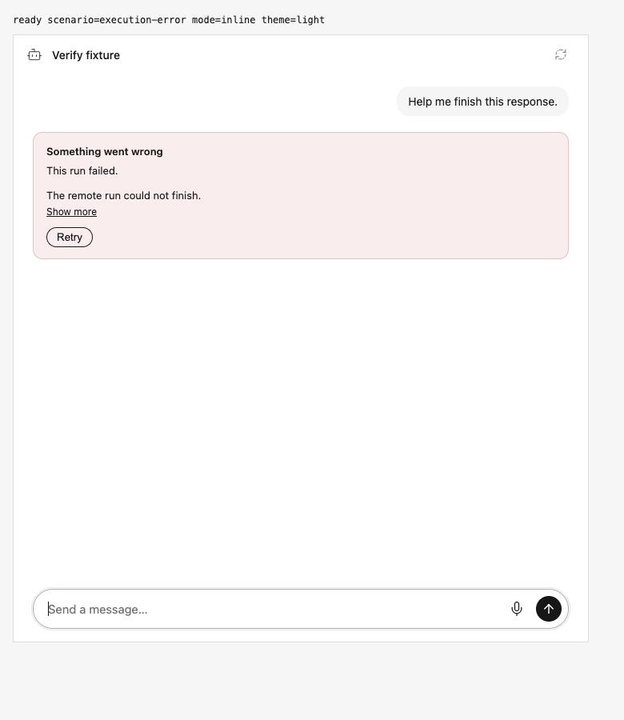

[`16-streaming-after-execution-failure.aria.txt`](./16-streaming-after-execution-failure.aria.txt)

**after execution failure events**: 1 request(s) crossed the network boundary, 4 controller event(s)

[`17-streaming-after-execution-failure-events.page.json`](./17-streaming-after-execution-failure-events.page.json)

### baseline comparison

**before recovery needed**: Merge-base widget source with the same deterministic fixture overlay; light theme, matched configuration and viewport.

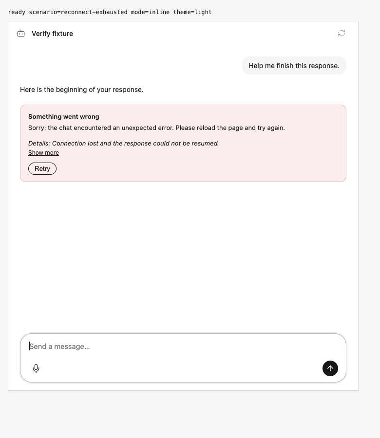

[`11-streaming-before-recovery-needed.aria.txt`](./11-streaming-before-recovery-needed.aria.txt)

**before working indicator**: Merge-base widget source with the same deterministic fixture overlay; light theme, matched configuration and viewport.

[`14-streaming-before-working-indicator.aria.txt`](./14-streaming-before-working-indicator.aria.txt)

**before compact recovery needed**: Merge-base widget source with the same deterministic fixture overlay; light theme, matched configuration and viewport.

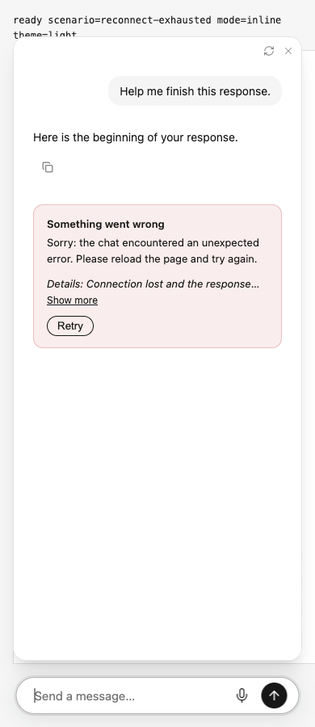

[`17-streaming-before-compact-recovery-needed.aria.txt`](./17-streaming-before-compact-recovery-needed.aria.txt)

**before waiting to reconnect**: Merge-base widget source with the same deterministic fixture overlay; light theme, matched configuration and viewport.

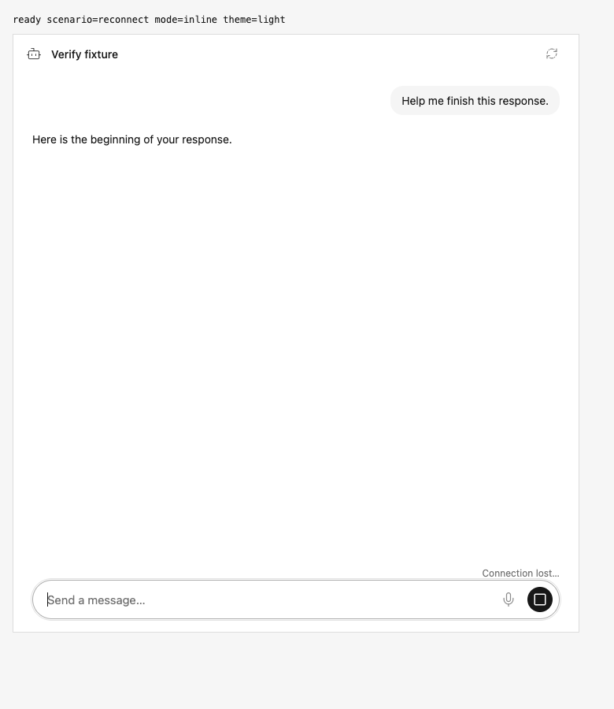

[`20-streaming-before-waiting-to-reconnect.aria.txt`](./20-streaming-before-waiting-to-reconnect.aria.txt)

**before reconnect request in flight**: Merge-base widget source with the same deterministic fixture overlay; light theme, matched configuration and viewport.

[`21-streaming-before-reconnect-request-in-flight.aria.txt`](./21-streaming-before-reconnect-request-in-flight.aria.txt)

