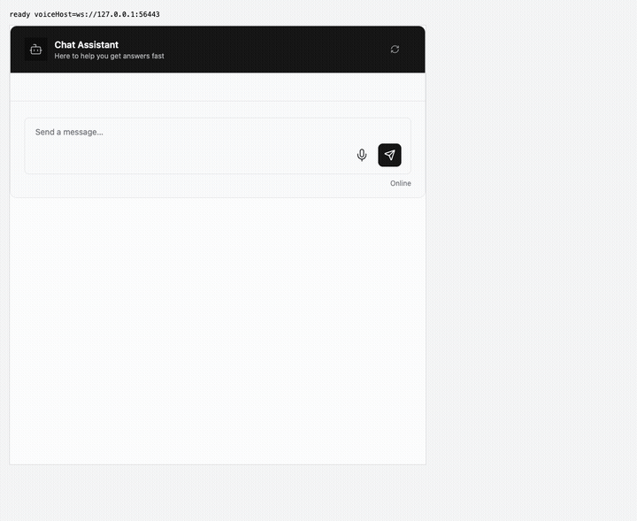
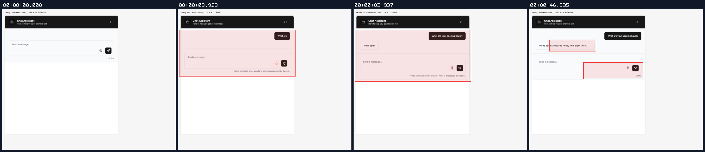
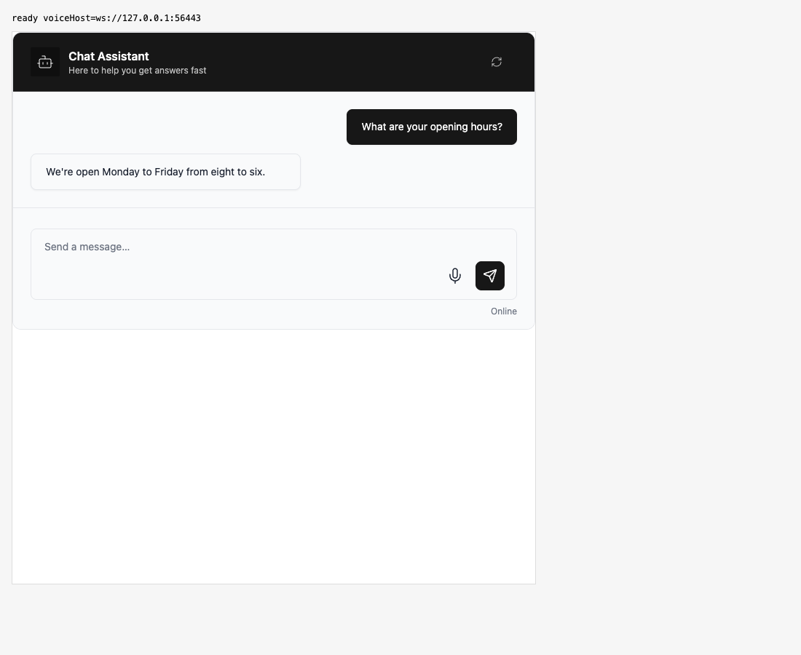
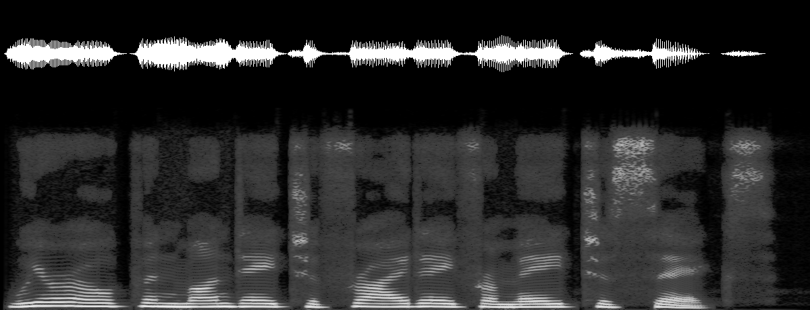
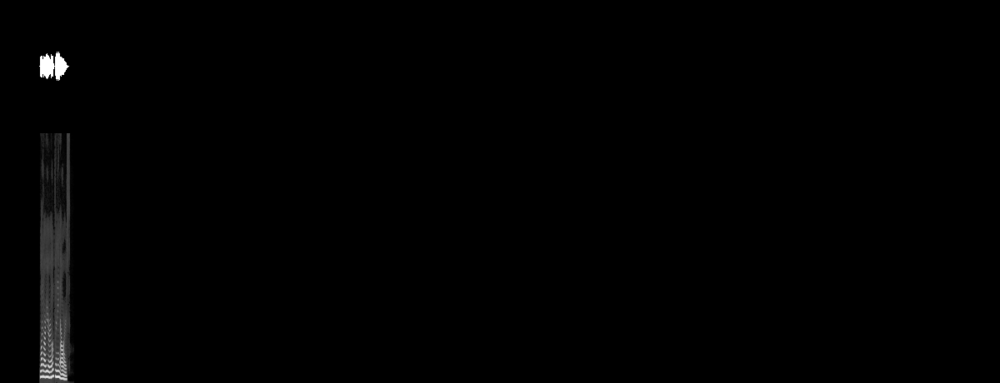

## Persona verification

branch `codex/voice-jitter-buffer` · captured at `44ca181cd9` · run `20261106-164406-0ad8f6` · apps/web vite dev (widget from source), keyless fixture

| Feature | Result | Note |
| --- | --- | --- |
| voice-runtype | ✅ verified | Synthetic mic-to-socket-to-speaker call: 2640 ms audible output for a 2661 ms reply, peak -2.6 dB, 180 mic frames, clean hang-up. Four deterministic waveform regressions also passed, including late frames, refill, interruption and a short tail; live GPT-Live not contacted. |

### voice-runtype

**buffered-call**

[`01-voice-runtype-buffered-call.webm`](./01-voice-runtype-buffered-call.webm)

**after buffered call**

[`02-voice-runtype-after-buffered-call.aria.txt`](./02-voice-runtype-after-buffered-call.aria.txt)

**150ms buffer audio round trip**: `output.png` is the audio the widget played, tapped in-page (waveform over spectrogram): 2640 ms (mean -15.7 dB, peak -2.6 dB); `server-heard.png` is the mic PCM the voice socket received: 46080 ms in 180 frames; micOnToSocketOpen 1 ms, socketOpenToFirstMicFrame 258 ms, micOnToFirstAudioReceived 3750 ms

[`03-voice-runtype-150ms-buffer-audio-round-trip.output.wav`](./03-voice-runtype-150ms-buffer-audio-round-trip.output.wav) · [`03-voice-runtype-150ms-buffer-audio-round-trip.server-heard.wav`](./03-voice-runtype-150ms-buffer-audio-round-trip.server-heard.wav) · [`03-voice-runtype-150ms-buffer-audio-round-trip.voice.json`](./03-voice-runtype-150ms-buffer-audio-round-trip.voice.json)

