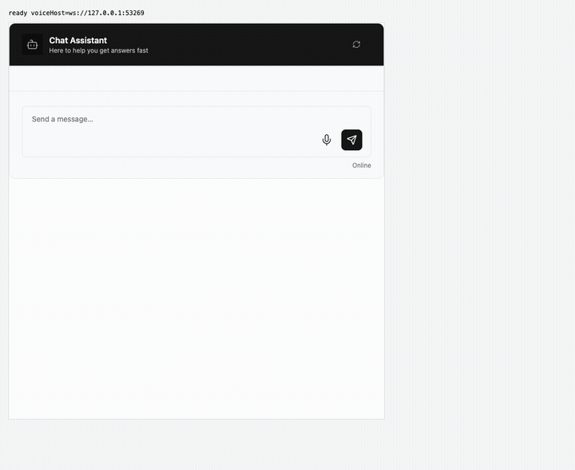
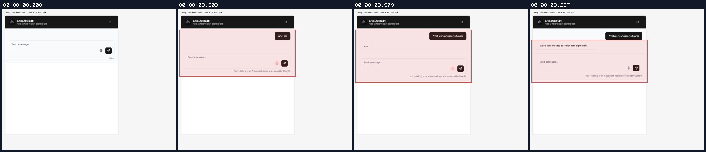
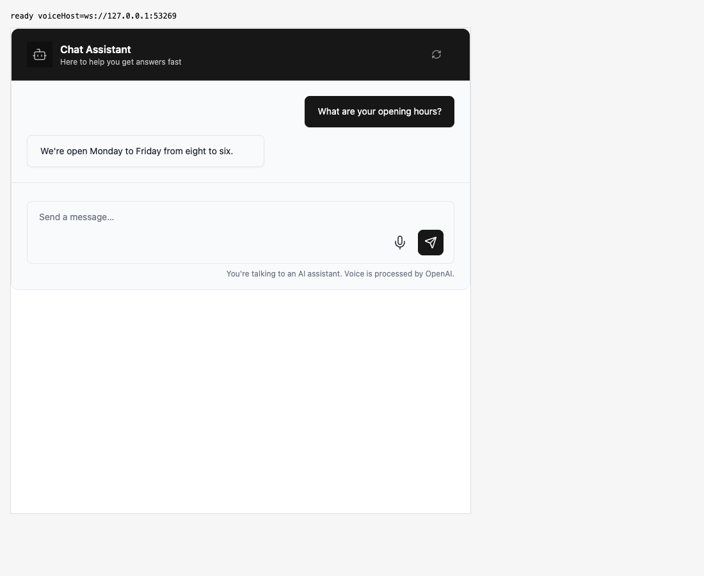
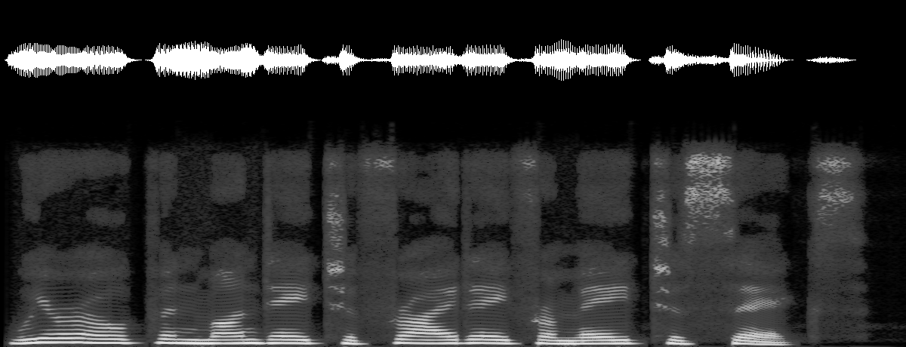
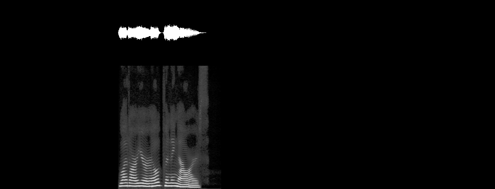

## Persona verification

branch `codex/voice-playback-metrics` · captured at `3b750253e8` · run `20261106-174145-437d77` · apps/web vite dev (widget from source), keyless fixture

| Feature | Result | Note |
| --- | --- | --- |
| voice-runtype | ✅ verified | No intended visual change. Synthetic mic/socket/playback round trip at PR head: 2640 ms output, peak -2.6 dB; 14 snapshots, zero underruns/refills, drained queue 0 ms. Native-audio E2E covers forced gaps/refill/cancellation. Doctor's process-group warning was checked against the owned Vite child PID/cwd. |

### voice-runtype

**playback measurements**

[`01-voice-runtype-playback-measurements.webm`](./01-voice-runtype-playback-measurements.webm)

**after measured call**

[`02-voice-runtype-after-measured-call.aria.txt`](./02-voice-runtype-after-measured-call.aria.txt)

**measured audio round trip**: `output.png` is the audio the widget played, tapped in-page (waveform over spectrogram): 2640 ms (mean -15.7 dB, peak -2.6 dB); `server-heard.png` is the mic PCM the voice socket received: 7680 ms in 30 frames; micOnToSocketOpen 3 ms, socketOpenToFirstMicFrame 268 ms, micOnToFirstAudioReceived 3758 ms

[`03-voice-runtype-measured-audio-round-trip.output.wav`](./03-voice-runtype-measured-audio-round-trip.output.wav) · [`03-voice-runtype-measured-audio-round-trip.server-heard.wav`](./03-voice-runtype-measured-audio-round-trip.server-heard.wav) · [`03-voice-runtype-measured-audio-round-trip.voice.json`](./03-voice-runtype-measured-audio-round-trip.voice.json)

