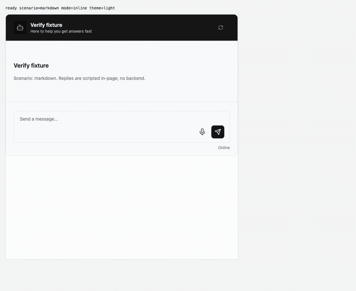
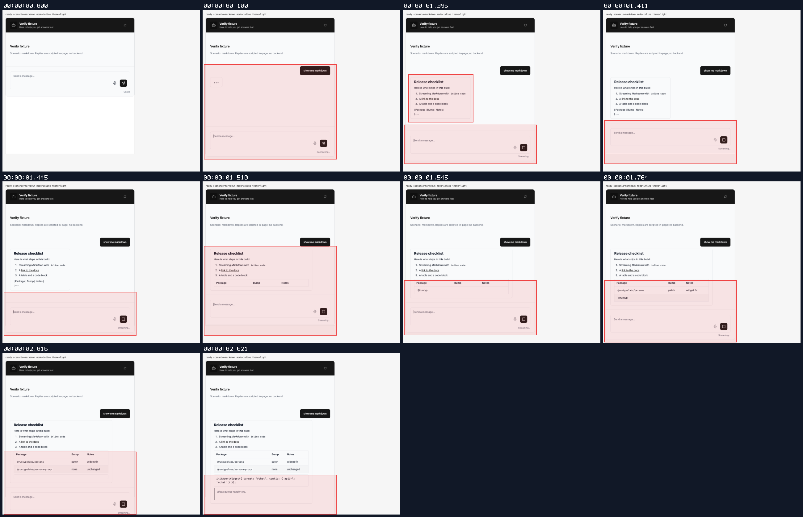
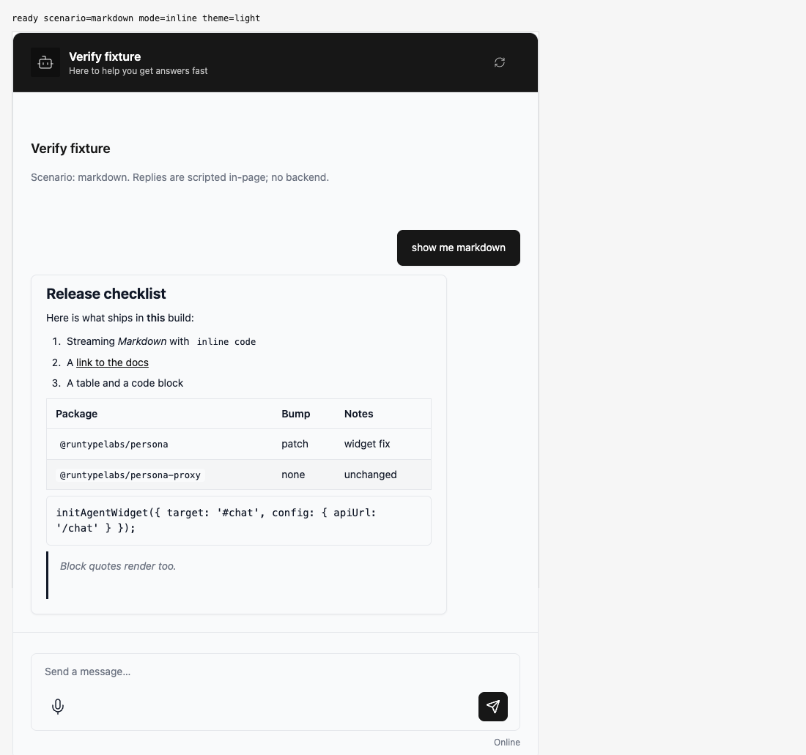
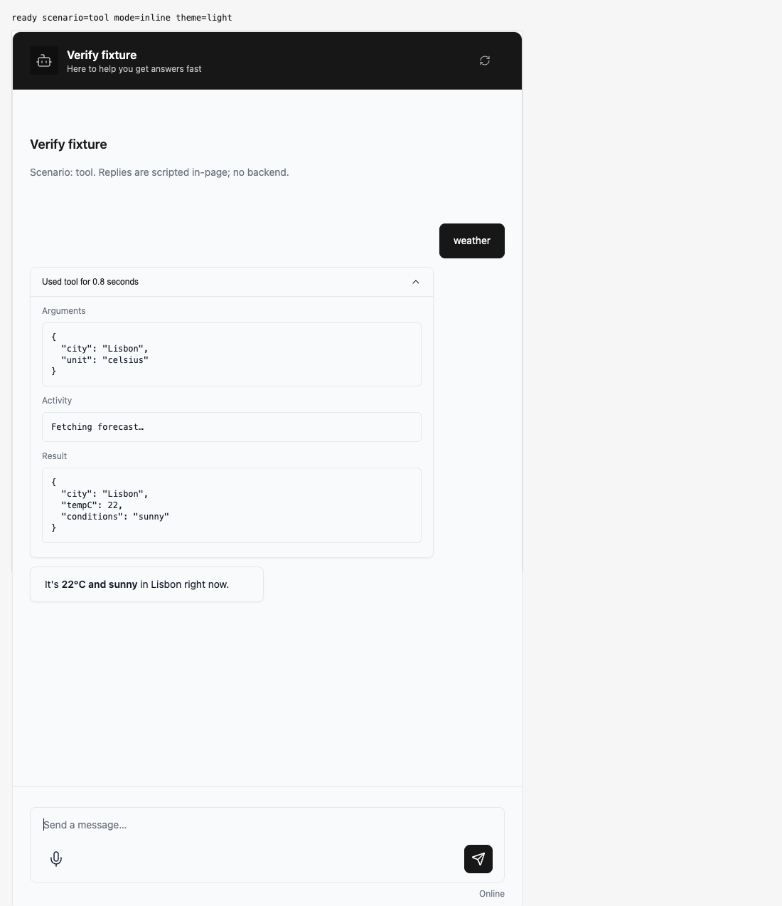
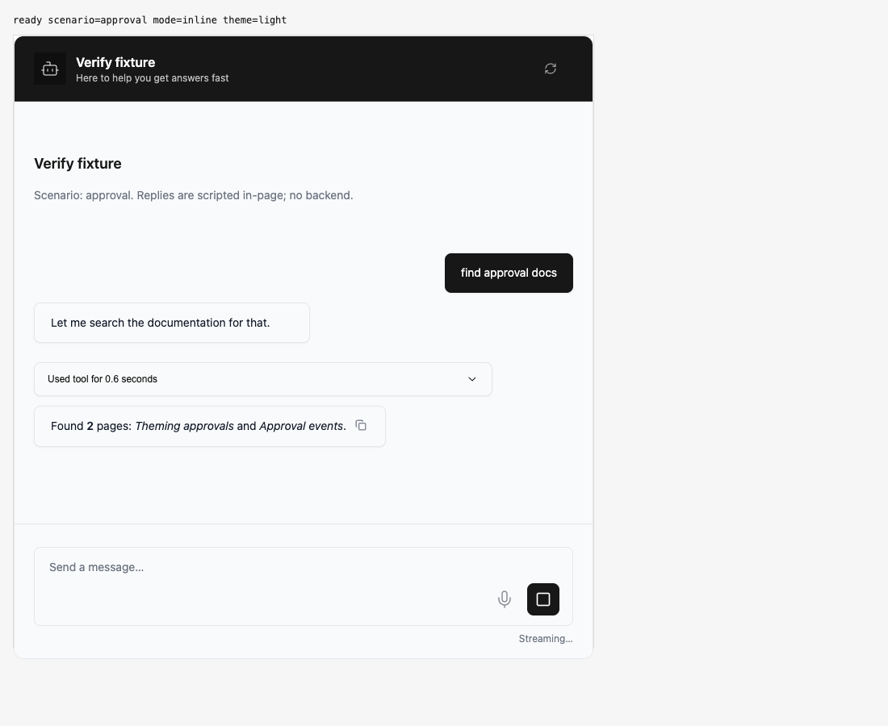

## Persona verification

branch `chore/dep-bumps-2026-11` · captured at `3e7338ec2d + uncommitted changes (4a56c92f60f2)` · run `20261107-202043-5703f6` · apps/web vite dev (widget from source), keyless fixture

| Feature | Result | Note |
| --- | --- | --- |
| markdown | ✅ verified | Streamed headings, ordered list, table, code block and quote render on marked 18; no idiomorph duplicate-id warnings or errors. Task lists covered by unit tests, not this fixture |
| tool-calls | ✅ verified | Tool turn streams and expands; no console errors |
| approvals | ✅ verified | Allow resumes the turn; no console errors |
| dictation-inline-swap | ⏭️ not driven | Mid-capture swap needs a host update() call; covered by ui.dictation-surface tests with jsdom 31, not driven in a browser |

### markdown

**streamed markdown turn**

[`01-markdown-streamed-markdown-turn.webm`](./01-markdown-streamed-markdown-turn.webm)

**rendered**

[`02-markdown-rendered.aria.txt`](./02-markdown-rendered.aria.txt)

**markdown turn**: 1 request(s) crossed the network boundary, 5 controller event(s)

[`03-markdown-markdown-turn.page.json`](./03-markdown-markdown-turn.page.json)

### tool-calls

**details expanded**

[`04-tool-calls-details-expanded.aria.txt`](./04-tool-calls-details-expanded.aria.txt)

**tool flow**: 1 request(s) crossed the network boundary, 6 controller event(s)

[`05-tool-calls-tool-flow.page.json`](./05-tool-calls-tool-flow.page.json)

### approvals

**allowed**

[`06-approvals-allowed.aria.txt`](./06-approvals-allowed.aria.txt)

**allow flow**: 2 request(s) crossed the network boundary, 15 controller event(s)

[`07-approvals-allow-flow.page.json`](./07-approvals-allow-flow.page.json)

