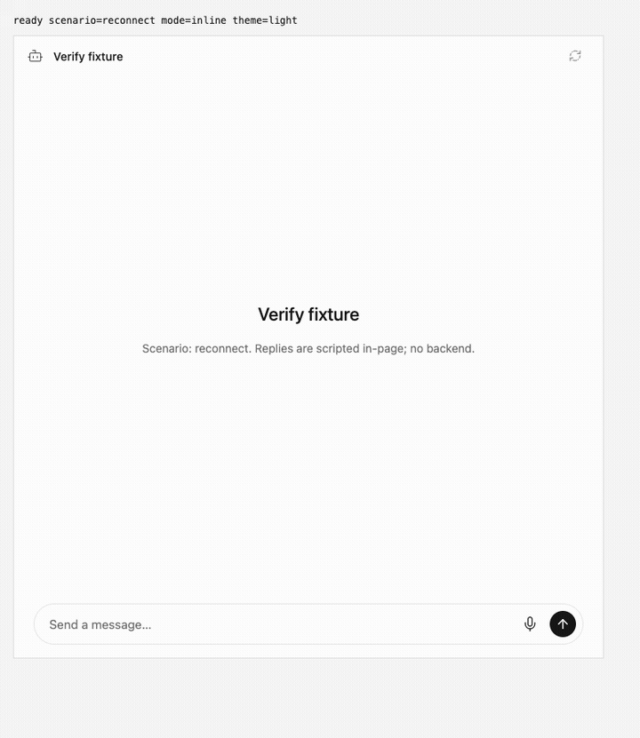
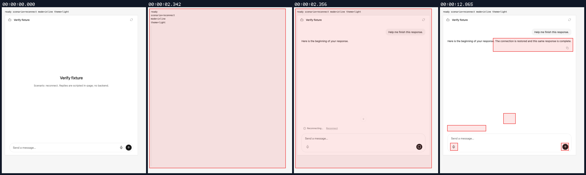
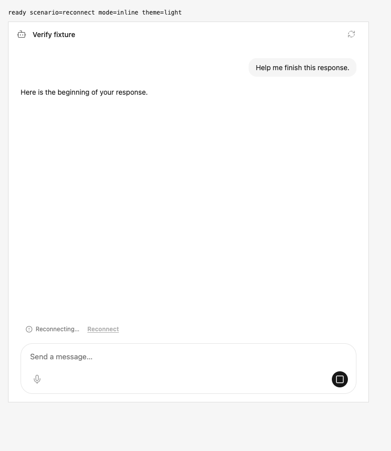
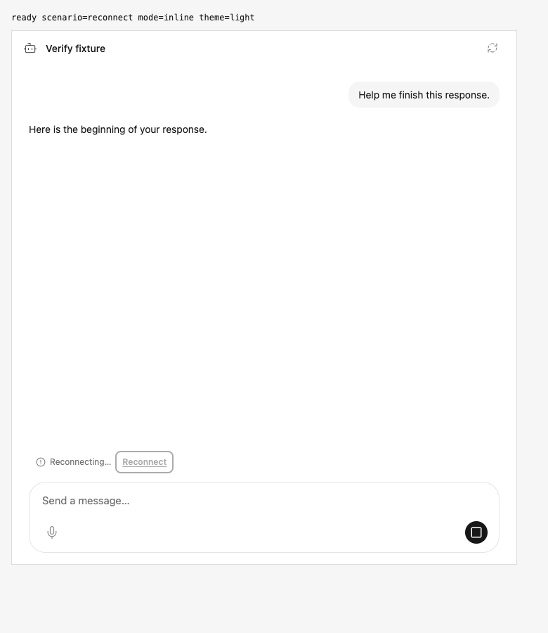
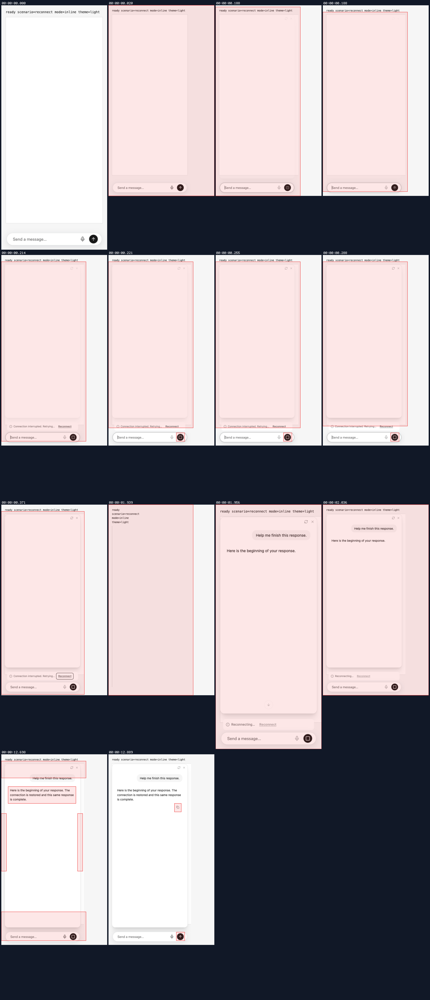
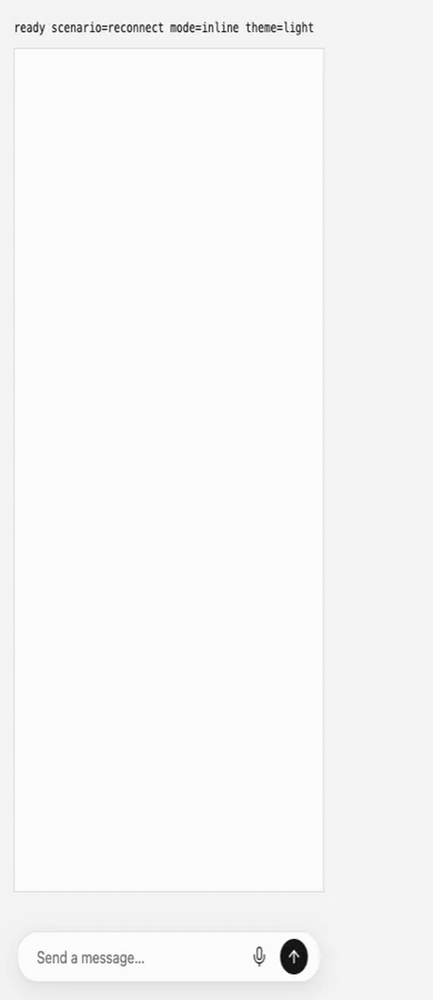
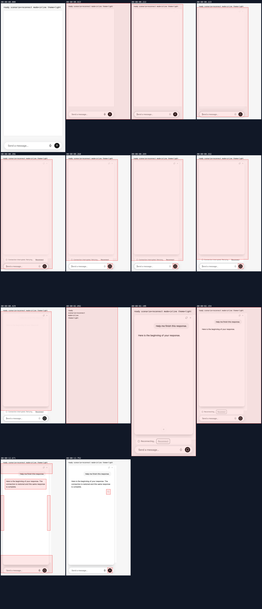
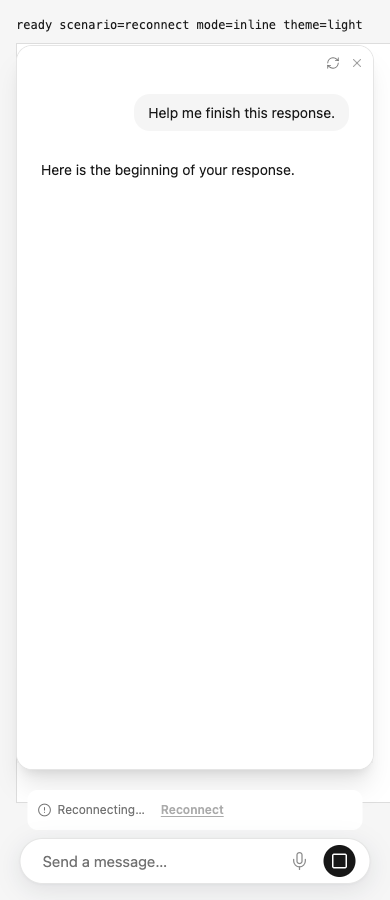
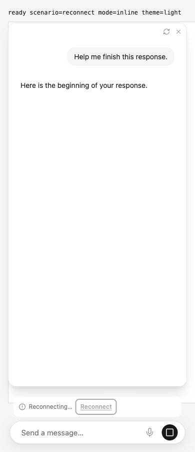

## Visual evidence

branch `fix/main-recovery-regressions` · captured at `9fb3b62d26`, `9bd4724b93` · run `20261108-091043-e61b61` · apps/web vite dev (widget from source), keyless fixture

| Feature | Result | Note |
| --- | --- | --- |
| streaming | ✅ verified | Normal780x900 and compact390x900: before loses keyboard focus; after retains focus and blocks repeated Enter/Space. Same theme/config and settled animation. Each trace has one dispatch, two resumes with the same execution/cursor, and one successful completion. |
| other-streaming-entry-points | ⏭️ not driven | Browser proof covers same-response reconnect; other paths remain automated-suite coverage. |

### streaming

**before keyboard reconnect**

[`01-streaming-before-keyboard-reconnect.webm`](./01-streaming-before-keyboard-reconnect.webm)

**after keyboard reconnect**

[`01-streaming-after-keyboard-reconnect.webm`](./01-streaming-after-keyboard-reconnect.webm)

**before keyboard focus during reconnect**

[`02-streaming-before-keyboard-focus-during-reconnect.aria.txt`](./02-streaming-before-keyboard-focus-during-reconnect.aria.txt)

**after keyboard focus during reconnect**

[`02-streaming-after-keyboard-focus-during-reconnect.aria.txt`](./02-streaming-after-keyboard-focus-during-reconnect.aria.txt)

**before keyboard reconnect requests**: 3 request(s) crossed the network boundary, 9 controller event(s)

[`03-streaming-before-keyboard-reconnect-requests.page.json`](./03-streaming-before-keyboard-reconnect-requests.page.json)

**after keyboard reconnect requests**: 3 request(s) crossed the network boundary, 9 controller event(s)

[`03-streaming-after-keyboard-reconnect-requests.page.json`](./03-streaming-after-keyboard-reconnect-requests.page.json)

**before compact keyboard reconnect**

[`04-streaming-before-compact-keyboard-reconnect.webm`](./04-streaming-before-compact-keyboard-reconnect.webm)

**after compact keyboard reconnect**

[`04-streaming-after-compact-keyboard-reconnect.webm`](./04-streaming-after-compact-keyboard-reconnect.webm)

**before compact keyboard focus during reconnect**

[`05-streaming-before-compact-keyboard-focus-during-reconnect.aria.txt`](./05-streaming-before-compact-keyboard-focus-during-reconnect.aria.txt)

**after compact keyboard focus during reconnect**

[`05-streaming-after-compact-keyboard-focus-during-reconnect.aria.txt`](./05-streaming-after-compact-keyboard-focus-during-reconnect.aria.txt)

**before compact keyboard reconnect requests**: 3 request(s) crossed the network boundary, 10 controller event(s)

[`06-streaming-before-compact-keyboard-reconnect-requests.page.json`](./06-streaming-before-compact-keyboard-reconnect-requests.page.json)

**after compact keyboard reconnect requests**: 3 request(s) crossed the network boundary, 10 controller event(s)

[`06-streaming-after-compact-keyboard-reconnect-requests.page.json`](./06-streaming-after-compact-keyboard-reconnect-requests.page.json)

**before keyboard focus probes**: Read-only activeElement, accessible state and request counts during keyboard activation.

[`07-before-keyboard-focus-probes.json`](./07-before-keyboard-focus-probes.json)

**after keyboard focus probes**: Read-only activeElement, accessible state and request counts during keyboard activation.

[`07-after-keyboard-focus-probes.json`](./07-after-keyboard-focus-probes.json)

