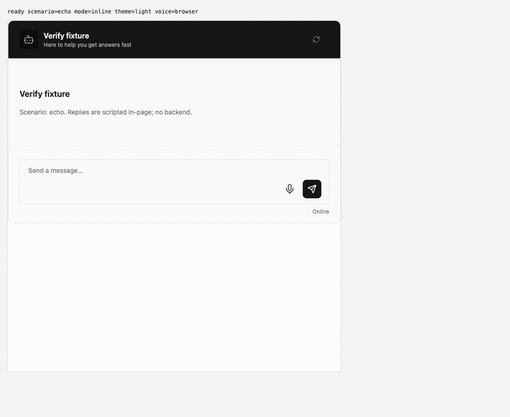
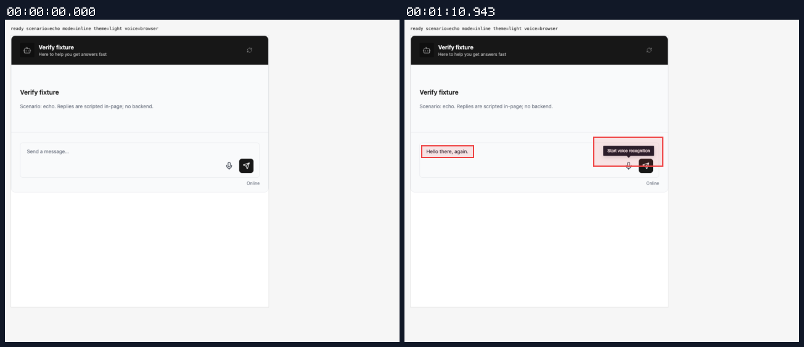
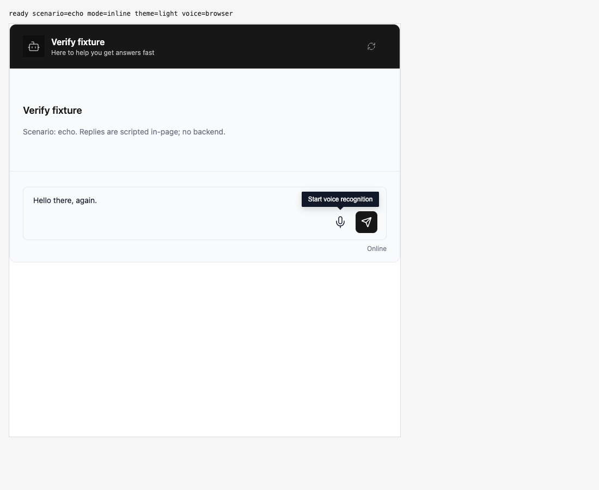

## Persona verification

branch `fix-browser-dictation-silence` · captured at `7e4d8a18ff + uncommitted changes (5c005c3d5c18)` · run `20261112-101320-d711a4` · apps/web vite dev (widget from source), keyless fixture

| Feature | Result | Note |
| --- | --- | --- |
| voice-browser | ✅ verified | Dictation mic UI remained recording during six seconds of sound without transcript changes; missing resumed speechend completed after4059ms silence, preserving late correction in editable review with zero requests. Scripted recognition and synthesized mic; real MediaStream/AudioContext/analyser. Read-aloud and legacy voice entry not exercised. |

### voice-browser

**resumed speech missing end**

[`01-voice-browser-resumed-speech-missing-end.webm`](./01-voice-browser-resumed-speech-missing-end.webm)

**automatic review after missing speechend**: Real analyser over synthesized mic stream; omitted resumed speechend; no sends

[`02-voice-browser-automatic-review-after-missing-speechend.aria.txt`](./02-voice-browser-automatic-review-after-missing-speechend.aria.txt)

**silence fallback review**: 0 request(s) crossed the network boundary, 15 controller event(s)

[`03-voice-browser-silence-fallback-review.page.json`](./03-voice-browser-silence-fallback-review.page.json) · [`03-voice-browser-silence-fallback-review.voice.json`](./03-voice-browser-silence-fallback-review.voice.json)

