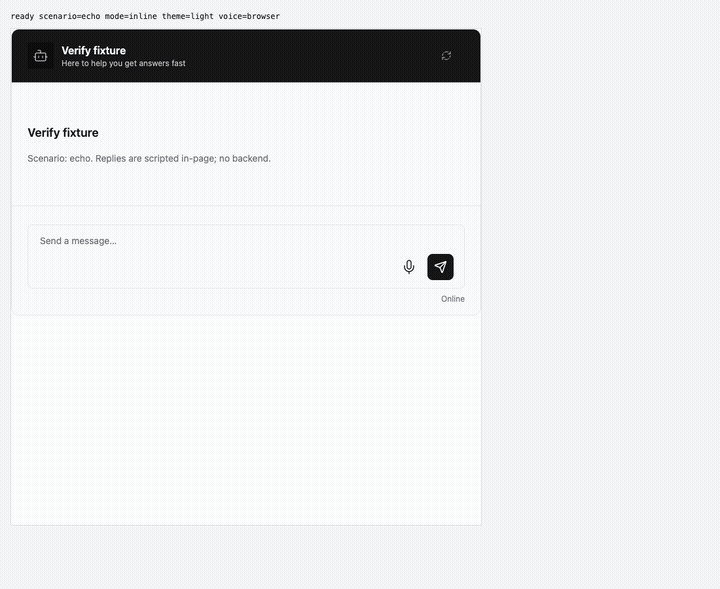
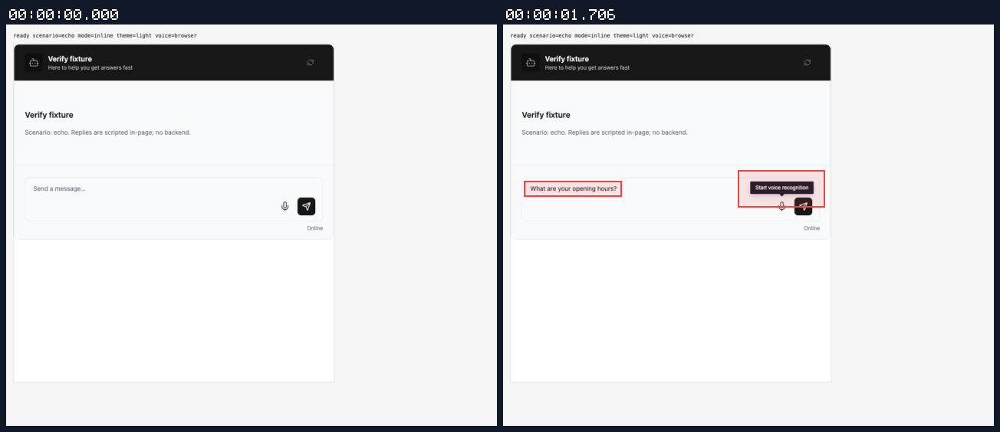
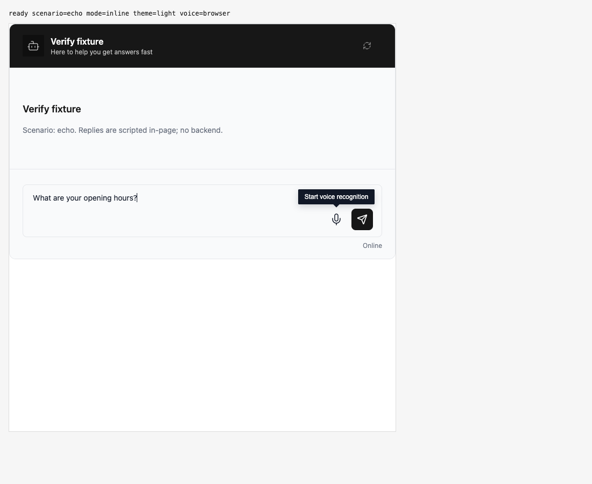

## Persona verification

branch `adaptive-browser-dictation` · captured at `8078c296d8 + uncommitted changes (a6fd8e76f013)` · run `20261115-112919-561a49` · apps/web vite dev (widget from source), keyless fixture

| Feature | Result | Note |
| --- | --- | --- |
| voice-browser | ✅ verified | Dedicated dictation review with synthetic RMS 0.012 microphone and scripted recognition; zero mic requests before Start; quiet ambient auto-finish retains draft without sending; real room recognition and legacy mic/read-aloud entry points not exercised. |

### voice-browser

**adaptive ambient dictation review**

[`01-voice-browser-adaptive-ambient-dictation-review.webm`](./01-voice-browser-adaptive-ambient-dictation-review.webm)

**adaptive ambient review**: Synthetic constant RMS 0.012 microphone stream through real Web Audio; scripted Web Speech. Review retains transcript without a request; source context closes.

[`02-voice-browser-adaptive-ambient-review.aria.txt`](./02-voice-browser-adaptive-ambient-review.aria.txt)

**adaptive ambient review side effects**: 0 request(s) crossed the network boundary, 10 controller event(s)

[`03-voice-browser-adaptive-ambient-review-side-effects.page.json`](./03-voice-browser-adaptive-ambient-review-side-effects.page.json) · [`03-voice-browser-adaptive-ambient-review-side-effects.voice.json`](./03-voice-browser-adaptive-ambient-review-side-effects.voice.json)

