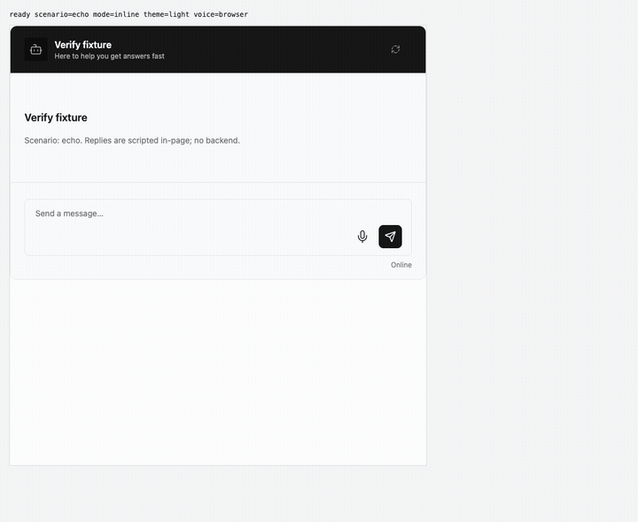
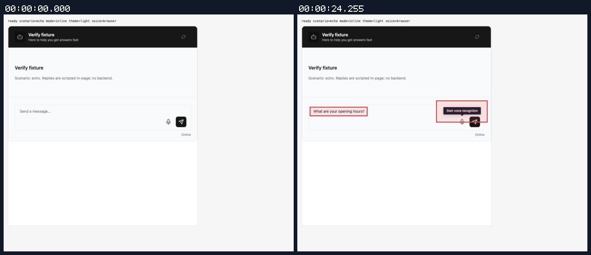
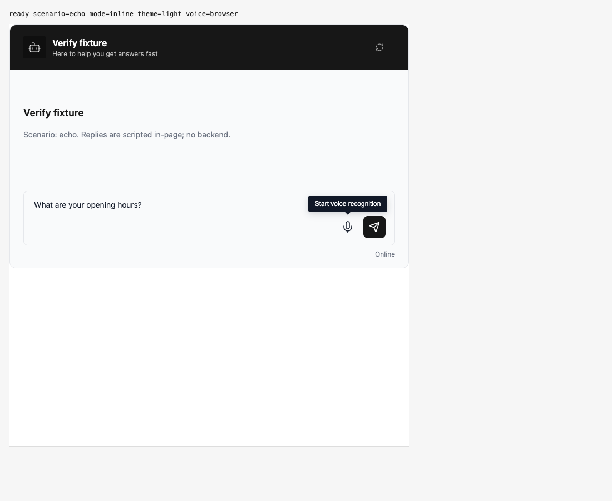
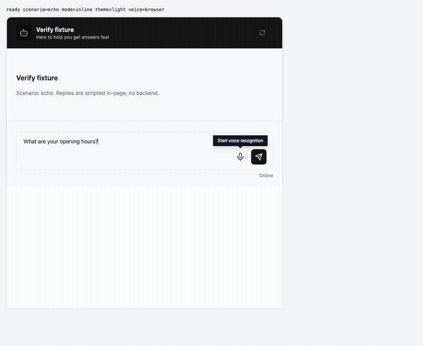
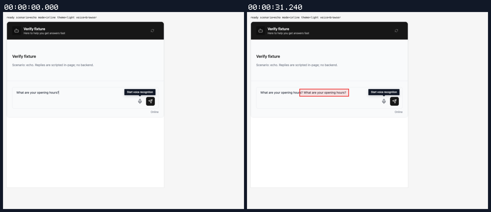

## Persona verification

branch `adaptive-browser-dictation` · captured at `7dc04e53f6 + uncommitted changes (5a6e7171a462)`, `7dc04e53f6 + uncommitted changes (595fb98bba45)` · run `20261120-103815-fa2ca8` · apps/web vite dev (widget from source), keyless fixture

| Feature | Result | Note |
| --- | --- | --- |
| voice-browser | ✅ verified | Dedicated dictation: speech-first RMS 0.03 then ambient 0.012 reaches review; resumed audio near the silence deadline without speechstart stays open through the new phrase, then reviews. Real Web Audio, synthetic mic and scripted recognition; zero requests, closed source contexts. Real room microphone, legacy mic, and read-aloud not exercised. |

### voice-browser

**speech then ambient noise**

[`01-voice-browser-speech-then-ambient-noise.webm`](./01-voice-browser-speech-then-ambient-noise.webm)

**speech first retained in review**: Synthetic real Web Audio RMS 0.03 then 0.012; scripted recognition; complete transcript retained, source context closed, zero requests.

[`02-voice-browser-speech-first-retained-in-review.aria.txt`](./02-voice-browser-speech-first-retained-in-review.aria.txt)

**speech first review side effects**: 0 request(s) crossed the network boundary, 10 controller event(s)

[`03-voice-browser-speech-first-review-side-effects.page.json`](./03-voice-browser-speech-first-review-side-effects.page.json) · [`03-voice-browser-speech-first-review-side-effects.voice.json`](./03-voice-browser-speech-first-review-side-effects.voice.json)

**resumed speech before timeout**

[`04-voice-browser-resumed-speech-before-timeout.webm`](./04-voice-browser-resumed-speech-before-timeout.webm)

**resumed speech retained in review**: Real Web Audio speech resumes at 3.17s shortly before expected 3.25s silence deadline; scripted recognition emits no speechstart event; capture continues through resumed audio then returns to review.

[`05-voice-browser-resumed-speech-retained-in-review.aria.txt`](./05-voice-browser-resumed-speech-retained-in-review.aria.txt)

**resumed speech side effects**: 0 request(s) crossed the network boundary, 20 controller event(s)

[`06-voice-browser-resumed-speech-side-effects.page.json`](./06-voice-browser-resumed-speech-side-effects.page.json) · [`06-voice-browser-resumed-speech-side-effects.voice.json`](./06-voice-browser-resumed-speech-side-effects.voice.json)

