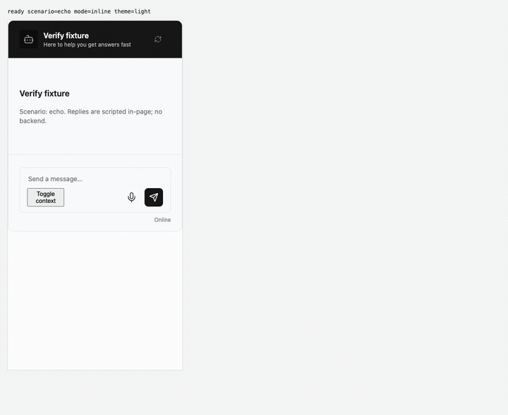
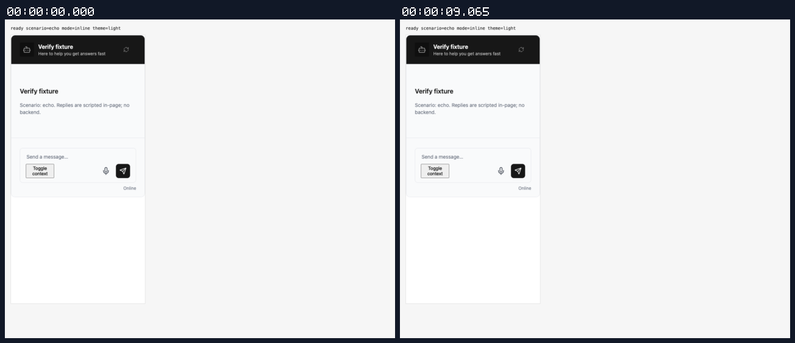
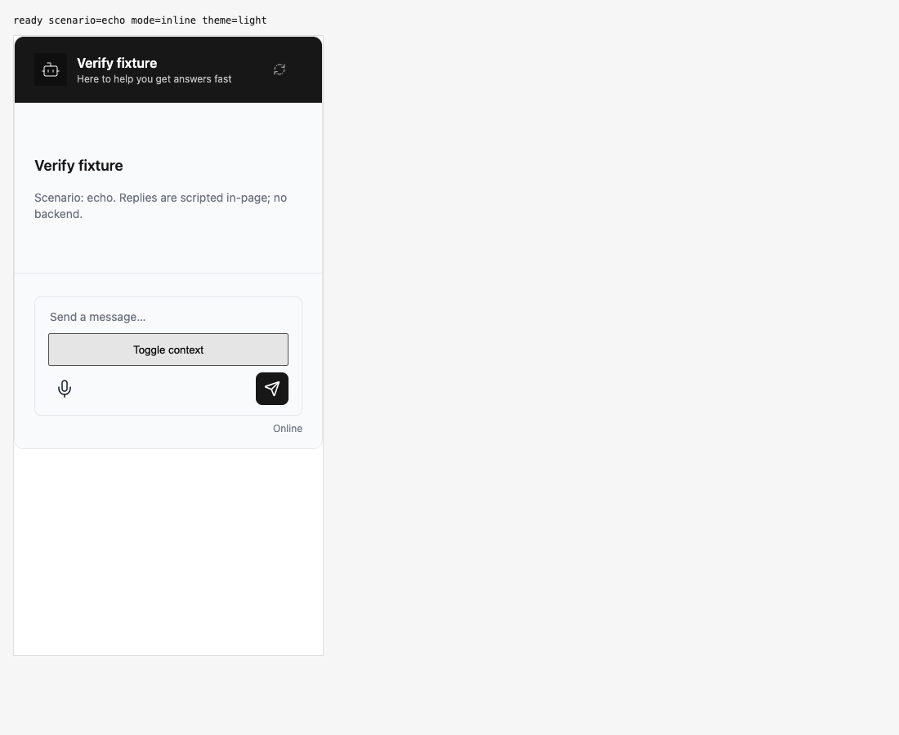
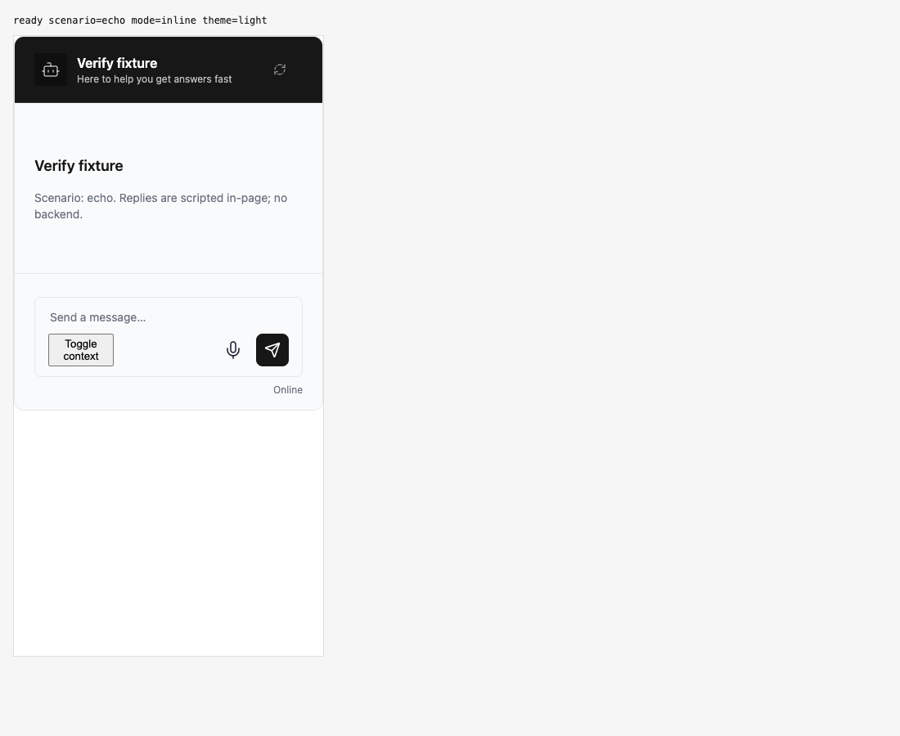

## Persona verification

branch `fix/composer-crowded-recovery` · captured at `777a4ee6b0 + uncommitted changes (48e5db24fc54)` · run `20261125-135033-f57b5b` · apps/web vite dev (widget from source), keyless fixture

| Feature | Result | Note |
| --- | --- | --- |
| launcher-and-theme | ✅ verified | Stacked composer recovers after the custom context control shrinks while send remains visible. Four Chromium regressions cover always/when-text, LTR/RTL, repeated shrinkage and host widening; launcher/theme entry points were not exercised. |

### launcher-and-theme

**Composer recovers after content shrinks**

[`01-launcher-and-theme-composer-recovers-after-content-shrinks.webm`](./01-launcher-and-theme-composer-recovers-after-content-shrinks.webm)

**Crowded composer with visible send**

[`02-launcher-and-theme-crowded-composer-with-visible-send.aria.txt`](./02-launcher-and-theme-crowded-composer-with-visible-send.aria.txt)

**Recovered single action row**

[`03-launcher-and-theme-recovered-single-action-row.aria.txt`](./03-launcher-and-theme-recovered-single-action-row.aria.txt)

**Composer resize side effects**: 0 request(s) crossed the network boundary, 0 controller event(s)

[`04-launcher-and-theme-composer-resize-side-effects.page.json`](./04-launcher-and-theme-composer-resize-side-effects.page.json)

